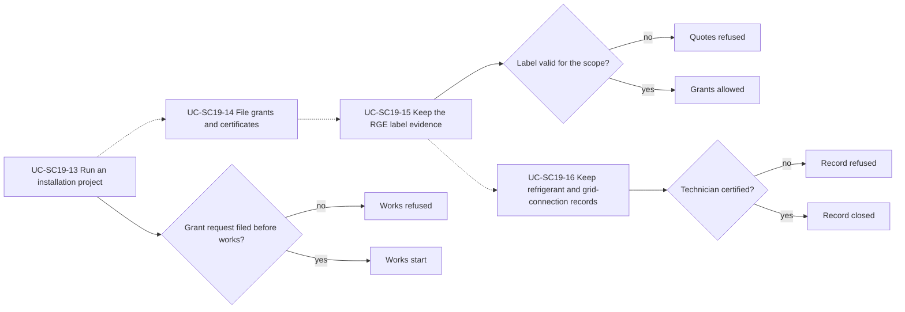
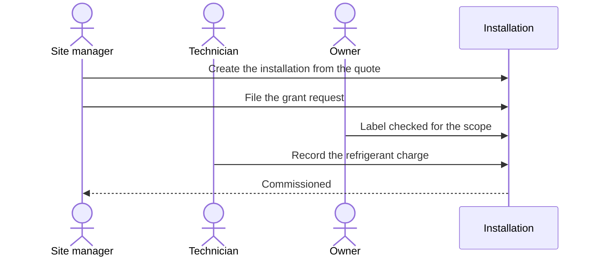

🏠 [Specs](../../../README.md) › 🏷️ [Sectors](../../README.md) › 🔧 [SC19 Trades and home services](../README.md) ›
🔀 [Flows](README.md) › 🔀 FL-SC19-04 Installations and labels

# 🔀 FL-SC19-04 Installations and labels

**Status:** ✅ specified

## Summary

An installation project runs from the accepted quote to the signed commissioning, the grant file is filed before works
with the label checked, the label evidence is kept and audited, and the refrigerant and grid-connection records are kept
by certified technicians ([D563](../../../06-decisions/sectors/d563-benchmark-gaps-sc19-trades-and-home-services.md)).

## Personas

- [U22 Site manager](../../../01-users/personas/u22-site-manager.md), who runs the installations and files the grants
- [U14 Field worker](../../../01-users/personas/u14-field-worker.md), who closes the steps and records the regulated
  acts
- [U13 Owner](../../../01-users/personas/u13-owner.md), who keeps the label evidence

## Flowchart

## Sequence diagram

## Steps

| Step | Persona | Screen | Use case | What happens |
|---|---|---|---|---|
| 1 | [U22](../../../01-users/personas/u22-site-manager.md) | [S-SC19-13](../screens/04-installations-and-labels/s-sc19-13-installation-project.md) | [UC-SC19-13](../use-cases/04-installations-and-labels/uc-sc19-13-run-an-installation-project.md) | The site manager creates the installation from the accepted quote and plans its steps |
| 2 | [U22](../../../01-users/personas/u22-site-manager.md) | [S-SC19-14](../screens/04-installations-and-labels/s-sc19-14-installation-grants.md) | [UC-SC19-14](../use-cases/04-installations-and-labels/uc-sc19-14-file-grants-and-certificates.md) | The site manager files the grant request after the label check |
| 3 | [U13](../../../01-users/personas/u13-owner.md) | [S-SC19-15](../screens/04-installations-and-labels/s-sc19-15-rge-evidence.md) | [UC-SC19-15](../use-cases/04-installations-and-labels/uc-sc19-15-keep-the-rge-label-evidence.md) | The owner keeps the label evidence and its audits |
| 4 | [U14](../../../01-users/personas/u14-field-worker.md) | [S-SC19-16](../screens/04-installations-and-labels/s-sc19-16-regulated-records.md) | [UC-SC19-16](../use-cases/04-installations-and-labels/uc-sc19-16-keep-refrigerant-and-grid-connection-records.md) | The technician records the refrigerant handling and the grid connection |

### Entities and screens

| Entity | States in this flow | Shown at step and screen | Aggregated view |
|---|---|---|---|
| [E-SC19-07 Installation](../data/e-sc19-07-installation.md) | Planned, In progress, Completed, Commissioned, Cancelled | 1 [S-SC19-13](../screens/04-installations-and-labels/s-sc19-13-installation-project.md) | Installations |
| [E-SC19-08 Grant file](../data/e-sc19-08-grant-file.md) | Draft, Filed, Accepted, Refused, Paid | 2 [S-SC19-14](../screens/04-installations-and-labels/s-sc19-14-installation-grants.md) | Grant files |
| [E-SC19-09 Label](../data/e-sc19-09-label.md) | Active, Audit due, Expired | 3 [S-SC19-15](../screens/04-installations-and-labels/s-sc19-15-rge-evidence.md) | Labels |
| [E-SC19-10 Regulated record](../data/e-sc19-10-regulated-record.md) | Drafted, Closed, Refused, Submitted | 4 [S-SC19-16](../screens/04-installations-and-labels/s-sc19-16-regulated-records.md) | Regulated records |

## Errors

- **E1 The label has expired.** The label of the company no longer covers the scope of a quote: the grant is dropped
  from the file, the quote is refused and the site manager is told
  ([BR-SC19-15](../business-rules/br-sc19-15-label-audits-are-planned-before-expiry.md), step 3).

## Images

Every step and error, for each persona taking part, in light and dark mode (D120). Steps are numbered as in the Steps
table; E rows are the error cases.

| Step | Persona | Device | Light | Dark |
|---|---|---|---|---|
| 1 | U22 | desktop | [light](../images/04-installations-and-labels/u22-site-manager/1-installation-project-desktop-light.png) | [dark](../images/04-installations-and-labels/u22-site-manager/1-installation-project-desktop-dark.png) |
| 1 | U14 | phone | [light](../images/04-installations-and-labels/u14-field-worker/1-installation-project-phone-light.png) | [dark](../images/04-installations-and-labels/u14-field-worker/1-installation-project-phone-dark.png) |
| 1 | U22 | phone | [light](../images/04-installations-and-labels/u22-site-manager/1-installation-project-phone-light.png) | [dark](../images/04-installations-and-labels/u22-site-manager/1-installation-project-phone-dark.png) |
| 1 | U22 | tablet | [light](../images/04-installations-and-labels/u22-site-manager/1-installation-project-tablet-light.png) | [dark](../images/04-installations-and-labels/u22-site-manager/1-installation-project-tablet-dark.png) |
| 2 | U22 | desktop | [light](../images/04-installations-and-labels/u22-site-manager/2-installation-grants-desktop-light.png) | [dark](../images/04-installations-and-labels/u22-site-manager/2-installation-grants-desktop-dark.png) |
| 2 | U22 | phone | [light](../images/04-installations-and-labels/u22-site-manager/2-installation-grants-phone-light.png) | [dark](../images/04-installations-and-labels/u22-site-manager/2-installation-grants-phone-dark.png) |
| 2 | U22 | tablet | [light](../images/04-installations-and-labels/u22-site-manager/2-installation-grants-tablet-light.png) | [dark](../images/04-installations-and-labels/u22-site-manager/2-installation-grants-tablet-dark.png) |
| 3 | U13 | desktop | [light](../images/04-installations-and-labels/u13-owner/3-rge-evidence-desktop-light.png) | [dark](../images/04-installations-and-labels/u13-owner/3-rge-evidence-desktop-dark.png) |
| 3 | U13 | phone | [light](../images/04-installations-and-labels/u13-owner/3-rge-evidence-phone-light.png) | [dark](../images/04-installations-and-labels/u13-owner/3-rge-evidence-phone-dark.png) |
| 4 | U14 | phone | [light](../images/04-installations-and-labels/u14-field-worker/4-regulated-records-phone-light.png) | [dark](../images/04-installations-and-labels/u14-field-worker/4-regulated-records-phone-dark.png) |
| E1 | U22 | desktop | [light](../images/04-installations-and-labels/u22-site-manager/e1-the-label-has-expired-desktop-light.png) | [dark](../images/04-installations-and-labels/u22-site-manager/e1-the-label-has-expired-desktop-dark.png) |
| E1 | U22 | phone | [light](../images/04-installations-and-labels/u22-site-manager/e1-the-label-has-expired-phone-light.png) | [dark](../images/04-installations-and-labels/u22-site-manager/e1-the-label-has-expired-phone-dark.png) |
| E1 | U22 | tablet | [light](../images/04-installations-and-labels/u22-site-manager/e1-the-label-has-expired-tablet-light.png) | [dark](../images/04-installations-and-labels/u22-site-manager/e1-the-label-has-expired-tablet-dark.png) |

## Open questions

None.

---

⬅️ [FL-SC19-03 Home services tax credit](fl-sc19-03-home-services-tax-credit.md) · ⬆️ [Up](README.md) ·
➡️ [FL-SC19-05](fl-sc19-05-on-call-warranties-van-stock-and-site-quotes.md)
