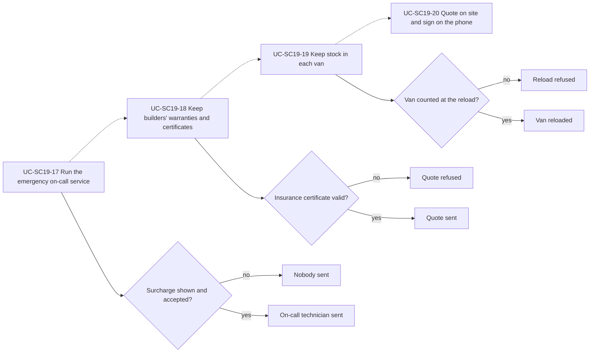
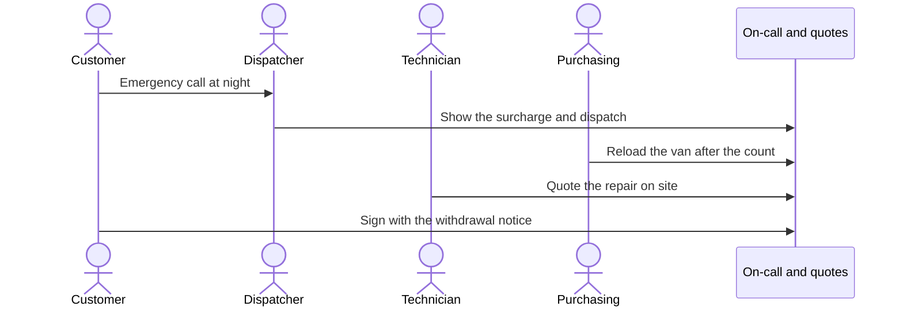

🏠 [Specs](../../../README.md) › 🏷️ [Sectors](../../README.md) › 🔧 [SC19 Trades and home services](../README.md) ›
🔀 [Flows](README.md) › 🔀 FL-SC19-05 On-call, warranties, van stock and site quotes

# 🔀 FL-SC19-05 On-call, warranties, van stock and site quotes

**Status:** 🔄 waiting for the owner

## Summary

An emergency on-call service with its rota and surcharge shown before dispatch, the insurance certificate and the
warranties of the works, the stock of each van counted at every reload, and quotes made on site and signed on the phone
with the withdrawal notice ([D563](../../../06-decisions/sectors/d563-benchmark-gaps-sc19-trades-and-home-services.md)).

## Personas

- [U29 Dispatcher](../../../01-users/personas/u29-dispatcher.md), who builds the rota and takes the emergency calls
- [U14 Field worker](../../../01-users/personas/u14-field-worker.md), who is on call, counts the van and quotes on site
- [U13 Owner](../../../01-users/personas/u13-owner.md), who keeps the certificates and the warranties
- [U09 Customer](../../../01-users/personas/u09-customer.md), who accepts the surcharge and signs
- [U04 Purchasing and stock](../../../01-users/personas/u04-purchasing.md), who sets the standard load and the reload

## Flowchart

## Sequence diagram

## Steps

| Step | Persona | Screen | Use case | What happens |
|---|---|---|---|---|
| 1 | [U29](../../../01-users/personas/u29-dispatcher.md) | [S-SC19-17](../screens/05-on-call-warranties-van-stock-and-site-quotes/s-sc19-17-on-call.md) | [UC-SC19-17](../use-cases/05-on-call-warranties-van-stock-and-site-quotes/uc-sc19-17-run-the-emergency-on-call-service.md) | The dispatcher builds the on-call rota and shows the surcharge before sending a technician |
| 2 | [U13](../../../01-users/personas/u13-owner.md) | [S-SC19-18](../screens/05-on-call-warranties-van-stock-and-site-quotes/s-sc19-18-builders-warranties.md) | [UC-SC19-18](../use-cases/05-on-call-warranties-van-stock-and-site-quotes/uc-sc19-18-keep-builders-warranties-and-certificates.md) | The owner keeps the insurance certificate and hands over the warranty terms of the works |
| 3 | [U14](../../../01-users/personas/u14-field-worker.md) | [S-SC19-19](../screens/05-on-call-warranties-van-stock-and-site-quotes/s-sc19-19-van-stock.md) | [UC-SC19-19](../use-cases/05-on-call-warranties-van-stock-and-site-quotes/uc-sc19-19-keep-stock-in-each-van.md) | Purchasing sets the standard load of each van and the technician counts it at every reload |
| 4 | [U14](../../../01-users/personas/u14-field-worker.md) | [S-SC19-20](../screens/05-on-call-warranties-van-stock-and-site-quotes/s-sc19-20-site-quotes.md) | [UC-SC19-20](../use-cases/05-on-call-warranties-van-stock-and-site-quotes/uc-sc19-20-quote-on-site-and-sign-on-the-phone.md) | The technician quotes on site and the customer signs on the phone with the withdrawal notice |

### Entities and screens

| Entity | States in this flow | Shown at step and screen | Aggregated view |
|---|---|---|---|
| [E-SC19-11 On-call rota](../data/e-sc19-11-on-call-rota.md) | Draft, Published, Closed | 1 [S-SC19-17](../screens/05-on-call-warranties-van-stock-and-site-quotes/s-sc19-17-on-call.md) | On-call rotas |
| [E-SC19-12 Warranty certificate](../data/e-sc19-12-warranty-certificate.md) | Valid, Expiring, Expired | 2 [S-SC19-18](../screens/05-on-call-warranties-van-stock-and-site-quotes/s-sc19-18-builders-warranties.md) | Warranty certificates |
| [E-SC19-13 Van stock](../data/e-sc19-13-van-stock.md) | Loaded, Refill due, Counted, Reconciled | 3 [S-SC19-19](../screens/05-on-call-warranties-van-stock-and-site-quotes/s-sc19-19-van-stock.md) | Van stocks |

## Errors

- **E1 The insurance certificate has expired.** The certificate of a trade has expired: quotes for works of that trade
  are refused and the owner is told to renew it
  ([BR-SC19-18](../business-rules/br-sc19-18-works-start-only-with-a-valid-insurance-certificate.md), step 2).

## Images

Every step and error, for each persona taking part, in light and dark mode (D120). Steps are numbered as in the Steps
table; E rows are the error cases.

| Step | Persona | Device | Light | Dark |
|---|---|---|---|---|
| 1 | U29 | desktop | [light](../images/05-on-call-warranties-van-stock-and-site-quotes/u29-dispatcher/1-on-call-desktop-light.png) | [dark](../images/05-on-call-warranties-van-stock-and-site-quotes/u29-dispatcher/1-on-call-desktop-dark.png) |
| 1 | U14 | phone | [light](../images/05-on-call-warranties-van-stock-and-site-quotes/u14-field-worker/1-on-call-phone-light.png) | [dark](../images/05-on-call-warranties-van-stock-and-site-quotes/u14-field-worker/1-on-call-phone-dark.png) |
| 1 | U29 | phone | [light](../images/05-on-call-warranties-van-stock-and-site-quotes/u29-dispatcher/1-on-call-phone-light.png) | [dark](../images/05-on-call-warranties-van-stock-and-site-quotes/u29-dispatcher/1-on-call-phone-dark.png) |
| 2 | U13 | desktop | [light](../images/05-on-call-warranties-van-stock-and-site-quotes/u13-owner/2-builders-warranties-desktop-light.png) | [dark](../images/05-on-call-warranties-van-stock-and-site-quotes/u13-owner/2-builders-warranties-desktop-dark.png) |
| 2 | U09 | phone | [light](../images/05-on-call-warranties-van-stock-and-site-quotes/u09-customer/2-builders-warranties-phone-light.png) | [dark](../images/05-on-call-warranties-van-stock-and-site-quotes/u09-customer/2-builders-warranties-phone-dark.png) |
| 2 | U13 | phone | [light](../images/05-on-call-warranties-van-stock-and-site-quotes/u13-owner/2-builders-warranties-phone-light.png) | [dark](../images/05-on-call-warranties-van-stock-and-site-quotes/u13-owner/2-builders-warranties-phone-dark.png) |
| 3 | U14 | phone | [light](../images/05-on-call-warranties-van-stock-and-site-quotes/u14-field-worker/3-van-stock-phone-light.png) | [dark](../images/05-on-call-warranties-van-stock-and-site-quotes/u14-field-worker/3-van-stock-phone-dark.png) |
| 3 | U04 | desktop | [light](../images/05-on-call-warranties-van-stock-and-site-quotes/u04-purchasing/3-van-stock-desktop-light.png) | [dark](../images/05-on-call-warranties-van-stock-and-site-quotes/u04-purchasing/3-van-stock-desktop-dark.png) |
| 4 | U14 | phone | [light](../images/05-on-call-warranties-van-stock-and-site-quotes/u14-field-worker/4-site-quotes-phone-light.png) | [dark](../images/05-on-call-warranties-van-stock-and-site-quotes/u14-field-worker/4-site-quotes-phone-dark.png) |
| 4 | U09 | phone | [light](../images/05-on-call-warranties-van-stock-and-site-quotes/u09-customer/4-site-quotes-phone-light.png) | [dark](../images/05-on-call-warranties-van-stock-and-site-quotes/u09-customer/4-site-quotes-phone-dark.png) |
| E1 | U29 | desktop | [light](../images/05-on-call-warranties-van-stock-and-site-quotes/u29-dispatcher/e1-the-insurance-certificate-has-expired-desktop-light.png) | [dark](../images/05-on-call-warranties-van-stock-and-site-quotes/u29-dispatcher/e1-the-insurance-certificate-has-expired-desktop-dark.png) |
| E1 | U29 | phone | [light](../images/05-on-call-warranties-van-stock-and-site-quotes/u29-dispatcher/e1-the-insurance-certificate-has-expired-phone-light.png) | [dark](../images/05-on-call-warranties-van-stock-and-site-quotes/u29-dispatcher/e1-the-insurance-certificate-has-expired-phone-dark.png) |

## Open questions

None.

---

⬅️ [FL-SC19-04 Installations and labels](fl-sc19-04-installations-and-labels.md) · ⬆️ [Up](README.md)
