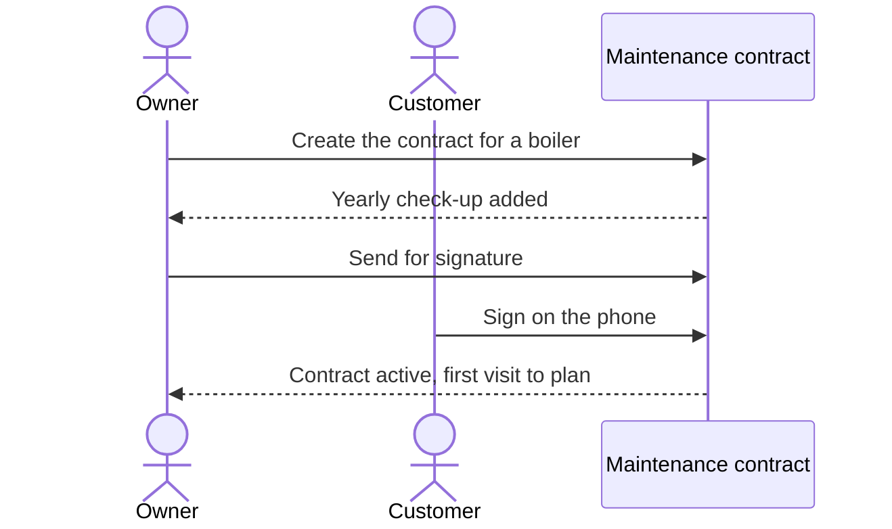

🏠 [Specs](../../../../README.md) › 🏷️ [Sectors](../../../README.md) ›
🔧 [SC19 Trades and home services](../../README.md) › 📝 [Use cases](../README.md) ›
📝 [Use cases: FL-SC19-01 Maintenance contracts](README.md) › 📝 UC-SC19-01 Sell a maintenance contract

# 📝 UC-SC19-01 Sell a maintenance contract

**Status:** ✅ specified

## Summary

A heating, plumbing or air-conditioning company sells a yearly maintenance contract for a boiler, a heat pump or an
air-conditioning unit. The contract lists the equipment, the price, the yearly visits and the legal check-ups the visit
covers, and the customer accepts it on the phone.

## Personas

- [U13 Owner](../../../../01-users/personas/u13-owner.md)
- [U09 Customer](../../../../01-users/personas/u09-customer.md)

## Goal

Every contract names the equipment and the legal check-up of each, so that no check-up the customer owes is forgotten
and the price covers it.

## Trigger

The owner sells a contract after an installation or a visit, or a customer asks for one on the portal.

## Frequency

A few contracts a week; the whole base is reviewed once a year.

## Preconditions

- The customer and the equipment are entered
  ([E-F6-01](../../../../02-functional/f06-customers-and-sales/data/e-f06-01-customer-record.md)).
- The legal check-up kinds of each equipment type are set in the sector pack.
- The company's trades are switched on in the sector pack.

## Postconditions

- **Succeeded:** the contract is saved ([E-SC19-01 Maintenance contract](../../data/e-sc19-01-maintenance-contract.md))
  with its equipment, its check-ups, its price and its dates, and the customer has accepted it.
- **Failed:** a contract is not activated without a signed acceptance and at least one visit, and an equipment with a
  legal yearly check-up is never left without it.

## Main flow

1. The owner opens the contracts screen
   ([S-SC19-01](../../screens/01-maintenance-contracts/s-sc19-01-maintenance-contract.md)) and creates a contract for a
   customer.
2. The owner adds each equipment with its kind, make, serial number and place.
3. SimpleERP adds to each equipment the legal check-up of its kind and its interval
   ([BR-SC19-01](../../business-rules/br-sc19-01-contracts-list-the-legal-yearly-check-ups.md)).
4. The owner sets the yearly price, the number of visits, the response time and the index clause.
5. The customer receives the contract on the phone and accepts it by e-signature
   [UC-F2-14](../../../../02-functional/f02-no-code-configuration/use-cases/07-benchmark-additions/uc-f02-14-send-documents-for-e-signature.md).
6. The contract becomes Active and the first visit is planned ([UC-SC19-02](uc-sc19-02-generate-recurring-visits.md)).

## Alternative flows

- 3a. The owner removes a legal check-up the equipment needs: the change is refused and the reason is shown.
- 5a. The customer prefers paper: the owner records the signed copy and the contract is activated.
- 4a. The contract also covers parts and labour: the price is split in two lines for the invoice.

## Error flows

- 3e. The equipment kind has no legal check-up defined: the contract stays in draft and the owner is told to choose a
  kind.
- 5e. The customer does not sign within the validity of the offer: the contract expires as a draft.
- Any step: a service does not answer; the call is retried first
  ([BR-F3-32](../../../../02-functional/f03-assistant/business-rules/br-f03-32-retry-before-an-error.md)), then the
  message follows the error pattern ([D122](../../../../06-decisions/ux/d122-error-message-standard.md)) and what the
  user typed stays on the screen.

## Business rules

- [BR-SC19-01](../../business-rules/br-sc19-01-contracts-list-the-legal-yearly-check-ups.md)
- [BR-SC19-04](../../business-rules/br-sc19-04-renewals-follow-the-notice-and-index-clauses.md)

## Entities

- [E-SC19-01 Maintenance contract](../../data/e-sc19-01-maintenance-contract.md): created, changed, activated
- [E-F6-01](../../../../02-functional/f06-customers-and-sales/data/e-f06-01-customer-record.md): read, the customer
- [E-F6-07](../../../../02-functional/f06-customers-and-sales/data/e-f06-07-subscription-contract.md): read, the
  subscription contract the billing reuses

## Permissions

Owner creates and changes contracts; customer reads and signs their own. A technician sees the equipment and
the visits, not the price.

## Notifications

The customer, on the phone: the contract to sign, then the confirmed contract.

## Audit events

Each contract created, changed, signed and activated, each check-up added or removed, who and when.

## AI involvement

No AI step of its own. The AI assistant may open the screen and prefill it from the user's words; the user checks and
confirms
[BR-F3-07](../../../../02-functional/f03-assistant/business-rules/br-f03-07-no-deletes-no-irreversible-acts.md).

## API, MCP and A2A exposure

T5 operations of the capability for the personas above: create, read, update and list. The MCP tool of the
capability may read and propose, never confirm alone. No A2A skill.

## Screens

- [S-SC19-01](../../screens/01-maintenance-contracts/s-sc19-01-maintenance-contract.md)

## Flowchart

See [FL-SC19-01 Maintenance contracts](../../flows/fl-sc19-01-maintenance-contracts.md#flowchart).

## Sequence diagram

## Acceptance criteria

1. **Given** a gas boiler with a legal yearly check-up **when** the owner creates its contract **then** the check-up is
   added and cannot be removed.
2. **Given** a contract in draft **when** the customer signs on the phone **then** the contract is Active with its
   signature kept.
3. **Given** an equipment kind without a legal check-up defined **when** the owner activates the contract **then** it
   stays in draft and asks for the kind.

## Non-functional notes

The screen answers within 2 seconds for 10,000 records; every change is audited.

## Regulatory references

A gas or oil boiler must be serviced every year by a qualified professional, who gives the occupant a
certificate. A maintenance contract is the usual way to meet this duty, so the contract lists the check-up. The
intervals of other equipment, such as heat pumps and air-conditioning units, are data of the France pack. Related:
[CR-FR-020](../../../../10-country-packs/france/invoicing/cr-fr-020-electronic-acceptance-and-signature.md),
[CR-FR-036](../../../../10-country-packs/france/consumer/cr-fr-036-withdrawal-right.md).

## Related use cases

- [UC-SC19-02 Generate recurring visits](uc-sc19-02-generate-recurring-visits.md)
- [UC-F6-10](../../../../02-functional/f06-customers-and-sales/use-cases/04-subscriptions/uc-f06-10-manage-subscriptions.md)
- [UC-F9-18](../../../../02-functional/f09-hr-and-projects/use-cases/06-plan-and-deliver-work/uc-f09-18-run-field-service.md)

## Open questions

None.

---

⬆️ [Up](README.md) · ➡️ [UC-SC19-02 Generate recurring visits](uc-sc19-02-generate-recurring-visits.md)
