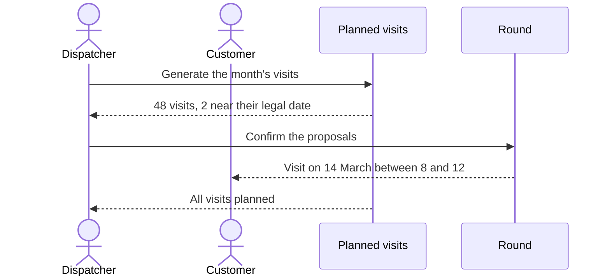

🏠 [Specs](../../../../README.md) › 🏷️ [Sectors](../../../README.md) ›
🔧 [SC19 Trades and home services](../../README.md) › 📝 [Use cases](../README.md) ›
📝 [Use cases: FL-SC19-01 Maintenance contracts](README.md) › 📝 UC-SC19-02 Generate recurring visits

# 📝 UC-SC19-02 Generate recurring visits

**Status:** ✅ specified

## Summary

The dispatcher generates the visits of every active contract from its visits per year, so that each equipment is visited
before the date its legal check-up is due, and places them on the technicians' rounds.

## Personas

- [U29 Dispatcher](../../../../01-users/personas/u29-dispatcher.md)

## Goal

No legal check-up goes past its due date, and the technicians' rounds are filled without the dispatcher typing each
visit.

## Trigger

A contract becomes Active, the month's visits are generated, or a visit is missed.

## Frequency

Visits are generated each month; the dispatcher reviews the list every morning.

## Preconditions

- The contracts are Active ([E-SC19-01 Maintenance contract](../../data/e-sc19-01-maintenance-contract.md)).
- The technicians have the qualifications the check-up needs
  ([E-F9-12](../../../../02-functional/f09-hr-and-projects/data/e-f09-12-certification.md)).
- Rounds can be planned
  [UC-F9-30](../../../../02-functional/f09-hr-and-projects/use-cases/11-capacity-rounds-and-partners/uc-f09-30-plan-rounds-and-optimise-routes.md).

## Postconditions

- **Succeeded:** each planned visit is saved ([E-SC19-02 Planned visit](../../data/e-sc19-02-planned-visit.md)) with its
  date window, its technician and its legal due date, and appears on the round.
- **Failed:** a visit is not planned after its legal due date without a warning, and a technician without the
  qualification is not proposed.

## Main flow

1. The dispatcher opens the visits screen
   ([S-SC19-02](../../screens/01-maintenance-contracts/s-sc19-02-recurring-visits.md)) and sees the visits to generate
   for the month.
2. SimpleERP creates one visit per contract line, with a date window that ends before the legal due date
   ([BR-SC19-02](../../business-rules/br-sc19-02-visits-are-planned-before-the-legal-due-date.md)).
3. The dispatcher asks for a proposal: SimpleERP suggests a technician and a day by place and qualification
   [UC-F9-33](../../../../02-functional/f09-hr-and-projects/use-cases/12-schedule-customer-requests/uc-f09-33-schedule-a-work-request.md).
4. The dispatcher confirms or moves the visits and the customers receive the date by message.
5. Each visit joins its technician's round
   [UC-F9-30](../../../../02-functional/f09-hr-and-projects/use-cases/11-capacity-rounds-and-partners/uc-f09-30-plan-rounds-and-optimise-routes.md).

## Alternative flows

- 3a. No qualified technician is free in the window: the visit is marked To plan and the dispatcher is warned.
- 4a. The customer asks for another day: the dispatcher moves the visit inside the window.
- 2a. The contract covers two visits a year: they are spaced half a year apart.

## Error flows

- 2e. The legal due date is already past: the visit is created as Overdue and the dispatcher is warned at once.
- 4e. The customer cannot be reached after three tries: the visit stays Proposed and is listed.
- Any step: a service does not answer; the call is retried first
  ([BR-F3-32](../../../../02-functional/f03-assistant/business-rules/br-f03-32-retry-before-an-error.md)), then the
  message follows the error pattern ([D122](../../../../06-decisions/ux/d122-error-message-standard.md)) and what the
  user typed stays on the screen.

## Business rules

- [BR-SC19-02](../../business-rules/br-sc19-02-visits-are-planned-before-the-legal-due-date.md)
- [BR-SC19-01](../../business-rules/br-sc19-01-contracts-list-the-legal-yearly-check-ups.md)

## Entities

- [E-SC19-02 Planned visit](../../data/e-sc19-02-planned-visit.md): created, planned, moved
- [E-SC19-01 Maintenance contract](../../data/e-sc19-01-maintenance-contract.md): read, the contract and its equipment
- [E-F9-26 Round](../../../../02-functional/f09-hr-and-projects/data/e-f09-26-round.md): created, the round of the day
- [E-F9-28](../../../../02-functional/f09-hr-and-projects/data/e-f09-28-assignment-proposal.md): read, the technician
  the engine proposes

## Permissions

Dispatcher generates, plans and moves visits; technicians read their own; customers see their own date. A
technician cannot change a legal due date.

## Notifications

The customer, on the phone: the visit date, and a reminder the day before. The dispatcher, in the app: a visit near its
legal due date with no date.

## Audit events

Each visit generated, proposed, confirmed, moved and missed, who and when.

## AI involvement

No AI step of its own. The AI assistant may open the screen and prefill it from the user's words; the user checks and
confirms
[BR-F3-07](../../../../02-functional/f03-assistant/business-rules/br-f03-07-no-deletes-no-irreversible-acts.md).

## API, MCP and A2A exposure

T5 operations of the capability for the personas above: create, read, update and list. The MCP tool of the
capability may read and propose, never confirm alone. No A2A skill.

## Screens

- [S-SC19-02](../../screens/01-maintenance-contracts/s-sc19-02-recurring-visits.md)

## Flowchart

See [FL-SC19-01 Maintenance contracts](../../flows/fl-sc19-01-maintenance-contracts.md#flowchart).

## Sequence diagram

## Acceptance criteria

1. **Given** a contract whose legal check-up is due on 30 April **when** the dispatcher generates the visits **then**
   the window ends on 15 April.
2. **Given** no qualified technician in the window **when** the dispatcher asks for a proposal **then** the visit is
   marked To plan and a warning is shown.
3. **Given** a legal due date already past **when** the visits are generated **then** the visit is Overdue and listed
   first.

## Non-functional notes

The screen answers within 2 seconds for 10,000 records; every change is audited.

## Regulatory references

The occupant owes the yearly check-up of a boiler, so the company plans the visit with a margin before the
due date and keeps the date it was done. Intervals of other equipment are data of the France pack. Related:
[CR-FR-210](../../../../10-country-packs/france/labour/cr-fr-210-qualifications-tied-to-tasks.md).

## Related use cases

- [UC-SC19-01 Sell a maintenance contract](uc-sc19-01-sell-a-maintenance-contract.md)
- [UC-SC19-03 Record legal check-ups](uc-sc19-03-record-legal-check-ups.md)
- [UC-F9-30](../../../../02-functional/f09-hr-and-projects/use-cases/11-capacity-rounds-and-partners/uc-f09-30-plan-rounds-and-optimise-routes.md)
- [UC-F9-33](../../../../02-functional/f09-hr-and-projects/use-cases/12-schedule-customer-requests/uc-f09-33-schedule-a-work-request.md)

## Open questions

None.

---

⬅️ [UC-SC19-01 Sell a maintenance contract](uc-sc19-01-sell-a-maintenance-contract.md) · ⬆️ [Up](README.md) ·
➡️ [UC-SC19-03 Record legal check-ups](uc-sc19-03-record-legal-check-ups.md)
