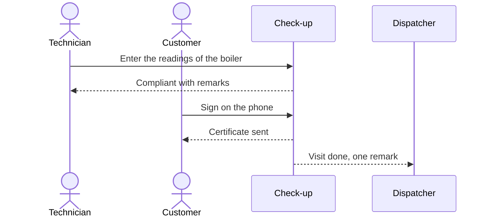

🏠 [Specs](../../../../README.md) › 🏷️ [Sectors](../../../README.md) ›
🔧 [SC19 Trades and home services](../../README.md) › 📝 [Use cases](../README.md) ›
📝 [Use cases: FL-SC19-01 Maintenance contracts](README.md) › 📝 UC-SC19-03 Record legal check-ups

# 📝 UC-SC19-03 Record legal check-ups

**Status:** ✅ specified

## Summary

A technician does the legal check-up of a boiler, a heat pump or an air-conditioning unit on the phone: readings,
result, defects found and the certificate the customer keeps.

## Personas

- [U14 Field worker](../../../../01-users/personas/u14-field-worker.md)

## Goal

The check-up is recorded with its readings and its result, and the customer receives the certificate within the delay,
whatever the result.

## Trigger

The technician starts a confirmed visit at the customer's home.

## Frequency

Several a day in the heating season.

## Preconditions

- A confirmed planned visit exists ([E-SC19-02 Planned visit](../../data/e-sc19-02-planned-visit.md)).
- The technician holds the qualification the check-up needs
  ([E-F9-12](../../../../02-functional/f09-hr-and-projects/data/e-f09-12-certification.md)).
- The check-up form of the equipment kind is loaded on the phone.

## Postconditions

- **Succeeded:** the certificate is saved
  ([E-SC19-03 Check-up certificate](../../data/e-sc19-03-check-up-certificate.md)) with the readings, the result and the
  technician, sent to the customer, and the visit is Done.
- **Failed:** a check-up is not closed with a reading missing, a certificate is not sent signed by an unqualified
  technician, and a failed check-up is flagged.

## Main flow

1. The technician opens the check-up on the phone
   ([S-SC19-03 Legal check-ups](../../screens/01-maintenance-contracts/s-sc19-03-legal-check-ups.md)) from the visit.
2. The technician fills the readings of the form: combustion, pressures, leaks, safety devices.
3. simple-ERP gives the result: compliant, compliant with remarks or not compliant.
4. The technician adds the defects and the photos of the plate and of any defect.
5. The customer signs on the phone and the certificate is sent
   ([BR-SC19-03](../../business-rules/br-sc19-03-certificates-are-given-to-the-customer.md)).
6. A repair quote is proposed for any defect
   [UC-SC19-20](../05-on-call-warranties-van-stock-and-site-quotes/uc-sc19-20-quote-on-site-and-sign-on-the-phone.md).

## Alternative flows

- 3a. The result is not compliant: the dispatcher is told and the customer receives the defects in writing.
- 5a. The customer is absent: the certificate is sent without a signature and the absence is noted.
- 4a. A part must be replaced now: the technician opens the intervention flow
  ([UC-SC19-07](../02-on-site-intervention/uc-sc19-07-record-parts-used.md)).

## Error flows

- 2e. A reading is missing: the check-up cannot be closed.
- 5e. The technician no longer holds the qualification: the certificate is refused and the dispatcher is told.
- Any step: a service does not answer; the call is retried first
  ([BR-F3-32](../../../../02-functional/f03-assistant/business-rules/br-f03-32-retry-before-an-error.md)), then the
  message follows the error pattern ([D122](../../../../06-decisions/ux/d122-error-message-standard.md)) and what the
  user typed stays on the screen.

## Business rules

- [BR-SC19-03](../../business-rules/br-sc19-03-certificates-are-given-to-the-customer.md)
- [BR-SC19-02](../../business-rules/br-sc19-02-visits-are-planned-before-the-legal-due-date.md)

## Entities

- [E-SC19-03 Check-up certificate](../../data/e-sc19-03-check-up-certificate.md): created, signed, sent
- [E-SC19-02 Planned visit](../../data/e-sc19-02-planned-visit.md): changed, the visit becomes Done
- [E-F9-12](../../../../02-functional/f09-hr-and-projects/data/e-f09-12-certification.md): read, the technician's
  qualification

## Permissions

Technician records and signs their own check-ups; dispatcher reads them; customer reads their own certificate.
A technician cannot edit a certificate once sent.

## Notifications

The customer, on the phone: the certificate. The dispatcher, in the app: a not compliant result.

## Audit events

Each reading, result, photo, signature and sending, who and when.

## AI involvement

No AI step of its own. The AI assistant may open the screen and prefill it from the user's words; the user checks and
confirms
[BR-F3-07](../../../../02-functional/f03-assistant/business-rules/br-f03-07-no-deletes-no-irreversible-acts.md).

## API, MCP and A2A exposure

T5 operations of the capability for the personas above: create, read, update and list. The MCP tool of the
capability may read and propose, never confirm alone. No A2A skill.

## Screens

- [S-SC19-03 Legal check-ups](../../screens/01-maintenance-contracts/s-sc19-03-legal-check-ups.md)

## Flowchart

See [FL-SC19-01 Maintenance contracts](../../flows/fl-sc19-01-maintenance-contracts.md#flowchart).

## Sequence diagram

## Acceptance criteria

1. **Given** all readings entered **when** the technician closes the check-up **then** the certificate is sent to the
   customer.
2. **Given** a reading missing **when** the technician closes the check-up **then** it stays open and names the reading.
3. **Given** a not compliant result **when** the certificate is sent **then** the dispatcher is told and the defects are
   listed.

## Non-functional notes

The screen answers within 2 seconds for 10,000 records; every change is audited.

## Regulatory references

After a boiler check-up the professional gives the occupant a written certificate within a few days, whatever
the result, and the occupant keeps it as proof. Each equipment kind's intervals and forms are data of the France pack.
Related: [CR-FR-210](../../../../10-country-packs/france/labour/cr-fr-210-qualifications-tied-to-tasks.md).

## Related use cases

- [UC-SC19-02 Generate recurring visits](uc-sc19-02-generate-recurring-visits.md)
- [UC-SC19-04 Renew and index contracts](uc-sc19-04-renew-and-index-contracts.md)
- [UC-SC19-02 Generate recurring visits](uc-sc19-02-generate-recurring-visits.md)
- [UC-SC19-04 Renew and index contracts](uc-sc19-04-renew-and-index-contracts.md)

## Open questions

None.

---

⬅️ [UC-SC19-02 Generate recurring visits](uc-sc19-02-generate-recurring-visits.md) · ⬆️ [Up](README.md) ·
➡️ [UC-SC19-04 Renew and index contracts](uc-sc19-04-renew-and-index-contracts.md)
