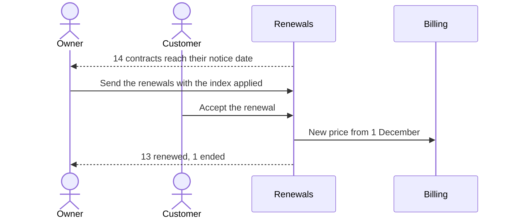

🏠 [Specs](../../../../README.md) › 🏷️ [Sectors](../../../README.md) ›
🔧 [SC19 Trades and home services](../../README.md) › 📝 [Use cases](../README.md) ›
📝 [Use cases: FL-SC19-01 Maintenance contracts](README.md) › 📝 UC-SC19-04 Renew and index contracts

# 📝 UC-SC19-04 Renew and index contracts

**Status:** ✅ specified

## Summary

The owner renews the maintenance contracts that reach their notice date and applies the index clause to the price, so
that no contract lapses unseen and no price stays frozen when the contract allows an increase.

## Personas

- [U13 Owner](../../../../01-users/personas/u13-owner.md)

## Goal

Each contract is renewed, changed or ended on its notice date, with the new price computed from its clause and the
customer informed in time.

## Trigger

A contract's notice date comes, or the owner reviews the base once a year.

## Frequency

A few renewals every week; one price review a year.

## Preconditions

- The contracts are Active ([E-SC19-01 Maintenance contract](../../data/e-sc19-01-maintenance-contract.md)).
- The index clause names the index and its base month.
- The notice periods are set in the contract.

## Postconditions

- **Succeeded:** each contract concerned is saved
  ([E-SC19-01 Maintenance contract](../../data/e-sc19-01-maintenance-contract.md)) renewed, changed or ended, with the
  new price and its computation, and the customer has been told.
- **Failed:** a contract is not renewed after the customer's valid notice, a price is not raised without a clause, and
  the lapsed ones are listed.

## Main flow

1. The owner opens the renewals screen
   ([S-SC19-04](../../screens/01-maintenance-contracts/s-sc19-04-contract-renewal.md)) and sees the contracts due for
   renewal.
2. simple-ERP computes the new price from the index clause and shows the old price, the index change and the new price
   ([BR-SC19-04](../../business-rules/br-sc19-04-renewals-follow-the-notice-and-index-clauses.md)).
3. The owner reviews the list and removes or changes a price.
4. The owner sends the renewal notice to the customers before the notice date.
5. A customer accepts by e-signature or ends the contract, and the contract changes state accordingly.

## Alternative flows

- 2a. The contract has no index clause: the price is kept and a manual change needs the customer's agreement.
- 5a. The customer says nothing and the contract renews itself: it is renewed and the notice is kept as proof.
- 4a. The customer asks to drop one equipment: the contract is changed and the price recomputed.

## Error flows

- 4e. The notice date has passed: the renewal can only be proposed for the following period and the owner is told.
- 2e. The index is not available: the price is not computed and the contract is listed.
- Any step: a service does not answer; the call is retried first
  ([BR-F3-32](../../../../02-functional/f03-assistant/business-rules/br-f03-32-retry-before-an-error.md)), then the
  message follows the error pattern ([D122](../../../../06-decisions/ux/d122-error-message-standard.md)) and what the
  user typed stays on the screen.

## Business rules

- [BR-SC19-04](../../business-rules/br-sc19-04-renewals-follow-the-notice-and-index-clauses.md)
- [BR-SC19-01](../../business-rules/br-sc19-01-contracts-list-the-legal-yearly-check-ups.md)

## Entities

- [E-F6-07](../../../../02-functional/f06-customers-and-sales/data/e-f06-07-subscription-contract.md): changed, the
  billing contract follows the new price

## Permissions

Owner renews, changes and ends contracts; customer accepts or ends their own. Accounting reads the new
prices.

## Notifications

The customer, by email: the renewal notice with the new price. The owner, in the app: contracts that reach their notice
date.

## Audit events

Each index computed, each notice sent, each renewal, change and end, who and when.

## AI involvement

No AI step of its own. The AI assistant may open the screen and prefill it from the user's words; the user checks and
confirms
[BR-F3-07](../../../../02-functional/f03-assistant/business-rules/br-f03-07-no-deletes-no-irreversible-acts.md).

## API, MCP and A2A exposure

T5 operations of the capability for the personas above: create, read, update and list. The MCP tool of the
capability may read and propose, never confirm alone. No A2A skill.

## Screens

- [S-SC19-04](../../screens/01-maintenance-contracts/s-sc19-04-contract-renewal.md)

## Flowchart

See [FL-SC19-01 Maintenance contracts](../../flows/fl-sc19-01-maintenance-contracts.md#flowchart).

## Sequence diagram

## Acceptance criteria

1. **Given** a contract with an index clause **when** the notice date comes **then** the new price is computed and shown
   with the index change.
2. **Given** a contract with no index clause **when** the owner changes the price **then** the change needs the
   customer's agreement.
3. **Given** a notice date already passed **when** the owner renews **then** the renewal is proposed for the next period
   only.

## Non-functional notes

The screen answers within 2 seconds for 10,000 records; every change is audited.

## Regulatory references

A price may follow an index only if the contract says so, with the index and the base month written in it,
and a contract that renews itself must remind the consumer before the date they may end it. The exact delays are data of
the France pack. Related: [CR-FR-036](../../../../10-country-packs/france/consumer/cr-fr-036-withdrawal-right.md).

## Related use cases

- [UC-SC19-03 Record legal check-ups](uc-sc19-03-record-legal-check-ups.md)
- [UC-SC19-01 Sell a maintenance contract](uc-sc19-01-sell-a-maintenance-contract.md)
- [UC-F6-10](../../../../02-functional/f06-customers-and-sales/use-cases/04-subscriptions/uc-f06-10-manage-subscriptions.md)

## Open questions

None.

---

⬅️ [UC-SC19-03 Record legal check-ups](uc-sc19-03-record-legal-check-ups.md) · ⬆️ [Up](README.md) ·
➡️ [UC-SC19-05 Dispatch an intervention](../02-on-site-intervention/uc-sc19-05-dispatch-an-intervention.md)
