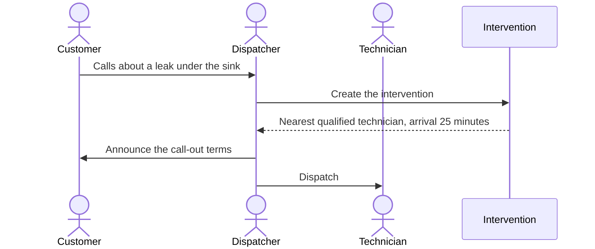

🏠 [Specs](../../../../README.md) › 🏷️ [Sectors](../../../README.md) ›
🔧 [SC19 Trades and home services](../../README.md) › 📝 [Use cases](../README.md) ›
📝 [Use cases: FL-SC19-02 On-site intervention](README.md) › 📝 UC-SC19-05 Dispatch an intervention

# 📝 UC-SC19-05 Dispatch an intervention

**Status:** ✅ specified

## Summary

A customer calls with a leak, a power cut or a boiler failure. The dispatcher records the request, sees the technicians
by place and qualification, and sends the nearest qualified one with the visit terms announced to the customer.

## Personas

- [U29 Dispatcher](../../../../01-users/personas/u29-dispatcher.md)

## Goal

The right technician reaches the customer as fast as possible, with the call-out terms known to both.

## Trigger

A customer calls, writes or books an urgent slot online.

## Frequency

Dozens a day, more in winter.

## Preconditions

- Technicians are entered with their qualifications
  ([E-F9-12](../../../../02-functional/f09-hr-and-projects/data/e-f09-12-certification.md)) and live positions where
  they agreed ([E-F9-32](../../../../02-functional/f09-hr-and-projects/data/e-f09-32-live-position.md)).
- The customer is known or created on the call
  ([E-F6-01](../../../../02-functional/f06-customers-and-sales/data/e-f06-01-customer-record.md)).
- The call-out terms are set in the sector pack.

## Postconditions

- **Succeeded:** the intervention is saved ([E-SC19-04 Intervention](../../data/e-sc19-04-intervention.md)) with its
  customer, place, trade, technician and terms, and the technician has it on the phone.
- **Failed:** an intervention is not dispatched to a technician without the qualification, the customer is never
  promised an arrival the dispatcher has not confirmed, and a request with no technician is flagged.

## Main flow

1. The dispatcher opens the dispatch screen
   ([S-SC19-05 Dispatch](../../screens/02-on-site-intervention/s-sc19-05-dispatch.md)) and creates an intervention from
   the call: customer, address, trade and problem.
2. simple-ERP proposes the nearest qualified technician with his arrival time
   ([BR-SC19-05](../../business-rules/br-sc19-05-the-nearest-qualified-technician-is-proposed.md)).
3. The dispatcher announces the call-out terms and the arrival time to the customer.
4. The dispatcher confirms the technician and the intervention is Dispatched.
5. The technician receives it on the phone with the address, the problem and the customer's number.

## Alternative flows

- 2a. Two technicians are equally near: the one with the lighter day is proposed.
- 4a. The dispatcher overrides the proposal with a reason: the choice is kept in the history.
- 1a. The call comes from a maintenance contract customer: the contract and its terms are shown.

## Error flows

- 2e. No technician holds the qualification: the intervention stays Requested and the dispatcher is told.
- 4e. The technician refuses on the phone: the proposal is made again to the next one.
- Any step: a service does not answer; the call is retried first
  ([BR-F3-32](../../../../02-functional/f03-assistant/business-rules/br-f03-32-retry-before-an-error.md)), then the
  message follows the error pattern ([D122](../../../../06-decisions/ux/d122-error-message-standard.md)) and what the
  user typed stays on the screen.

## Business rules

- [BR-SC19-05](../../business-rules/br-sc19-05-the-nearest-qualified-technician-is-proposed.md)
- [BR-SC19-17](../../business-rules/br-sc19-17-call-out-surcharges-are-shown-before-dispatch.md)

## Entities

- [E-SC19-04 Intervention](../../data/e-sc19-04-intervention.md): created, dispatched
- [E-F9-12](../../../../02-functional/f09-hr-and-projects/data/e-f09-12-certification.md): read, the qualifications of
  the technicians
- [E-F9-32](../../../../02-functional/f09-hr-and-projects/data/e-f09-32-live-position.md): read, the live position of a
  technician
- [E-F9-37](../../../../02-functional/f09-hr-and-projects/data/e-f09-37-field-worksheet.md): created, the worksheet the
  technician fills on site
- [E-F6-01](../../../../02-functional/f06-customers-and-sales/data/e-f06-01-customer-record.md): read, the customer

## Permissions

Dispatcher creates and dispatches interventions; technician reads and accepts their own; customer sees their own arrival
time. The live position is seen only in work time and while an intervention is open.

## Notifications

The technician, on the phone: a new intervention. The customer, by SMS: the arrival time.

## Audit events

Each request, proposal, override with its reason, dispatch and refusal, who and when.

## AI involvement

No AI step of its own. The AI assistant may open the screen and prefill it from the user's words; the user checks and
confirms
[BR-F3-07](../../../../02-functional/f03-assistant/business-rules/br-f03-07-no-deletes-no-irreversible-acts.md).

## API, MCP and A2A exposure

T5 operations of the capability for the personas above: create, read, update and list. The MCP tool of the
capability may read and propose, never confirm alone. No A2A skill.

## Screens

- [S-SC19-05 Dispatch](../../screens/02-on-site-intervention/s-sc19-05-dispatch.md)

## Flowchart

See [FL-SC19-02 On-site intervention](../../flows/fl-sc19-02-on-site-intervention.md#flowchart).

## Sequence diagram

## Acceptance criteria

1. **Given** three plumbers, one qualified and nearest **when** the dispatcher creates a leak intervention **then** that
   plumber is proposed with his arrival time.
2. **Given** no technician with the qualification **when** the dispatcher creates the intervention **then** it stays
   Requested and the dispatcher is told.
3. **Given** the dispatcher overrides the proposal **when** he confirms another technician **then** the reason is kept
   in the history.

## Non-functional notes

The screen answers within 2 seconds for 10,000 records; every change is audited.

## Regulatory references

Only a technician who holds the qualification a task needs may be sent to do it. Positions are used only
during work time. Related:
[CR-FR-210](../../../../10-country-packs/france/labour/cr-fr-210-qualifications-tied-to-tasks.md),
[CR-FR-211](../../../../10-country-packs/france/data-protection/cr-fr-211-live-geolocation-of-employees.md),
[CR-FR-054](../../../../10-country-packs/france/data-protection/cr-fr-054-location-with-consent.md).

## Related use cases

- [UC-SC19-06 Report on site with photos](uc-sc19-06-report-on-site-with-photos.md)
- [UC-F9-33](../../../../02-functional/f09-hr-and-projects/use-cases/12-schedule-customer-requests/uc-f09-33-schedule-a-work-request.md)
- [UC-F9-34](../../../../02-functional/f09-hr-and-projects/use-cases/12-schedule-customer-requests/uc-f09-34-run-the-automatic-scheduling.md)

## Open questions

None.

---

⬅️ [UC-SC19-04 Renew and index contracts](../01-maintenance-contracts/uc-sc19-04-renew-and-index-contracts.md) ·
⬆️ [Up](README.md) · ➡️ [UC-SC19-06 Report on site with photos](uc-sc19-06-report-on-site-with-photos.md)
