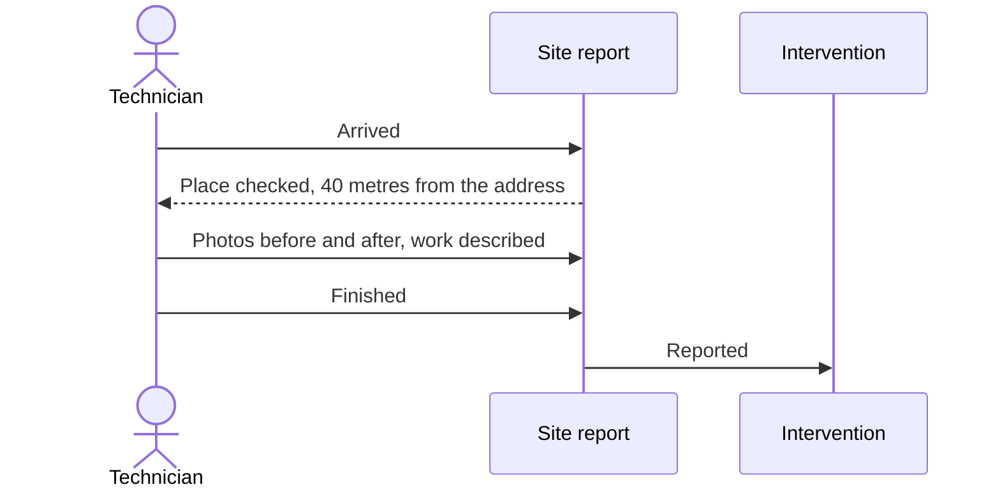

🏠 [Specs](../../../../README.md) › 🏷️ [Sectors](../../../README.md) ›
🔧 [SC19 Trades and home services](../../README.md) › 📝 [Use cases](../README.md) ›
📝 [Use cases: FL-SC19-02 On-site intervention](README.md) › 📝 UC-SC19-06 Report on site with photos

# 📝 UC-SC19-06 Report on site with photos

**Status:** ✅ specified

## Summary

The technician reports on the phone what was found and done: arrival and departure times, the place checked by the
phone's position, the photos before and after, and the customer's signature.

## Personas

- [U14 Field worker](../../../../01-users/personas/u14-field-worker.md)

## Goal

Every intervention has a report that shows when, where and what was done, usable to invoice and to answer a dispute.

## Trigger

The technician arrives on site, works, and finishes.

## Frequency

Every intervention.

## Preconditions

- The intervention is Dispatched ([E-SC19-04 Intervention](../../data/e-sc19-04-intervention.md)).
- The technician agreed to the position check
  ([BR-SC19-06](../../business-rules/br-sc19-06-reports-carry-time-place-and-photos.md)).
- The phone has a camera.

## Postconditions

- **Succeeded:** the report is saved ([E-SC19-05 Site report](../../data/e-sc19-05-site-report.md)) with its times, its
  place, its photos and the work done, and the intervention is Reported.
- **Failed:** a report is not closed without times, place and at least one photo, and a place far from the address is
  flagged.

## Main flow

1. The technician opens the report on the phone
   ([S-SC19-06 Site report](../../screens/02-on-site-intervention/s-sc19-06-site-report.md)) and taps Arrived.
2. simple-ERP records the time and checks the place against the address
   ([BR-SC19-06](../../business-rules/br-sc19-06-reports-carry-time-place-and-photos.md)).
3. The technician takes photos before and after and describes the work done and the cause found.
4. The technician taps Finished and simple-ERP records the departure time.
5. The technician reads the report with the customer and goes to the signature
   ([UC-SC19-08](uc-sc19-08-sign-and-invoice-on-the-spot.md)).

## Alternative flows

- 2a. The place is more than the tolerance from the address: the technician confirms the reason, for example a
  customer's second home.
- 3a. The cause is an equipment of a contract: the finding is added to its history
  ([UC-SC19-01](../01-maintenance-contracts/uc-sc19-01-sell-a-maintenance-contract.md)).
- 4a. The work must continue another day: the report is kept open and a second visit is planned.

## Error flows

- 3e. No photo is taken: the report cannot be closed.
- 2e. The phone gives no position: the technician enters the place by hand and it is flagged.
- Any step: a service does not answer; the call is retried first
  ([BR-F3-32](../../../../02-functional/f03-assistant/business-rules/br-f03-32-retry-before-an-error.md)), then the
  message follows the error pattern ([D122](../../../../06-decisions/ux/d122-error-message-standard.md)) and what the
  user typed stays on the screen.

## Business rules

- [BR-SC19-06](../../business-rules/br-sc19-06-reports-carry-time-place-and-photos.md)
- [BR-SC19-08](../../business-rules/br-sc19-08-the-invoice-follows-the-signed-report.md)

## Entities

- [E-SC19-05 Site report](../../data/e-sc19-05-site-report.md): created, completed
- [E-SC19-04 Intervention](../../data/e-sc19-04-intervention.md): changed, the intervention is On site then Reported
- [E-F9-37](../../../../02-functional/f09-hr-and-projects/data/e-f09-37-field-worksheet.md): created, the worksheet the
  report is part of

## Permissions

Technician writes their own reports; dispatcher reads them; customer reads their own. A report cannot be
changed once signed.

## Notifications

The dispatcher, in the app: a report with a place far from the address.

## Audit events

Each arrival, photo, place check, departure and signature, who and when.

## AI involvement

No AI step of its own. The AI assistant may open the screen and prefill it from the user's words; the user checks and
confirms
[BR-F3-07](../../../../02-functional/f03-assistant/business-rules/br-f03-07-no-deletes-no-irreversible-acts.md).

## API, MCP and A2A exposure

T5 operations of the capability for the personas above: create, read, update and list. The MCP tool of the
capability may read and propose, never confirm alone. No A2A skill.

## Screens

- [S-SC19-06 Site report](../../screens/02-on-site-intervention/s-sc19-06-site-report.md)

## Flowchart

See [FL-SC19-02 On-site intervention](../../flows/fl-sc19-02-on-site-intervention.md#flowchart).

## Sequence diagram

## Acceptance criteria

1. **Given** a technician at the address **when** he taps Arrived **then** the time is recorded and the place is
   checked.
2. **Given** a place 3 kilometres from the address **when** he taps Arrived **then** the difference is flagged and he
   must give a reason.
3. **Given** no photo taken **when** he closes the report **then** it stays open and asks for a photo.

## Non-functional notes

The screen answers within 2 seconds for 10,000 records; every change is audited.

## Regulatory references

The position is read only to check the place of work, with the technician informed and only during work time.
Photos show the work, not people. Related:
[CR-FR-054](../../../../10-country-packs/france/data-protection/cr-fr-054-location-with-consent.md),
[CR-FR-211](../../../../10-country-packs/france/data-protection/cr-fr-211-live-geolocation-of-employees.md).

## Related use cases

- [UC-SC19-05 Dispatch an intervention](uc-sc19-05-dispatch-an-intervention.md)
- [UC-SC19-07 Record parts used](uc-sc19-07-record-parts-used.md)
- [UC-SC19-05 Dispatch an intervention](uc-sc19-05-dispatch-an-intervention.md)
- [UC-SC19-07 Record parts used](uc-sc19-07-record-parts-used.md)

## Open questions

None.

---

⬅️ [UC-SC19-05 Dispatch an intervention](uc-sc19-05-dispatch-an-intervention.md) · ⬆️ [Up](README.md) ·
➡️ [UC-SC19-07 Record parts used](uc-sc19-07-record-parts-used.md)
