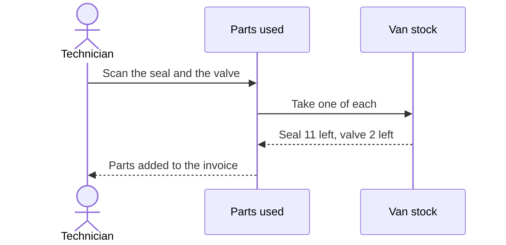

🏠 [Specs](../../../../README.md) › 🏷️ [Sectors](../../../README.md) ›
🔧 [SC19 Trades and home services](../../README.md) › 📝 [Use cases](../README.md) ›
📝 [Use cases: FL-SC19-02 On-site intervention](README.md) › 📝 UC-SC19-07 Record parts used

# 📝 UC-SC19-07 Record parts used

**Status:** ✅ specified

## Summary

The technician scans or picks the parts used on the intervention, and each part leaves the stock of the technician's
van, with its price on the invoice.

## Personas

- [U14 Field worker](../../../../01-users/personas/u14-field-worker.md)

## Goal

Every part used is on the invoice and out of the van's stock the same day.

## Trigger

The technician uses a part during an intervention.

## Frequency

Several parts a day.

## Preconditions

- The technician's van is a stock location
  ([E-F7-07 Location](../../../../02-functional/f07-purchasing-and-stock/data/e-f07-07-location.md)) with its stock
  ([E-SC19-13 Van stock](../../data/e-sc19-13-van-stock.md)).
- The parts are items with prices
  ([E-F7-06 Item](../../../../02-functional/f07-purchasing-and-stock/data/e-f07-06-item.md)).
- The intervention is On site ([E-SC19-04 Intervention](../../data/e-sc19-04-intervention.md)).

## Postconditions

- **Succeeded:** each part is on the report and out of the van's stock, with its price on the invoice lines.
- **Failed:** a part not in the van is flagged, a part is never invoiced and left in stock, and a negative van stock is
  refused.

## Main flow

1. The technician opens the parts screen
   ([S-SC19-07 Parts used](../../screens/02-on-site-intervention/s-sc19-07-parts-used.md)) from the report.
2. The technician scans the barcode of a part or picks it from the van's list.
3. SimpleERP takes one from the van's stock
   ([BR-SC19-07](../../business-rules/br-sc19-07-parts-used-lower-the-vans-stock.md)) and shows the remaining quantity.
4. The technician changes the quantity and adds a part bought on the way if needed.
5. The parts are added to the intervention's invoice lines.

## Alternative flows

- 3a. The remaining quantity falls under the van's minimum: a refill is suggested
  ([UC-SC19-19](../05-on-call-warranties-van-stock-and-site-quotes/uc-sc19-19-keep-stock-in-each-van.md)).
- 2a. The part is not in the catalogue: the technician names it and accounting links it later.
- 4a. A part is returned unused: it goes back into the van's stock.

## Error flows

- 3e. The van has none of the part: the technician is told and may record a part bought elsewhere.
- 2e. The barcode is unknown: the technician searches by name.
- Any step: a service does not answer; the call is retried first
  ([BR-F3-32](../../../../02-functional/f03-assistant/business-rules/br-f03-32-retry-before-an-error.md)), then the
  message follows the error pattern ([D122](../../../../06-decisions/ux/d122-error-message-standard.md)) and what the
  user typed stays on the screen.

## Business rules

- [BR-SC19-07](../../business-rules/br-sc19-07-parts-used-lower-the-vans-stock.md)
- [BR-SC19-19](../../business-rules/br-sc19-19-each-van-is-counted-at-every-reload.md)

## Entities

- [E-SC19-13 Van stock](../../data/e-sc19-13-van-stock.md): changed, the van's stock
- [E-F7-06 Item](../../../../02-functional/f07-purchasing-and-stock/data/e-f07-06-item.md): read, the part
- [E-SC19-05 Site report](../../data/e-sc19-05-site-report.md): changed, the parts of the report

## Permissions

Technician records parts on their own interventions; dispatcher and purchasing read them. The technician sees
prices only if the owner allows it.

## Notifications

Purchasing, in the app: a van below its minimum.

## Audit events

Each part added, removed and returned, with the van and the intervention, who and when.

## AI involvement

No AI step of its own. The AI assistant may open the screen and prefill it from the user's words; the user checks and
confirms
[BR-F3-07](../../../../02-functional/f03-assistant/business-rules/br-f03-07-no-deletes-no-irreversible-acts.md).

## API, MCP and A2A exposure

T5 operations of the capability for the personas above: create, read, update and list. The MCP tool of the
capability may read and propose, never confirm alone. No A2A skill.

## Screens

- [S-SC19-07 Parts used](../../screens/02-on-site-intervention/s-sc19-07-parts-used.md)

## Flowchart

See [FL-SC19-02 On-site intervention](../../flows/fl-sc19-02-on-site-intervention.md#flowchart).

## Sequence diagram

## Acceptance criteria

1. **Given** a seal in the van **when** the technician scans it **then** the van's stock goes down by one and the part
   is on the invoice.
2. **Given** a part not in the van **when** the technician scans it **then** he is told and may record it as bought
   elsewhere.
3. **Given** a return of an unused part **when** the technician returns it **then** it goes back into the van's stock.

## Non-functional notes

The screen answers within 2 seconds for 10,000 records; every change is audited.

## Regulatory references

None specific to this use case beyond the rules above.

## Related use cases

- [UC-SC19-06 Report on site with photos](uc-sc19-06-report-on-site-with-photos.md)
- [UC-SC19-08 Sign and invoice on the spot](uc-sc19-08-sign-and-invoice-on-the-spot.md)
- [UC-SC19-06 Report on site with photos](uc-sc19-06-report-on-site-with-photos.md)
- [UC-SC19-19](../05-on-call-warranties-van-stock-and-site-quotes/uc-sc19-19-keep-stock-in-each-van.md)

## Open questions

None.

---

⬅️ [UC-SC19-06 Report on site with photos](uc-sc19-06-report-on-site-with-photos.md) · ⬆️ [Up](README.md) ·
➡️ [UC-SC19-08 Sign and invoice on the spot](uc-sc19-08-sign-and-invoice-on-the-spot.md)
