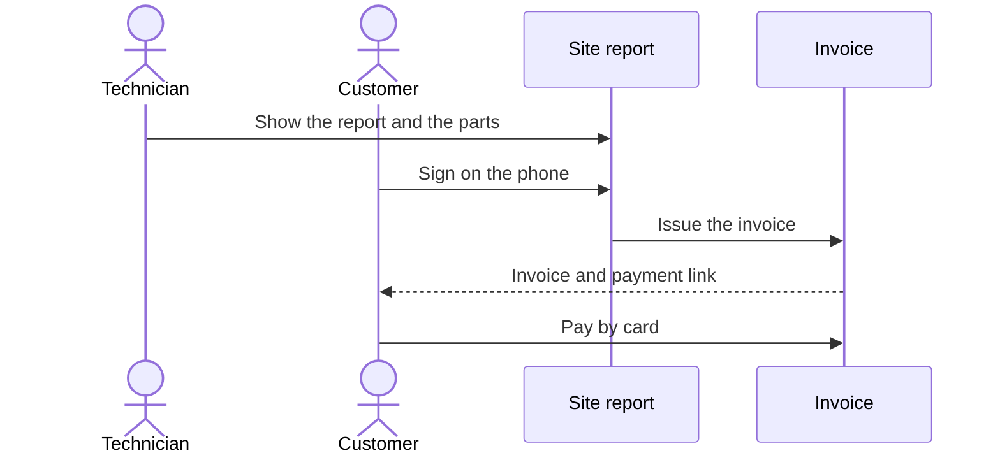

🏠 [Specs](../../../../README.md) › 🏷️ [Sectors](../../../README.md) ›
🔧 [SC19 Trades and home services](../../README.md) › 📝 [Use cases](../README.md) ›
📝 [Use cases: FL-SC19-02 On-site intervention](README.md) › 📝 UC-SC19-08 Sign and invoice on the spot

# 📝 UC-SC19-08 Sign and invoice on the spot

**Status:** ✅ specified

## Summary

At the end of the intervention the customer signs the report on the technician's phone and receives the invoice at once,
with the payment link.

## Personas

- [U14 Field worker](../../../../01-users/personas/u14-field-worker.md)
- [U09 Customer](../../../../01-users/personas/u09-customer.md)

## Goal

The work is accepted and invoiced on the spot, so that the customer pays the day it is done.

## Trigger

The technician has closed the report.

## Frequency

Every intervention.

## Preconditions

- The report is Closed ([E-SC19-05 Site report](../../data/e-sc19-05-site-report.md)).
- The parts are recorded ([UC-SC19-07](uc-sc19-07-record-parts-used.md)).
- The customer is at home or reachable on the phone.

## Postconditions

- **Succeeded:** the report is Signed, the invoice is issued
  ([E-F6-05 Invoice](../../../../02-functional/f06-customers-and-sales/data/e-f06-05-invoice.md)) and sent, and the
  intervention is Invoiced.
- **Failed:** an invoice is not issued before the customer's signature, and an unsigned report is listed for the office.

## Main flow

1. The technician opens the signature screen
   ([S-SC19-08](../../screens/02-on-site-intervention/s-sc19-08-sign-and-invoice.md)) on the phone.
2. The technician shows the report, the parts and the price to the customer.
3. The customer signs on the phone and may add a remark
   ([BR-SC19-08](../../business-rules/br-sc19-08-the-invoice-follows-the-signed-report.md)).
4. SimpleERP issues the invoice from the signed report and sends it by email and SMS.
5. The customer pays by card on the phone or later by the payment link
   [UC-F6-07](../../../../02-functional/f06-customers-and-sales/use-cases/03-invoice-and-get-paid/uc-f06-07-get-paid-online-and-reconcile.md).

## Alternative flows

- 3a. The customer refuses to sign: the refusal and its reason are recorded and the office calls the customer.
- 4a. The work is under a maintenance contract: no invoice is issued and the report is attached to the contract.
- 5a. The customer pays by cheque: the payment is recorded by accounting.

## Error flows

- 3e. The customer is not there: the report is sent by SMS for a remote signature and the invoice follows the signature.
- 4e. The invoice cannot be issued as the customer lacks an address: the technician enters it.
- Any step: a service does not answer; the call is retried first
  ([BR-F3-32](../../../../02-functional/f03-assistant/business-rules/br-f03-32-retry-before-an-error.md)), then the
  message follows the error pattern ([D122](../../../../06-decisions/ux/d122-error-message-standard.md)) and what the
  user typed stays on the screen.

## Business rules

- [BR-SC19-08](../../business-rules/br-sc19-08-the-invoice-follows-the-signed-report.md)
- [BR-SC19-05](../../business-rules/br-sc19-05-the-nearest-qualified-technician-is-proposed.md)

## Entities

- [E-SC19-05 Site report](../../data/e-sc19-05-site-report.md): changed, the report is Signed
- [E-F6-05 Invoice](../../../../02-functional/f06-customers-and-sales/data/e-f06-05-invoice.md): created, the invoice
- [E-SC19-04 Intervention](../../data/e-sc19-04-intervention.md): changed, the intervention is Invoiced

## Permissions

Technician collects the signature and issues the invoice; customer signs and pays; accounting reads. A
technician cannot change an amount after the signature.

## Notifications

The customer, by email and SMS: the invoice and the payment link.

## Audit events

Each signature, refusal, invoice and payment, who and when.

## AI involvement

No AI step of its own. The AI assistant may open the screen and prefill it from the user's words; the user checks and
confirms
[BR-F3-07](../../../../02-functional/f03-assistant/business-rules/br-f03-07-no-deletes-no-irreversible-acts.md).

## API, MCP and A2A exposure

T5 operations of the capability for the personas above: create, read, update and list. The MCP tool of the
capability may read and propose, never confirm alone. No A2A skill.

## Screens

- [S-SC19-08](../../screens/02-on-site-intervention/s-sc19-08-sign-and-invoice.md)

## Flowchart

See [FL-SC19-02 On-site intervention](../../flows/fl-sc19-02-on-site-intervention.md#flowchart).

## Sequence diagram

## Acceptance criteria

1. **Given** a closed report **when** the customer signs **then** the invoice is issued from the report and sent.
2. **Given** a customer who refuses **when** the technician records the refusal **then** no invoice is issued and the
   office is told.
3. **Given** an intervention under a contract **when** the customer signs **then** no invoice is issued and the report
   is attached to the contract.

## Non-functional notes

The screen answers within 2 seconds for 10,000 records; every change is audited.

## Regulatory references

The invoice carries the mentions of the law and the customer's signature is kept as proof of acceptance.
Related: [CR-FR-015](../../../../10-country-packs/france/invoicing/cr-fr-015-invoice-mandatory-mentions.md),
[CR-FR-020](../../../../10-country-packs/france/invoicing/cr-fr-020-electronic-acceptance-and-signature.md).

## Related use cases

- [UC-SC19-07 Record parts used](uc-sc19-07-record-parts-used.md)
- [UC-SC19-06 Report on site with photos](uc-sc19-06-report-on-site-with-photos.md)
- [UC-F6-06](../../../../02-functional/f06-customers-and-sales/use-cases/03-invoice-and-get-paid/uc-f06-06-invoice-deposits-progress-and-final.md)

## Open questions

None.

---

⬅️ [UC-SC19-07 Record parts used](uc-sc19-07-record-parts-used.md) · ⬆️ [Up](README.md) ·
➡️ [UC-SC19-09](../03-home-services-tax-credit/uc-sc19-09-sell-cleaning-and-gardening-to-households.md)
