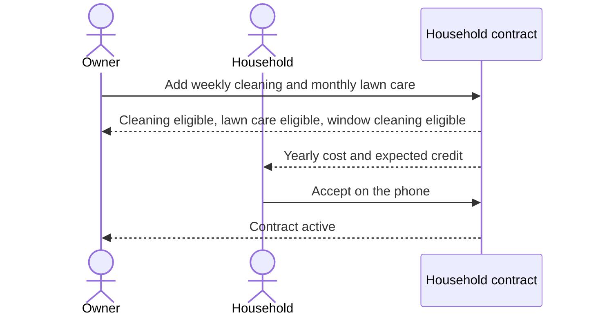

🏠 [Specs](../../../../README.md) › 🏷️ [Sectors](../../../README.md) ›
🔧 [SC19 Trades and home services](../../README.md) › 📝 [Use cases](../README.md) ›
📝 [Use cases: FL-SC19-03 Home services tax credit](README.md) › 📝 UC-SC19-09 Sell cleaning and gardening to households

# 📝 UC-SC19-09 Sell cleaning and gardening to households

**Status:** ✅ specified

## Summary

A cleaning or gardening company sells regular services to households: it lists which services are eligible for the
home-services tax credit, which are not, and gives the household a contract that the household accepts on the phone.

## Personas

- [U13 Owner](../../../../01-users/personas/u13-owner.md)
- [U09 Customer](../../../../01-users/personas/u09-customer.md)

## Goal

Every household contract separates the eligible services from the others, so that the tax credit is claimed on the right
amounts only.

## Trigger

A household asks for a regular service, or the owner renews a contract.

## Frequency

A few contracts a week; hundreds of households for a larger company.

## Preconditions

- The company is declared or approved for personal services
  ([CR-FR-102](../../../../10-country-packs/france/home-care/cr-fr-102-personal-services-registration.md)).
- The services catalogue marks each service eligible or not (data of the France pack).
- The household is a customer
  ([E-F6-01](../../../../02-functional/f06-customers-and-sales/data/e-f06-01-customer-record.md)).

## Postconditions

- **Succeeded:** the contract is saved ([E-SC19-06 Household contract](../../data/e-sc19-06-household-contract.md)) with
  its services, frequency, hours and price, each service marked eligible or not, and the household has accepted it.
- **Failed:** an ineligible service is never shown as eligible, a contract is not activated without the declaration or
  approval of the company, and the household is told what the credit covers.

## Main flow

1. The owner opens the household contracts screen
   ([S-SC19-09](../../screens/03-home-services-tax-credit/s-sc19-09-household-services.md)) and creates a contract.
2. The owner adds services from the catalogue: each line shows whether it is eligible
   ([BR-SC19-09](../../business-rules/br-sc19-09-only-eligible-services-carry-the-tax-credit.md)).
3. The owner sets the frequency, the hours and the price per hour.
4. simple-ERP shows the household the yearly cost and the amount of tax credit they may expect.
5. The household accepts on the phone by e-signature
   [UC-F2-14](../../../../02-functional/f02-no-code-configuration/use-cases/07-benchmark-additions/uc-f02-14-send-documents-for-e-signature.md)
   and may choose the immediate advance ([UC-SC19-12](uc-sc19-12-use-the-immediate-advance.md)).

## Alternative flows

- 2a. A task is not in the catalogue: the owner marks it ineligible until the pack lists it.
- 5a. The household is a company or a landlord for a rented flat: the services are not eligible and the contract says
  so.
- 3a. The contract mixes cleaning and a repair: the repair goes to its own quote.

## Error flows

- 2e. The company's declaration or approval is missing or expired: the contract cannot be activated.
- 5e. The household does not accept within the offer's validity: the contract expires.
- Any step: a service does not answer; the call is retried first
  ([BR-F3-32](../../../../02-functional/f03-assistant/business-rules/br-f03-32-retry-before-an-error.md)), then the
  message follows the error pattern ([D122](../../../../06-decisions/ux/d122-error-message-standard.md)) and what the
  user typed stays on the screen.

## Business rules

- [BR-SC19-09](../../business-rules/br-sc19-09-only-eligible-services-carry-the-tax-credit.md)
- [BR-SC19-10](../../business-rules/br-sc19-10-visits-follow-the-contracts-frequency.md)

## Entities

- [E-SC19-06 Household contract](../../data/e-sc19-06-household-contract.md): created, changed, activated
- [E-F6-01](../../../../02-functional/f06-customers-and-sales/data/e-f06-01-customer-record.md): read, the household
- [E-SC04-16 Mandate](../../../sc04-home-care/data/e-sc04-16-mandate.md): read, the mandate when the company acts as an
  agent of the household

## Permissions

Owner creates and changes contracts; household reads and accepts their own. Cleaners see the tasks and the
hours, not the price.

## Notifications

The household, on the phone: the contract to accept and the yearly estimate of the tax credit.

## Audit events

Each contract created, changed and accepted, each service marked eligible or not, who and when.

## AI involvement

No AI step of its own. The AI assistant may open the screen and prefill it from the user's words; the user checks and
confirms
[BR-F3-07](../../../../02-functional/f03-assistant/business-rules/br-f03-07-no-deletes-no-irreversible-acts.md).

## API, MCP and A2A exposure

T5 operations of the capability for the personas above: create, read, update and list. The MCP tool of the
capability may read and propose, never confirm alone. No A2A skill.

## Screens

- [S-SC19-09](../../screens/03-home-services-tax-credit/s-sc19-09-household-services.md)

## Flowchart

See [FL-SC19-03 Home services tax credit](../../flows/fl-sc19-03-home-services-tax-credit.md#flowchart).

## Sequence diagram

## Acceptance criteria

1. **Given** a catalogue where cleaning is eligible and a repair is not **when** the owner adds both **then** only
   cleaning is marked eligible.
2. **Given** a company without its declaration **when** the owner activates a contract **then** it is refused and the
   missing declaration is named.
3. **Given** a household that accepts **when** it signs on the phone **then** the contract is Active with the signature
   kept.

## Non-functional notes

The screen answers within 2 seconds for 10,000 records; every change is audited.

## Regulatory references

A household that pays for eligible services at home may claim a tax credit for a share of the amount paid,
within a yearly ceiling, and only if the provider is declared or, for some services, approved. The services, the share
and the ceilings are data of the France pack. Related:
[CR-FR-102](../../../../10-country-packs/france/home-care/cr-fr-102-personal-services-registration.md),
[CR-FR-103](../../../../10-country-packs/france/tax-and-vat/cr-fr-103-home-services-tax-credit.md).

## Related use cases

- [UC-SC19-10 Plan recurring household visits](uc-sc19-10-plan-recurring-household-visits.md)
- [UC-SC04-09](../../../sc04-home-care/use-cases/04-bill-and-fund/uc-sc04-09-issue-the-yearly-tax-credit-certificate.md)
- [UC-F6-10](../../../../02-functional/f06-customers-and-sales/use-cases/04-subscriptions/uc-f06-10-manage-subscriptions.md)

## Open questions

None.

---

⬅️ [UC-SC19-08 Sign and invoice on the spot](../02-on-site-intervention/uc-sc19-08-sign-and-invoice-on-the-spot.md) ·
⬆️ [Up](README.md) · ➡️ [UC-SC19-10 Plan recurring household visits](uc-sc19-10-plan-recurring-household-visits.md)
