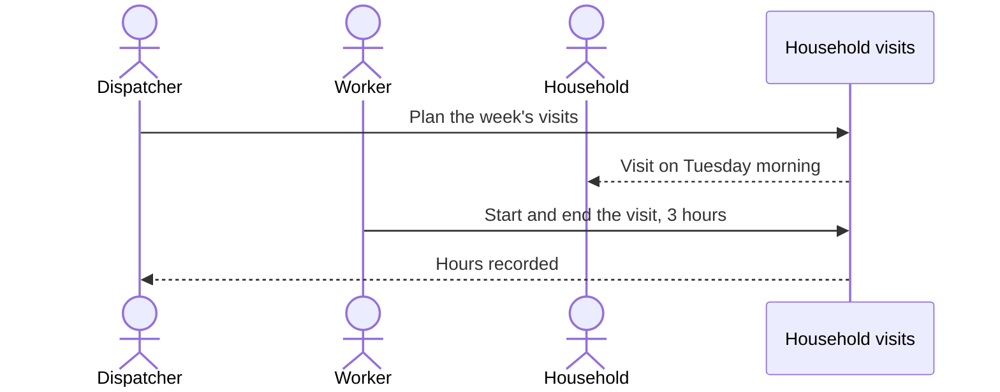

🏠 [Specs](../../../../README.md) › 🏷️ [Sectors](../../../README.md) ›
🔧 [SC19 Trades and home services](../../README.md) › 📝 [Use cases](../README.md) ›
📝 [Use cases: FL-SC19-03 Home services tax credit](README.md) › 📝 UC-SC19-10 Plan recurring household visits

# 📝 UC-SC19-10 Plan recurring household visits

**Status:** ✅ specified

## Summary

The dispatcher plans the recurring visits of the household contracts on the cleaners' and gardeners' rounds, and the
worker confirms each visit on the phone with the hours done.

## Personas

- [U29 Dispatcher](../../../../01-users/personas/u29-dispatcher.md)
- [U14 Field worker](../../../../01-users/personas/u14-field-worker.md)

## Goal

Each household receives the visits its contract promises and each hour done is recorded for the invoice and the
certificate.

## Trigger

A household contract becomes Active, or a visit is missed or moved.

## Frequency

Daily.

## Preconditions

- The household contracts are Active ([E-SC19-06 Household contract](../../data/e-sc19-06-household-contract.md)).
- The workers have shifts ([E-F9-16 Shift](../../../../02-functional/f09-hr-and-projects/data/e-f09-16-shift.md)).
- Rounds are planned
  [UC-F9-30](../../../../02-functional/f09-hr-and-projects/use-cases/11-capacity-rounds-and-partners/uc-f09-30-plan-rounds-and-optimise-routes.md).

## Postconditions

- **Succeeded:** each visit is on a round with its hours done, and the hours feed the monthly invoice.
- **Failed:** a visit is not planned beyond the contract's frequency, the same worker is kept when possible, and a
  missed visit is made up or credited.

## Main flow

1. The dispatcher opens the household visits screen
   ([S-SC19-10](../../screens/03-home-services-tax-credit/s-sc19-10-household-visits.md)) and sees the visits the
   contracts require this week.
2. simple-ERP places each visit by the contract's frequency and the household's preferred day
   ([BR-SC19-10](../../business-rules/br-sc19-10-visits-follow-the-contracts-frequency.md)).
3. The dispatcher confirms the rounds and the households are told.
4. The worker starts and ends the visit on the phone and the hours are recorded.
5. At month end the hours of each contract feed the invoice
   [UC-F6-06](../../../../02-functional/f06-customers-and-sales/use-cases/03-invoice-and-get-paid/uc-f06-06-invoice-deposits-progress-and-final.md).

## Alternative flows

- 2a. The usual worker is absent: a replacement is proposed and the household is told.
- 4a. The household is absent: the visit is recorded as not done for that reason and the contract says whether it is
  charged.
- 3a. The household asks to move a visit: it is moved inside the week if the contract allows.

## Error flows

- 2e. No worker is free on the day: the visit is marked To plan and the dispatcher is warned.
- 4e. The phone has no network: the hours are kept on the phone and sent later
  [UC-F2-22](../../../../02-functional/f02-no-code-configuration/use-cases/09-portals-and-offline-forms/uc-f02-22-fill-a-form-offline-on-the-phone.md).
- Any step: a service does not answer; the call is retried first
  ([BR-F3-32](../../../../02-functional/f03-assistant/business-rules/br-f03-32-retry-before-an-error.md)), then the
  message follows the error pattern ([D122](../../../../06-decisions/ux/d122-error-message-standard.md)) and what the
  user typed stays on the screen.

## Business rules

- [BR-SC19-10](../../business-rules/br-sc19-10-visits-follow-the-contracts-frequency.md)
- [BR-SC19-09](../../business-rules/br-sc19-09-only-eligible-services-carry-the-tax-credit.md)

## Entities

- [E-SC19-06 Household contract](../../data/e-sc19-06-household-contract.md): read, the contract's frequency
- [E-F9-26 Round](../../../../02-functional/f09-hr-and-projects/data/e-f09-26-round.md): created, the round of the
  worker
- [E-F9-17](../../../../02-functional/f09-hr-and-projects/data/e-f09-17-timesheet-line.md): created, the hours worked

## Permissions

Dispatcher plans visits; worker confirms their own visits; household sees their next visits. A worker sees
the household's address and tasks, not its contract price.

## Notifications

The household, by SMS: the next visit and the worker. The worker, on the phone: the day's round.

## Audit events

Each visit planned, moved, started, ended and missed, who and when.

## AI involvement

No AI step of its own. The AI assistant may open the screen and prefill it from the user's words; the user checks and
confirms
[BR-F3-07](../../../../02-functional/f03-assistant/business-rules/br-f03-07-no-deletes-no-irreversible-acts.md).

## API, MCP and A2A exposure

T5 operations of the capability for the personas above: create, read, update and list. The MCP tool of the
capability may read and propose, never confirm alone. No A2A skill.

## Screens

- [S-SC19-10](../../screens/03-home-services-tax-credit/s-sc19-10-household-visits.md)

## Flowchart

See [FL-SC19-03 Home services tax credit](../../flows/fl-sc19-03-home-services-tax-credit.md#flowchart).

## Sequence diagram

## Acceptance criteria

1. **Given** a weekly contract **when** the dispatcher plans the week **then** one visit per household is placed on its
   preferred day.
2. **Given** the usual worker absent **when** the dispatcher plans the visit **then** a replacement is proposed and the
   household is told.
3. **Given** a household absent at the visit **when** the worker records it **then** the visit is marked not done with
   its reason.

## Non-functional notes

The screen answers within 2 seconds for 10,000 records; every change is audited.

## Regulatory references

The hours done for a household are the base of the invoice and of the yearly certificate, so each visit is
recorded with its date and duration. Related:
[CR-FR-103](../../../../10-country-packs/france/tax-and-vat/cr-fr-103-home-services-tax-credit.md),
[CR-FR-106](../../../../10-country-packs/france/labour/cr-fr-106-home-care-travel-and-split-shifts.md).

## Related use cases

- [UC-SC19-09](uc-sc19-09-sell-cleaning-and-gardening-to-households.md)
- [UC-SC19-11 Issue the tax credit certificate](uc-sc19-11-issue-the-tax-credit-certificate.md)
- [UC-SC19-09](uc-sc19-09-sell-cleaning-and-gardening-to-households.md)
- [UC-F9-30](../../../../02-functional/f09-hr-and-projects/use-cases/11-capacity-rounds-and-partners/uc-f09-30-plan-rounds-and-optimise-routes.md)

## Open questions

None.

---

⬅️ [UC-SC19-09 Sell cleaning and gardening to households](uc-sc19-09-sell-cleaning-and-gardening-to-households.md) ·
⬆️ [Up](README.md) · ➡️ [UC-SC19-11 Issue the tax credit certificate](uc-sc19-11-issue-the-tax-credit-certificate.md)
