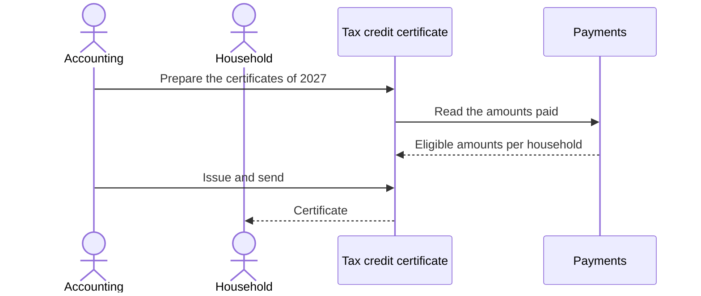

🏠 [Specs](../../../../README.md) › 🏷️ [Sectors](../../../README.md) ›
🔧 [SC19 Trades and home services](../../README.md) › 📝 [Use cases](../README.md) ›
📝 [Use cases: FL-SC19-03 Home services tax credit](README.md) › 📝 UC-SC19-11 Issue the tax credit certificate

# 📝 UC-SC19-11 Issue the tax credit certificate

**Status:** ✅ specified

## Summary

Accounting issues the yearly tax-credit certificate of each household with the amounts the household actually paid for
eligible services, so that the household can claim its credit.

## Personas

- [U05 Accounting](../../../../01-users/personas/u05-accounting.md)

## Goal

Each household receives its certificate on time with the right amounts, and the amounts follow the payments received.

## Trigger

The year ends, a household asks for a copy, or a payment is corrected.

## Frequency

Once a year for every household, plus copies.

## Preconditions

- The households' invoices and payments are in accounting
  ([E-F6-05 Invoice](../../../../02-functional/f06-customers-and-sales/data/e-f06-05-invoice.md),
  [E-F6-06](../../../../02-functional/f06-customers-and-sales/data/e-f06-06-customer-payment.md)).
- The eligible lines are marked ([E-SC19-06 Household contract](../../data/e-sc19-06-household-contract.md)).
- The certificate form of the France pack is loaded.

## Postconditions

- **Succeeded:** each certificate is issued and sent with its amounts, and the existing certificate of the sector
  ([E-SC04-09](../../../sc04-home-care/data/e-sc04-09-tax-credit-certificate.md)) holds its record.
- **Failed:** a certificate is not issued with an amount that was not paid, an ineligible amount is never listed, and a
  corrected payment gives a corrected certificate.

## Main flow

1. Accounting opens the certificate screen
   ([S-SC19-11](../../screens/03-home-services-tax-credit/s-sc19-11-tax-credit-certificate.md)) for the year.
2. SimpleERP lists for each household the eligible amounts paid in the year, net of any amount already paid by the
   advance ([BR-SC19-11](../../business-rules/br-sc19-11-certificates-list-paid-amounts-only.md)).
3. Accounting reviews the totals and the households whose amount changed.
4. Accounting issues the certificates and they are sent to the households by email and the portal.
5. Each certificate is kept with its record
   ([E-SC04-09](../../../sc04-home-care/data/e-sc04-09-tax-credit-certificate.md)).

## Alternative flows

- 2a. A payment is received after year end: it counts in the year of payment.
- 3a. A household asks for a copy: the same certificate is sent again with its date.
- 4a. An invoice is cancelled after the certificate: a corrected certificate is issued and the old one is marked
  replaced.

## Error flows

- 2e. An invoice with an unpaid balance: only the paid part is listed.
- 4e. The household has no email and no portal account: the certificate is printed for posting.
- Any step: a service does not answer; the call is retried first
  ([BR-F3-32](../../../../02-functional/f03-assistant/business-rules/br-f03-32-retry-before-an-error.md)), then the
  message follows the error pattern ([D122](../../../../06-decisions/ux/d122-error-message-standard.md)) and what the
  user typed stays on the screen.

## Business rules

- [BR-SC19-11](../../business-rules/br-sc19-11-certificates-list-paid-amounts-only.md)
- [BR-SC04-12](../../../sc04-home-care/business-rules/br-sc04-12-yearly-certificate-before-march.md)

## Entities

- [E-SC04-09](../../../sc04-home-care/data/e-sc04-09-tax-credit-certificate.md): created, the yearly certificate of the
  household
- [E-F6-06](../../../../02-functional/f06-customers-and-sales/data/e-f06-06-customer-payment.md): read, the payments
  received
- [E-SC19-06 Household contract](../../data/e-sc19-06-household-contract.md): read, the eligible lines

## Permissions

Accounting issues and corrects certificates; household reads their own. A technician has no access.

## Notifications

The household, by email: the yearly certificate.

## Audit events

Each certificate issued, sent, copied and corrected, who and when.

## AI involvement

No AI step of its own. The AI assistant may open the screen and prefill it from the user's words; the user checks and
confirms
[BR-F3-07](../../../../02-functional/f03-assistant/business-rules/br-f03-07-no-deletes-no-irreversible-acts.md).

## API, MCP and A2A exposure

T5 operations of the capability for the personas above: create, read, update and list. The MCP tool of the
capability may read and propose, never confirm alone. No A2A skill.

## Screens

- [S-SC19-11](../../screens/03-home-services-tax-credit/s-sc19-11-tax-credit-certificate.md)

## Flowchart

See [FL-SC19-03 Home services tax credit](../../flows/fl-sc19-03-home-services-tax-credit.md#flowchart).

## Sequence diagram

## Acceptance criteria

1. **Given** a household that paid 3,000 EUR of eligible services **when** accounting issues the certificate **then** it
   lists 3,000 EUR.
2. **Given** an invoice only half paid **when** accounting issues the certificate **then** only the paid half is listed.
3. **Given** an invoice cancelled after the certificate **when** accounting corrects it **then** a corrected certificate
   is issued and the first is marked replaced.

## Non-functional notes

The screen answers within 2 seconds for 10,000 records; every change is audited.

## Regulatory references

The provider gives the household, by a date in spring, a yearly certificate listing the amounts paid for
eligible services; it lists amounts paid, not billed. The date and the form are data of the France pack. Related:
[CR-FR-103](../../../../10-country-packs/france/tax-and-vat/cr-fr-103-home-services-tax-credit.md).

## Related use cases

- [UC-SC19-10 Plan recurring household visits](uc-sc19-10-plan-recurring-household-visits.md)
- [UC-SC19-12 Use the immediate advance](uc-sc19-12-use-the-immediate-advance.md)
- [UC-SC04-09](../../../sc04-home-care/use-cases/04-bill-and-fund/uc-sc04-09-issue-the-yearly-tax-credit-certificate.md)
- [UC-SC19-12 Use the immediate advance](uc-sc19-12-use-the-immediate-advance.md)

## Open questions

None.

---

⬅️ [UC-SC19-10 Plan recurring household visits](uc-sc19-10-plan-recurring-household-visits.md) · ⬆️ [Up](README.md) ·
➡️ [UC-SC19-12 Use the immediate advance](uc-sc19-12-use-the-immediate-advance.md)
