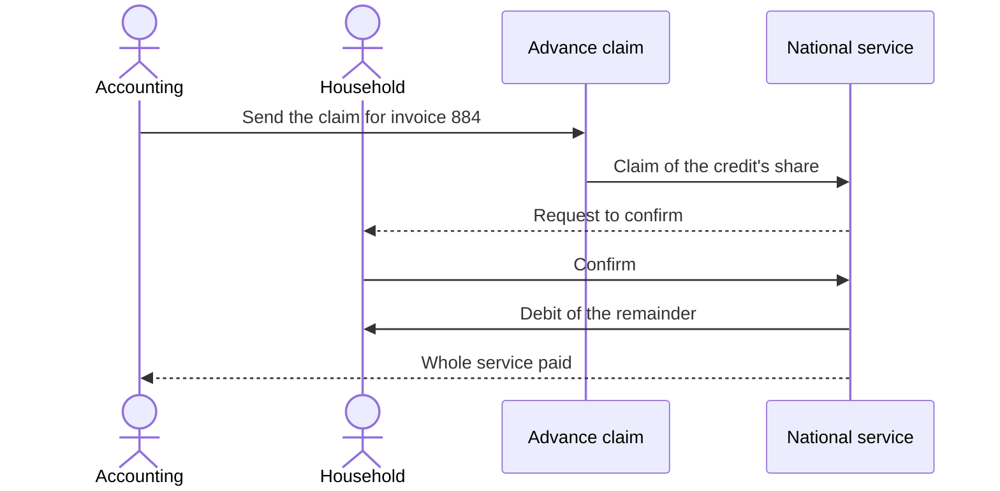

🏠 [Specs](../../../../README.md) › 🏷️ [Sectors](../../../README.md) ›
🔧 [SC19 Trades and home services](../../README.md) › 📝 [Use cases](../README.md) ›
📝 [Use cases: FL-SC19-03 Home services tax credit](README.md) › 📝 UC-SC19-12 Use the immediate advance

# 📝 UC-SC19-12 Use the immediate advance

**Status:** ✅ specified

## Summary

A household that asks for it pays only its share of the invoice: the company declares the invoice for the immediate
advance of the tax credit, the household checks it on the phone within 48 hours (then it is validated automatically),
URSSAF pays the whole service to the company and debits the household for its remainder.

## Personas

- [U05 Accounting](../../../../01-users/personas/u05-accounting.md)
- [U09 Customer](../../../../01-users/personas/u09-customer.md)

## Goal

The household does not advance the tax credit and the company is paid the whole service by URSSAF.

## Trigger

An invoice for eligible services is issued to a household that chose the advance.

## Frequency

Every invoice of an opted-in household.

## Preconditions

- The household consented to the advance
  ([BR-SC19-12](../../business-rules/br-sc19-12-the-advance-needs-the-customers-consent.md)).
- The household is enrolled with the national service (its status is checked).
- The invoice is issued ([E-F6-05 Invoice](../../../../02-functional/f06-customers-and-sales/data/e-f06-05-invoice.md)).

## Postconditions

- **Succeeded:** the claim is saved ([E-SC04-13](../../../sc04-home-care/data/e-sc04-13-immediate-advance-claim.md)),
  the household has validated it (or 48 hours have passed) and URSSAF has paid the whole service to the company.
- **Failed:** no claim is sent without the household's consent, a claim the household disputes is not paid by URSSAF
  and is billed to the household in full.

## Main flow

1. Accounting opens the advance screen
   ([S-SC19-12](../../screens/03-home-services-tax-credit/s-sc19-12-immediate-advance.md)) and sees the invoices of
   opted-in households.
2. SimpleERP checks the consent and the enrolment of each household
   ([BR-SC19-12](../../business-rules/br-sc19-12-the-advance-needs-the-customers-consent.md)).
3. Accounting sends each claim to the national service.
4. The household receives a request on the phone and validates or disputes the claim within 48 hours.
5. Once validated, URSSAF debits the household for its remainder and pays the whole service to the company; the
   invoice shows it as paid through the advance.

## Alternative flows

- 4a. The household does not answer within 48 hours: the claim is validated automatically.
- 2a. The household is not enrolled: the invoice is billed in full and the household is told how to enrol.
- 4b. The household disputes the claim: it is withdrawn and the household pays in full.

## Error flows

- 3e. The service rejects the claim for a wrong amount: the claim is corrected and sent again.
- 2e. The consent is missing or withdrawn: the claim is not sent.
- Any step: a service does not answer; the call is retried first
  ([BR-F3-32](../../../../02-functional/f03-assistant/business-rules/br-f03-32-retry-before-an-error.md)), then the
  message follows the error pattern ([D122](../../../../06-decisions/ux/d122-error-message-standard.md)) and what the
  user typed stays on the screen.

## Business rules

- [BR-SC19-12](../../business-rules/br-sc19-12-the-advance-needs-the-customers-consent.md)
- [BR-SC04-13](../../../sc04-home-care/business-rules/br-sc04-13-immediate-advance-on-request.md)

## Entities

- [E-SC04-13](../../../sc04-home-care/data/e-sc04-13-immediate-advance-claim.md): created, the immediate advance claim
- [E-F6-05 Invoice](../../../../02-functional/f06-customers-and-sales/data/e-f06-05-invoice.md): read, the invoice
- [E-SC19-06 Household contract](../../data/e-sc19-06-household-contract.md): read, the household's choice of the
  advance

## Permissions

Accounting sends and follows claims; household consents, confirms and disputes. The consent is kept as proof
and can be withdrawn at any time.

## Notifications

The household, on the phone: the claim to confirm. Accounting, in the app: a rejected claim.

## Audit events

Each consent, claim, confirmation, dispute, rejection and payment, who and when.

## AI involvement

No AI step of its own. The AI assistant may open the screen and prefill it from the user's words; the user checks and
confirms
[BR-F3-07](../../../../02-functional/f03-assistant/business-rules/br-f03-07-no-deletes-no-irreversible-acts.md).

## API, MCP and A2A exposure

T5 operations of the capability for the personas above: create, read, update and list. The MCP tool of the
capability may read and propose, never confirm alone. No A2A skill.

## Screens

- [S-SC19-12](../../screens/03-home-services-tax-credit/s-sc19-12-immediate-advance.md)

## Flowchart

See [FL-SC19-03 Home services tax credit](../../flows/fl-sc19-03-home-services-tax-credit.md#flowchart).

## Sequence diagram

## Acceptance criteria

1. **Given** a household that consented and is enrolled **when** accounting sends the claim **then** the household
   receives a request to confirm.
2. **Given** a household without consent **when** accounting sends the claim **then** it is refused and the invoice is
   billed in full.
3. **Given** a disputed claim **when** the household disputes it **then** the claim is withdrawn and the household pays
   in full.

## Non-functional notes

The screen answers within 2 seconds for 10,000 records; every change is audited.

## Regulatory references

The immediate advance lets a household pay only its share: it needs the household's consent and enrolment
with URSSAF (the household activates its account from a link valid 7 days), and the provider declares each invoice
there; the household has 48 hours to check it, then it is validated automatically, URSSAF debits the household for the
remainder 2 days after and pays the whole service to the provider; a financial guarantee is required from the first
advance (CSS D133-22). Related:
[CR-FR-104 Immediate advance of the tax credit](../../../../10-country-packs/france/tax-and-vat/cr-fr-104-immediate-advance-of-tax-credit.md).

## Related use cases

- [UC-SC19-11 Issue the tax credit certificate](uc-sc19-11-issue-the-tax-credit-certificate.md)
- [UC-SC04-10](../../../sc04-home-care/use-cases/04-bill-and-fund/uc-sc04-10-use-the-immediate-advance.md)
- [UC-SC19-11 Issue the tax credit certificate](uc-sc19-11-issue-the-tax-credit-certificate.md)

## Open questions

None.

---

⬅️ [UC-SC19-11 Issue the tax credit certificate](uc-sc19-11-issue-the-tax-credit-certificate.md) · ⬆️ [Up](README.md) ·
➡️ [UC-SC19-13 Run an installation project](../04-installations-and-labels/uc-sc19-13-run-an-installation-project.md)
