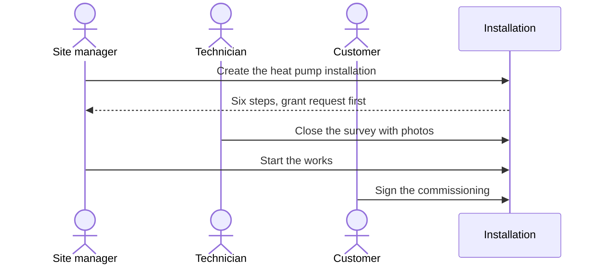

🏠 [Specs](../../../../README.md) › 🏷️ [Sectors](../../../README.md) ›
🔧 [SC19 Trades and home services](../../README.md) › 📝 [Use cases](../README.md) ›
📝 [Use cases: FL-SC19-04 Installations and labels](README.md) › 📝 UC-SC19-13 Run an installation project

# 📝 UC-SC19-13 Run an installation project

**Status:** ✅ specified

## Summary

The site manager runs the installation of a heat pump, a solar roof or a new electrical board as a project: survey,
quote, grant request, works, commissioning and connection, with the technicians recording progress on the phone.

## Personas

- [U22 Site manager](../../../../01-users/personas/u22-site-manager.md)
- [U14 Field worker](../../../../01-users/personas/u14-field-worker.md)

## Goal

Each installation follows its steps in order, starts only when the grant request that must come first is filed, and ends
with a commissioning that the customer signs.

## Trigger

A customer accepts a quote for an installation.

## Frequency

A few installations a week for a medium company.

## Preconditions

- The quote is accepted ([E-F6-03 Quote](../../../../02-functional/f06-customers-and-sales/data/e-f06-03-quote.md)).
- The project exists in the company's projects
  ([E-F9-18](../../../../02-functional/f09-hr-and-projects/data/e-f09-18-project-and-task.md)).
- The label of the company covers the work ([E-SC19-09 Label](../../data/e-sc19-09-label.md)).

## Postconditions

- **Succeeded:** the installation is saved ([E-SC19-07 Installation](../../data/e-sc19-07-installation.md)) with its
  steps, its dates, its technicians and its commissioning, and the customer has signed the handover.
- **Failed:** works are not started while a grant request that must come first is not filed, and a step is not closed
  with its documents missing.

## Main flow

1. The site manager opens the installation screen
   ([S-SC19-13](../../screens/04-installations-and-labels/s-sc19-13-installation-project.md)) from the accepted quote.
2. SimpleERP creates the steps of the installation kind: survey, grant request, ordering, works, commissioning,
   connection.
3. The site manager assigns each step to a technician and plans the dates.
4. The technicians close each step on the phone with photos and documents.
5. Before works start, SimpleERP checks the grant request is filed
   ([BR-SC19-13](../../business-rules/br-sc19-13-works-start-after-the-grant-file-is-filed.md)).
6. At the end the customer signs the commissioning and the installation is Commissioned.

## Alternative flows

- 5a. The customer pays without a grant: the check is skipped and the choice is recorded.
- 3a. A part is delivered late: the works step is moved and the customer is told.
- 6a. The customer refuses to sign: the remarks are recorded and the site manager plans the corrections.

## Error flows

- 5e. The grant request is not filed: the works step cannot start.
- 4e. A step needs a document the technician cannot give: the step stays open and the site manager is told.
- Any step: a service does not answer; the call is retried first
  ([BR-F3-32](../../../../02-functional/f03-assistant/business-rules/br-f03-32-retry-before-an-error.md)), then the
  message follows the error pattern ([D122](../../../../06-decisions/ux/d122-error-message-standard.md)) and what the
  user typed stays on the screen.

## Business rules

- [BR-SC19-13](../../business-rules/br-sc19-13-works-start-after-the-grant-file-is-filed.md)
- [BR-SC19-14](../../business-rules/br-sc19-14-grants-need-the-label-at-signature.md)

## Entities

- [E-SC19-07 Installation](../../data/e-sc19-07-installation.md): created, changed, commissioned
- [E-F6-03 Quote](../../../../02-functional/f06-customers-and-sales/data/e-f06-03-quote.md): read, the accepted quote
- [E-F9-18](../../../../02-functional/f09-hr-and-projects/data/e-f09-18-project-and-task.md): read, the project
- [E-SC19-08 Grant file](../../data/e-sc19-08-grant-file.md): read, the grant file

## Permissions

Site manager creates and follows installations; technicians close their own steps; customer reads progress and signs the
commissioning. Subcontractors see only the steps assigned to them.

## Notifications

The customer, on the phone: the date of each step. The site manager, in the app: a late step.

## Audit events

Each step created, assigned, closed and reopened, each document, who and when.

## AI involvement

No AI step of its own. The AI assistant may open the screen and prefill it from the user's words; the user checks and
confirms
[BR-F3-07](../../../../02-functional/f03-assistant/business-rules/br-f03-07-no-deletes-no-irreversible-acts.md).

## API, MCP and A2A exposure

T5 operations of the capability for the personas above: create, read, update and list. The MCP tool of the
capability may read and propose, never confirm alone. No A2A skill.

## Screens

- [S-SC19-13](../../screens/04-installations-and-labels/s-sc19-13-installation-project.md)

## Flowchart

See [FL-SC19-04 Installations and labels](../../flows/fl-sc19-04-installations-and-labels.md#flowchart).

## Sequence diagram

## Acceptance criteria

1. **Given** a grant request not yet filed **when** the site manager starts the works **then** it is refused and names
   the grant request.
2. **Given** a customer who chose to go without a grant **when** the site manager starts the works **then** the choice
   is recorded and the works start.
3. **Given** all steps closed **when** the customer signs **then** the installation is Commissioned.

## Non-functional notes

The screen answers within 2 seconds for 10,000 records; every change is audited.

## Regulatory references

For many renovation grants the request must be filed before the works start, and the grant is paid only on
proof of the works. The installer's label, the invoice and the commissioning report are part of that proof. The
conditions are data of the France pack. Related:
[CR-FR-084](../../../../10-country-packs/france/tax-and-vat/cr-fr-084-renovation-reduced-vat.md),
[CR-FR-090](../../../../10-country-packs/france/construction/cr-fr-090-builders-warranties.md).

## Related use cases

- [UC-SC19-14 File grants and certificates](uc-sc19-14-file-grants-and-certificates.md)
- [UC-SC01-19](../../../sc01-construction/use-cases/06-revision-developers-bim-and-grants/uc-sc01-19-prepare-renovation-grant-files.md)
- [UC-F9-18](../../../../02-functional/f09-hr-and-projects/use-cases/06-plan-and-deliver-work/uc-f09-18-run-field-service.md)

## Open questions

None.

---

⬅️ [UC-SC19-12 Use the immediate advance](../03-home-services-tax-credit/uc-sc19-12-use-the-immediate-advance.md) ·
⬆️ [Up](README.md) · ➡️ [UC-SC19-14 File grants and certificates](uc-sc19-14-file-grants-and-certificates.md)
