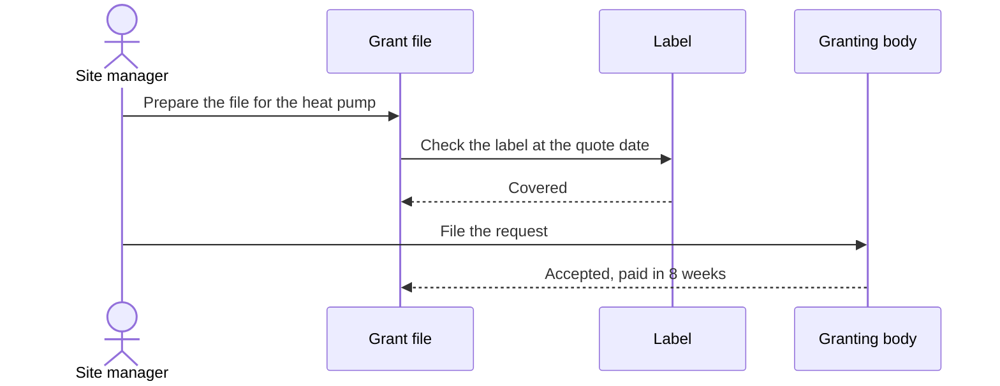

🏠 [Specs](../../../../README.md) › 🏷️ [Sectors](../../../README.md) ›
🔧 [SC19 Trades and home services](../../README.md) › 📝 [Use cases](../README.md) ›
📝 [Use cases: FL-SC19-04 Installations and labels](README.md) › 📝 UC-SC19-14 File grants and certificates

# 📝 UC-SC19-14 File grants and certificates

**Status:** ✅ specified

## Summary

The site manager prepares and files the grant file of an installation: the works, the grants they open, the installer's
label that must cover them, the documents and the request, and follows the answer and the payment.

## Personas

- [U22 Site manager](../../../../01-users/personas/u22-site-manager.md)

## Goal

Every installation that opens a grant has a complete file filed before works, and the grant reaches the customer or the
company as agreed.

## Trigger

An installation that may open a grant is created, or a body answers a request.

## Frequency

Most installations of heat pumps and insulation; fewer for other trades.

## Preconditions

- The installation exists ([E-SC19-07 Installation](../../data/e-sc19-07-installation.md)).
- The label covers the work and is valid at the quote's signature ([E-SC19-09 Label](../../data/e-sc19-09-label.md)).
- The customer's income and housing details are collected with consent.

## Postconditions

- **Succeeded:** the file is saved ([E-SC19-08 Grant file](../../data/e-sc19-08-grant-file.md)) with its grants, label
  check, documents and filing, and its answer and payment are followed to the end.
- **Failed:** a file is not filed with a label that does not cover the work, a document missing is listed, and a refused
  request is explained to the customer.

## Main flow

1. The site manager opens the grants screen
   ([S-SC19-14](../../screens/04-installations-and-labels/s-sc19-14-installation-grants.md)) from the installation.
2. simple-ERP lists the grants the work and the customer may open, from the pack.
3. It checks that the label covers the work at the quote's signature
   ([BR-SC19-14](../../business-rules/br-sc19-14-grants-need-the-label-at-signature.md)).
4. The site manager attaches the quote, the technical sheets and the customer's documents.
5. The site manager files the request with the body and notes the receipt.
6. The answer and the payment are recorded when they arrive.

## Alternative flows

- 3a. The label does not cover the work: the grant is dropped from the file and the customer is told before signing.
- 6a. The body asks for a missing document: the file returns to Draft until it is sent.
- 5a. The customer files the request alone: the file records it and the company follows the answer.

## Error flows

- 3e. The label expired before the signature: the file cannot be filed.
- 6e. The request is refused: the reason is recorded and the customer is told the options.
- Any step: a service does not answer; the call is retried first
  ([BR-F3-32](../../../../02-functional/f03-assistant/business-rules/br-f03-32-retry-before-an-error.md)), then the
  message follows the error pattern ([D122](../../../../06-decisions/ux/d122-error-message-standard.md)) and what the
  user typed stays on the screen.

## Business rules

- [BR-SC19-14](../../business-rules/br-sc19-14-grants-need-the-label-at-signature.md)
- [BR-SC19-15](../../business-rules/br-sc19-15-label-audits-are-planned-before-expiry.md)

## Entities

- [E-SC19-08 Grant file](../../data/e-sc19-08-grant-file.md): created, filed, followed
- [E-SC01-18 Grant file](../../../sc01-construction/data/e-sc01-18-grant-file.md): read, the same pattern for a
  builder's renovation quote
- [E-SC19-07 Installation](../../data/e-sc19-07-installation.md): read, the installation
- [E-SC19-09 Label](../../data/e-sc19-09-label.md): read, the label
- [E-F8-18 Grant](../../../../02-functional/f08-accounting/data/e-f08-18-grant.md): created, the grant to account for

## Permissions

Site manager prepares and files; owner reads; accounting reads the payments. The customer's income documents
are visible only to the site manager.

## Notifications

The site manager, in the app: an answer or a missing document. The customer, by email: the filing and the answer.

## Audit events

Each grant listed, label check, document, filing, answer and payment, who and when.

## AI involvement

No AI step of its own. The AI assistant may open the screen and prefill it from the user's words; the user checks and
confirms
[BR-F3-07](../../../../02-functional/f03-assistant/business-rules/br-f03-07-no-deletes-no-irreversible-acts.md).

## API, MCP and A2A exposure

T5 operations of the capability for the personas above: create, read, update and list. The MCP tool of the
capability may read and propose, never confirm alone. No A2A skill.

## Screens

- [S-SC19-14](../../screens/04-installations-and-labels/s-sc19-14-installation-grants.md)

## Flowchart

See [FL-SC19-04 Installations and labels](../../flows/fl-sc19-04-installations-and-labels.md#flowchart).

## Sequence diagram

## Acceptance criteria

1. **Given** a label that covers heat pumps **when** the site manager prepares the file **then** the label check passes.
2. **Given** a label expired at the quote's signature **when** the site manager files **then** it is refused and the
   grant is dropped.
3. **Given** a body that asks for a document **when** the answer arrives **then** the file returns to Draft and names
   the document.

## Non-functional notes

The screen answers within 2 seconds for 10,000 records; every change is audited.

## Regulatory references

Many renovation grants and energy-savings bonuses require the installer to hold a label that covers the work
at the date of the quote's signature, and the request to be filed before the works. The grants, the label scopes and the
delays are data of the France pack. Related:
[CR-FR-084](../../../../10-country-packs/france/tax-and-vat/cr-fr-084-renovation-reduced-vat.md). Same duty as
[BR-SC01-19](../../../sc01-construction/business-rules/br-sc01-19-grants-need-the-rge-label-at-signature.md) for a
builder.

## Related use cases

- [UC-SC19-13 Run an installation project](uc-sc19-13-run-an-installation-project.md)
- [UC-SC19-15 Keep the RGE label evidence](uc-sc19-15-keep-the-rge-label-evidence.md)
- [UC-SC01-19](../../../sc01-construction/use-cases/06-revision-developers-bim-and-grants/uc-sc01-19-prepare-renovation-grant-files.md)
- [UC-SC19-15 Keep the RGE label evidence](uc-sc19-15-keep-the-rge-label-evidence.md)

## Open questions

None.

---

⬅️ [UC-SC19-13 Run an installation project](uc-sc19-13-run-an-installation-project.md) · ⬆️ [Up](README.md) ·
➡️ [UC-SC19-15 Keep the RGE label evidence](uc-sc19-15-keep-the-rge-label-evidence.md)
