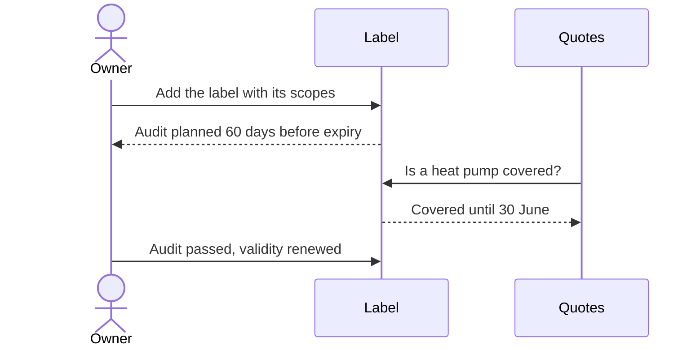

🏠 [Specs](../../../../README.md) › 🏷️ [Sectors](../../../README.md) ›
🔧 [SC19 Trades and home services](../../README.md) › 📝 [Use cases](../README.md) ›
📝 [Use cases: FL-SC19-04 Installations and labels](README.md) › 📝 UC-SC19-15 Keep the RGE label evidence

# 📝 UC-SC19-15 Keep the RGE label evidence

**Status:** ✅ specified

## Summary

The owner keeps the evidence of the company's environmental label by scope of work: the certificate, its validity, the
qualified people behind each scope and the audit dates, so that grants are never claimed on a lapsed label.

## Personas

- [U13 Owner](../../../../01-users/personas/u13-owner.md)

## Goal

The company knows at every date which works its label covers, and each audit is planned before the label expires.

## Trigger

A label is obtained or renewed, an audit approaches, or a quote asks whether the company is covered.

## Frequency

A few updates a year; checked on every quote.

## Preconditions

- The company's qualified people are recorded
  ([E-F9-12](../../../../02-functional/f09-hr-and-projects/data/e-f09-12-certification.md)).
- The label body's certificate is available.
- The scopes of work are listed in the sector pack.

## Postconditions

- **Succeeded:** the label is saved ([E-SC19-09 Label](../../data/e-sc19-09-label.md)) with its scopes, validity, people
  and audit dates, and quotes check it.
- **Failed:** a lapsed label is never shown as valid, a scope without a qualified person is flagged, and an audit is
  never missed.

## Main flow

1. The owner opens the label screen
   ([S-SC19-15 RGE evidence](../../screens/04-installations-and-labels/s-sc19-15-rge-evidence.md)) and adds a label with
   its body, its number and its validity.
2. The owner lists the scopes the label covers and links the qualified people of each.
3. SimpleERP plans the next audit before the expiry
   ([BR-SC19-15](../../business-rules/br-sc19-15-label-audits-are-planned-before-expiry.md)).
4. Quotes and grant files read the label and refuse a scope it does not cover.
5. When the audit passes the owner records the new validity.

## Alternative flows

- 2a. A qualified person leaves: the scope is flagged and the owner is told.
- 5a. The audit fails: the label is marked Audit due until a new date is set and grants of that scope are stopped.
- 1a. The company holds several labels: each is a record with its own scopes.

## Error flows

- 3e. The validity date is missing: the label cannot be saved.
- 4e. The label has expired: quotes of its scopes are refused and the grants are dropped.
- Any step: a service does not answer; the call is retried first
  ([BR-F3-32](../../../../02-functional/f03-assistant/business-rules/br-f03-32-retry-before-an-error.md)), then the
  message follows the error pattern ([D122](../../../../06-decisions/ux/d122-error-message-standard.md)) and what the
  user typed stays on the screen.

## Business rules

- [BR-SC19-15](../../business-rules/br-sc19-15-label-audits-are-planned-before-expiry.md)
- [BR-SC19-14](../../business-rules/br-sc19-14-grants-need-the-label-at-signature.md)

## Entities

- [E-SC19-09 Label](../../data/e-sc19-09-label.md): created, audited, expired
- [E-F9-12](../../../../02-functional/f09-hr-and-projects/data/e-f09-12-certification.md): read, the qualified people
- [E-SC19-08 Grant file](../../data/e-sc19-08-grant-file.md): read, the grant files that rely on it

## Permissions

Owner keeps the label; site manager reads it; quotes read it. A technician sees only whether their own
qualification is behind a scope.

## Notifications

The owner, in the app and by email: an audit in 90 days and a scope without a qualified person.

## Audit events

Each label added, audited, renewed and expired, each scope and person, who and when.

## AI involvement

No AI step of its own. The AI assistant may open the screen and prefill it from the user's words; the user checks and
confirms
[BR-F3-07](../../../../02-functional/f03-assistant/business-rules/br-f03-07-no-deletes-no-irreversible-acts.md).

## API, MCP and A2A exposure

T5 operations of the capability for the personas above: create, read, update and list. The MCP tool of the
capability may read and propose, never confirm alone. No A2A skill.

## Screens

- [S-SC19-15 RGE evidence](../../screens/04-installations-and-labels/s-sc19-15-rge-evidence.md)

## Flowchart

See [FL-SC19-04 Installations and labels](../../flows/fl-sc19-04-installations-and-labels.md#flowchart).

## Sequence diagram

## Acceptance criteria

1. **Given** a label that expires in 90 days **when** the owner opens the screen **then** the audit is planned and
   shown.
2. **Given** an expired label **when** a quote of its scope is made **then** it is refused and the grant dropped.
3. **Given** a scope with no qualified person **when** the owner saves it **then** the scope is flagged.

## Non-functional notes

The screen answers within 2 seconds for 10,000 records; every change is audited.

## Regulatory references

The environmental label is granted by an accredited body for named kinds of work, is valid for a limited time
and is audited; grants and bonuses depend on holding it for the work at the date of the quote. The scopes and durations
are data of the France pack. Related:
[CR-FR-210](../../../../10-country-packs/france/labour/cr-fr-210-qualifications-tied-to-tasks.md).

## Related use cases

- [UC-SC19-14 File grants and certificates](uc-sc19-14-file-grants-and-certificates.md)
- [UC-SC19-16](uc-sc19-16-keep-refrigerant-and-grid-connection-records.md)
- [UC-SC19-14 File grants and certificates](uc-sc19-14-file-grants-and-certificates.md)
- [UC-F9-38](../../../../02-functional/f09-hr-and-projects/use-cases/13-keep-qualifications/uc-f09-38-record-degrees-and-qualifications.md)

## Open questions

None.

---

⬅️ [UC-SC19-14 File grants and certificates](uc-sc19-14-file-grants-and-certificates.md) · ⬆️ [Up](README.md) ·
➡️ [UC-SC19-16](uc-sc19-16-keep-refrigerant-and-grid-connection-records.md)
