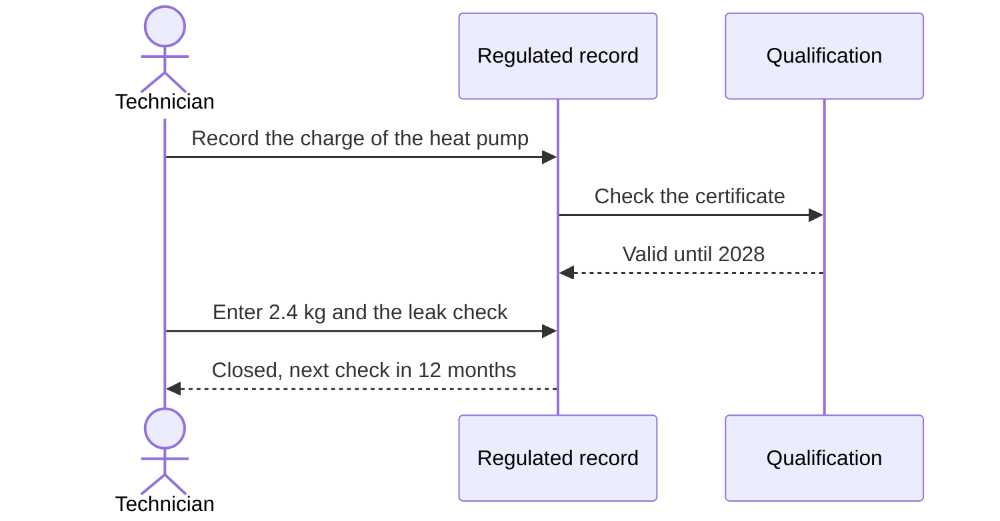

🏠 [Specs](../../../../README.md) › 🏷️ [Sectors](../../../README.md) ›
🔧 [SC19 Trades and home services](../../README.md) › 📝 [Use cases](../README.md) ›
📝 [Use cases: FL-SC19-04 Installations and labels](README.md) ›
📝 UC-SC19-16 Keep refrigerant and grid-connection records

# 📝 UC-SC19-16 Keep refrigerant and grid-connection records

**Status:** ✅ specified

## Summary

A technician records on the phone the regulated facts of an installation: the refrigerant handled and the leak checks of
a heat pump or an air-conditioning unit, and the grid connection and the certificate of conformity of a solar or
electrical installation.

## Personas

- [U14 Field worker](../../../../01-users/personas/u14-field-worker.md)

## Goal

Every regulated handling is done by a certified technician and recorded in time with its quantities, so that the company
can show the records to an inspector.

## Trigger

A technician charges, recovers or checks refrigerant, or an installation is connected to the grid.

## Frequency

Several records a week for a heating and cooling company.

## Preconditions

- The technician's refrigerant certificate is recorded
  ([E-F9-12](../../../../02-functional/f09-hr-and-projects/data/e-f09-12-certification.md)).
- The installation exists ([E-SC19-07 Installation](../../data/e-sc19-07-installation.md)).
- The equipment's charge and kind are entered.

## Postconditions

- **Succeeded:** the record is saved ([E-SC19-10 Regulated record](../../data/e-sc19-10-regulated-record.md)) with its
  kind, quantities, technician and dates, and the connection or the leak check is closed.
- **Failed:** a handling is not recorded for a technician without the certificate, a record is not closed without its
  quantities, and a leak check past its date is listed.

## Main flow

1. The technician opens the regulated records screen
   ([S-SC19-16](../../screens/04-installations-and-labels/s-sc19-16-regulated-records.md)) from the installation.
2. The technician picks the kind: refrigerant handling, leak check or grid connection.
3. simple-ERP checks the technician's certificate
   ([BR-SC19-16](../../business-rules/br-sc19-16-refrigerant-handling-needs-a-certified-technician.md)).
4. The technician enters the quantities, the equipment and the place, or the connection request and the certificate of
   conformity.
5. The record is closed and the next leak check or the connection date is planned.

## Alternative flows

- 3a. The technician has no certificate: the record is refused and the dispatcher sends a certified colleague.
- 4a. A leak is found: the repair is planned and the record notes the quantity lost.
- 2a. A grid connection: the request to the grid operator and its date are recorded and the connection is followed.

## Error flows

- 3e. The certificate expired: the handling is refused until it is renewed.
- 4e. The quantity recovered is more than the charge: the record is flagged for a check.
- Any step: a service does not answer; the call is retried first
  ([BR-F3-32](../../../../02-functional/f03-assistant/business-rules/br-f03-32-retry-before-an-error.md)), then the
  message follows the error pattern ([D122](../../../../06-decisions/ux/d122-error-message-standard.md)) and what the
  user typed stays on the screen.

## Business rules

- [BR-SC19-16](../../business-rules/br-sc19-16-refrigerant-handling-needs-a-certified-technician.md)
- [BR-SC19-16](../../business-rules/br-sc19-16-refrigerant-handling-needs-a-certified-technician.md)

## Entities

- [E-SC19-10 Regulated record](../../data/e-sc19-10-regulated-record.md): created, closed
- [E-F9-12](../../../../02-functional/f09-hr-and-projects/data/e-f09-12-certification.md): read, the technician's
  certificate
- [E-SC19-07 Installation](../../data/e-sc19-07-installation.md): read, the installation

## Permissions

Certified technician records; site manager and owner read; an inspector's extract is produced by the owner. A
record cannot be deleted, only corrected.

## Notifications

The dispatcher, in the app: a technician's certificate that expires in 30 days and a leak check due.

## Audit events

Each record, correction, quantity and certificate check, who and when.

## AI involvement

No AI step of its own. The AI assistant may open the screen and prefill it from the user's words; the user checks and
confirms
[BR-F3-07](../../../../02-functional/f03-assistant/business-rules/br-f03-07-no-deletes-no-irreversible-acts.md).

## API, MCP and A2A exposure

T5 operations of the capability for the personas above: create, read, update and list. The MCP tool of the
capability may read and propose, never confirm alone. No A2A skill.

## Screens

- [S-SC19-16](../../screens/04-installations-and-labels/s-sc19-16-regulated-records.md)

## Flowchart

See [FL-SC19-04 Installations and labels](../../flows/fl-sc19-04-installations-and-labels.md#flowchart).

## Sequence diagram

## Acceptance criteria

1. **Given** a technician with a valid certificate **when** he records a charge **then** the record is saved with the
   quantity.
2. **Given** a technician without a valid certificate **when** he records a charge **then** it is refused.
3. **Given** a leak check past its date **when** the dispatcher opens the list **then** it is listed first.

## Non-functional notes

The screen answers within 2 seconds for 10,000 records; every change is audited.

## Regulatory references

Handling refrigerants requires the company and the technician to hold a certificate for the kind of work;
equipment above a size must be checked for leaks at set intervals; the quantities handled and the checks are recorded
and kept. A solar installation is connected to the grid on a request to the grid operator and after a certificate of
conformity of the electrical installation. The sizes, intervals and years kept are data of the France pack. Related:
[CR-FR-210](../../../../10-country-packs/france/labour/cr-fr-210-qualifications-tied-to-tasks.md),
[CR-FR-075](../../../../10-country-packs/france/labour/cr-fr-075-work-equipment-periodic-checks.md).

## Related use cases

- [UC-SC19-15 Keep the RGE label evidence](uc-sc19-15-keep-the-rge-label-evidence.md)
- [UC-SC19-13 Run an installation project](uc-sc19-13-run-an-installation-project.md)
- [UC-SC19-15 Keep the RGE label evidence](uc-sc19-15-keep-the-rge-label-evidence.md)

## Open questions

None.

---

⬅️ [UC-SC19-15 Keep the RGE label evidence](uc-sc19-15-keep-the-rge-label-evidence.md) · ⬆️ [Up](README.md) ·
➡️ [UC-SC19-17](../05-on-call-warranties-van-stock-and-site-quotes/uc-sc19-17-run-the-emergency-on-call-service.md)
