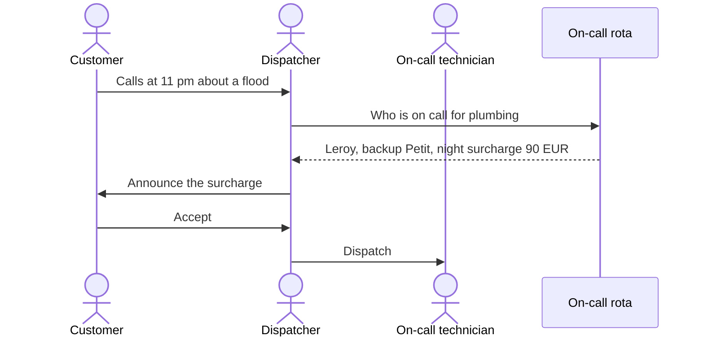

🏠 [Specs](../../../../README.md) › 🏷️ [Sectors](../../../README.md) ›
🔧 [SC19 Trades and home services](../../README.md) › 📝 [Use cases](../README.md) ›
📝 [Use cases: FL-SC19-05 On-call, warranties, van stock and site quotes](README.md) ›
📝 UC-SC19-17 Run the emergency on-call service

# 📝 UC-SC19-17 Run the emergency on-call service

**Status:** ✅ specified

## Summary

A plumbing, heating or locksmith company runs an emergency service outside office hours: a rota of on-call technicians,
a night and weekend phone line, call-out surcharges shown to the customer before dispatch, and the on-call allowances
passed to payroll.

## Personas

- [U29 Dispatcher](../../../../01-users/personas/u29-dispatcher.md)
- [U14 Field worker](../../../../01-users/personas/u14-field-worker.md)

## Goal

An emergency call at night or on a holiday reaches an on-call technician at once, the customer knows the price before
anyone is sent, and the technician is paid the allowance.

## Trigger

An emergency call arrives outside office hours, or the dispatcher plans the next rota.

## Frequency

Every night and weekend; the rota is planned monthly.

## Preconditions

- Technicians are entered with their qualifications
  ([E-F9-12](../../../../02-functional/f09-hr-and-projects/data/e-f09-12-certification.md)).
- The surcharge table of the sector pack is set.
- Shifts are planned ([E-F9-16 Shift](../../../../02-functional/f09-hr-and-projects/data/e-f09-16-shift.md)).

## Postconditions

- **Succeeded:** the rota is saved ([E-SC19-11 On-call rota](../../data/e-sc19-11-on-call-rota.md)) with its technicians
  and backups, each emergency has an intervention ([E-SC19-04 Intervention](../../data/e-sc19-04-intervention.md)) with
  its surcharge, and the allowances are in the pay inputs.
- **Failed:** no emergency is dispatched without the surcharge shown and accepted, a rota without a backup is flagged,
  and rest rules are respected.

## Main flow

1. The dispatcher opens the on-call screen
   ([S-SC19-17](../../screens/05-on-call-warranties-van-stock-and-site-quotes/s-sc19-17-on-call.md)) and builds the rota
   of the month by trade.
2. SimpleERP checks the rest time of each technician
   ([CR-FR-042](../../../../10-country-packs/france/labour/cr-fr-042-working-time-and-rest.md)).
3. A customer calls at night: the on-call phone creates an intervention
   ([UC-SC19-05](../02-on-site-intervention/uc-sc19-05-dispatch-an-intervention.md)).
4. SimpleERP shows the call-out terms and the surcharge of the hour and the dispatcher announces them
   ([BR-SC19-17](../../business-rules/br-sc19-17-call-out-surcharges-are-shown-before-dispatch.md)).
5. The customer accepts on the phone and the on-call technician is dispatched.
6. At month end the on-call time and the callouts become pay inputs
   [UC-F13-03](../../../../02-functional/f13-payroll/use-cases/02-monthly-pay-run/uc-f13-03-collect-pay-inputs-from-f9.md).

## Alternative flows

- 4a. The customer refuses the surcharge: no technician is sent and the call is closed with the reason.
- 1a. A technician swaps their on-call week: both agree and the dispatcher confirms the change.
- 5a. The on-call technician does not answer: the backup is called.

## Error flows

- 2e. A technician would have less than the legal rest: the rota is refused for that person.
- 4e. The surcharge table has no row for the hour: the dispatcher is told and enters one by hand.
- Any step: a service does not answer; the call is retried first
  ([BR-F3-32](../../../../02-functional/f03-assistant/business-rules/br-f03-32-retry-before-an-error.md)), then the
  message follows the error pattern ([D122](../../../../06-decisions/ux/d122-error-message-standard.md)) and what the
  user typed stays on the screen.

## Business rules

- [BR-SC19-17](../../business-rules/br-sc19-17-call-out-surcharges-are-shown-before-dispatch.md)
- [BR-SC19-05](../../business-rules/br-sc19-05-the-nearest-qualified-technician-is-proposed.md)

## Entities

- [E-SC19-11 On-call rota](../../data/e-sc19-11-on-call-rota.md): created, published, closed
- [E-F9-16 Shift](../../../../02-functional/f09-hr-and-projects/data/e-f09-16-shift.md): created, the shift of the
  on-call week
- [E-SC19-04 Intervention](../../data/e-sc19-04-intervention.md): created, the emergency intervention
- [E-F13-03 Pay input](../../../../02-functional/f13-payroll/data/e-f13-03-pay-input.md): created, the on-call allowance
  as a pay input

## Permissions

Dispatcher builds and changes the rota; technicians read and swap their own; customers see the surcharge before
dispatch. The on-call phone number is not shown to customers.

## Notifications

The technician, on the phone: the on-call week and each emergency. The customer, by voice and SMS: the surcharge.

## Audit events

Each rota, swap, emergency call, announced surcharge, customer answer and allowance, who and when.

## AI involvement

No AI step of its own. The AI assistant may open the screen and prefill it from the user's words; the user checks and
confirms
[BR-F3-07](../../../../02-functional/f03-assistant/business-rules/br-f03-07-no-deletes-no-irreversible-acts.md).

## API, MCP and A2A exposure

T5 operations of the capability for the personas above: create, read, update and list. The MCP tool of the
capability may read and propose, never confirm alone. No A2A skill.

## Screens

- [S-SC19-17](../../screens/05-on-call-warranties-van-stock-and-site-quotes/s-sc19-17-on-call.md)

## Flowchart

See
[FL-SC19-05 On-call, warranties, van stock and site quotes](../../flows/fl-sc19-05-on-call-warranties-van-stock-and-site-quotes.md#flowchart).

## Sequence diagram

## Acceptance criteria

1. **Given** a rota with each week covered **when** the dispatcher publishes it **then** technicians receive their
   on-call weeks.
2. **Given** a night call **when** the dispatcher creates the intervention **then** the night surcharge is shown and
   must be accepted before dispatch.
3. **Given** a rota that breaks the rest time **when** the dispatcher builds it **then** that person's week is refused.

## Non-functional notes

The screen answers within 2 seconds for 10,000 records; every change is audited.

## Regulatory references

Before sending a technician for a repair or troubleshooting, the professional gives the price of the
call-out, the hourly rate, the travel cost and any surcharge for night, weekend or holiday, and above an amount of the
pack a written quote is needed. On-call and the rest after it follow the working-time rules and the collective
agreement. Related: [CR-FR-042](../../../../10-country-packs/france/labour/cr-fr-042-working-time-and-rest.md),
[CR-FR-043 Overtime](../../../../10-country-packs/france/labour/cr-fr-043-overtime.md),
[CR-FR-015](../../../../10-country-packs/france/invoicing/cr-fr-015-invoice-mandatory-mentions.md).

## Related use cases

- [UC-SC19-18](uc-sc19-18-keep-builders-warranties-and-certificates.md)
- [UC-SC19-05](../02-on-site-intervention/uc-sc19-05-dispatch-an-intervention.md)
- [UC-F9-15](../../../../02-functional/f09-hr-and-projects/use-cases/06-plan-and-deliver-work/uc-f09-15-plan-shifts.md)

## Open questions

None.

---

⬅️ [UC-SC19-16](../04-installations-and-labels/uc-sc19-16-keep-refrigerant-and-grid-connection-records.md) ·
⬆️ [Up](README.md) ·
➡️ [UC-SC19-18 Keep builders' warranties and certificates](uc-sc19-18-keep-builders-warranties-and-certificates.md)
