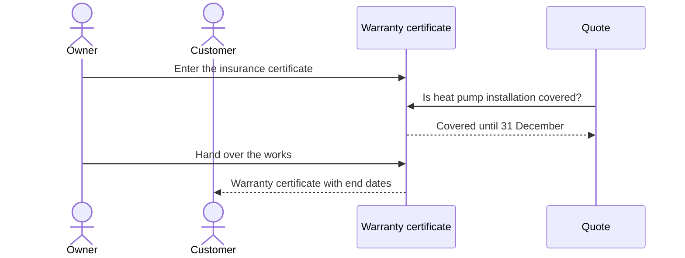

🏠 [Specs](../../../../README.md) › 🏷️ [Sectors](../../../README.md) ›
🔧 [SC19 Trades and home services](../../README.md) › 📝 [Use cases](../README.md) ›
📝 [Use cases: FL-SC19-05 On-call, warranties, van stock and site quotes](README.md) ›
📝 UC-SC19-18 Keep builders' warranties and certificates

# 📝 UC-SC19-18 Keep builders' warranties and certificates

**Status:** 🔄 waiting for the owner

## Summary

The owner keeps the ten-year insurance certificate of the company for each trade, and gives each customer the warranty
certificate of the works, with the warranties that run from the handover and their end dates.

## Personas

- [U13 Owner](../../../../01-users/personas/u13-owner.md)
- [U09 Customer](../../../../01-users/personas/u09-customer.md)

## Goal

Works start only with a valid insurance certificate, and every customer holds the warranty terms and end dates of the
works done for them.

## Trigger

A quote for works is made, an insurance certificate expires, or the works are handed over.

## Frequency

Every quote for works; the certificate is renewed once a year.

## Preconditions

- The company's insurance policy covers named activities.
- The works are quoted ([E-F6-03 Quote](../../../../02-functional/f06-customers-and-sales/data/e-f06-03-quote.md)).
- The handover date is recorded.

## Postconditions

- **Succeeded:** the certificate is saved
  ([E-SC19-12 Warranty certificate](../../data/e-sc19-12-warranty-certificate.md)) with its insurer, policy, activities
  and validity, the quotes and invoices show it, and the customer has the warranty terms and end dates.
- **Failed:** works are not started under an expired certificate or for an activity the policy does not cover, and an
  expiring certificate is flagged in time.

## Main flow

1. The owner opens the warranties screen
   ([S-SC19-18](../../screens/05-on-call-warranties-van-stock-and-site-quotes/s-sc19-18-builders-warranties.md)) and
   enters the insurance certificate with its insurer, policy number, activities and validity.
2. A quote for works checks the activity against the certificate
   ([BR-SC19-18](../../business-rules/br-sc19-18-works-start-only-with-a-valid-insurance-certificate.md)).
3. The quote and the invoice show the insurer and the cover as the law requires.
4. At the handover simple-ERP creates the warranty terms with their end dates.
5. The customer receives the warranty certificate on the portal and the phone, and the end dates are kept.

## Alternative flows

- 2a. The activity is not covered: the quote is refused and the owner is told to ask the insurer.
- 1a. The company holds two policies for two trades: each is a record.
- 5a. A defect is reported under a warranty: the claim opens in the warranty handling
  [UC-F6-31](../../../../02-functional/f06-customers-and-sales/use-cases/10-partners-contracts-and-warranties/uc-f06-31-handle-a-warranty-claim.md).

## Error flows

- 2e. The certificate has expired: quotes for works are refused.
- 4e. No handover date: the warranty end dates cannot be computed.
- Any step: a service does not answer; the call is retried first
  ([BR-F3-32](../../../../02-functional/f03-assistant/business-rules/br-f03-32-retry-before-an-error.md)), then the
  message follows the error pattern ([D122](../../../../06-decisions/ux/d122-error-message-standard.md)) and what the
  user typed stays on the screen.

## Business rules

- [BR-SC19-18](../../business-rules/br-sc19-18-works-start-only-with-a-valid-insurance-certificate.md)
- [BR-SC01-02](../../../sc01-construction/business-rules/br-sc01-02-insurance-certificate-on-quotes-and-invoices.md)

## Entities

- [E-SC19-12 Warranty certificate](../../data/e-sc19-12-warranty-certificate.md): created, renewed, delivered
- [E-SC01-11 Warranty](../../../sc01-construction/data/e-sc01-11-warranty.md): read, the same warranties on a builder's
  site
- [E-F6-27 Warranty](../../../../02-functional/f06-customers-and-sales/data/e-f06-27-warranty.md): read, the claims on a
  warranty
- [E-F6-03 Quote](../../../../02-functional/f06-customers-and-sales/data/e-f06-03-quote.md): read, the quote that checks
  the cover

## Permissions

Owner keeps the certificates; dispatcher and site manager read them; customer reads their own warranty certificate.
Technicians see only whether a trade is covered.

## Notifications

The owner, by email: a certificate that expires in 60 days. The customer, on the phone: the warranty certificate at the
handover.

## Audit events

Each certificate entered, renewed and expired, each warranty created and delivered, who and when.

## AI involvement

No AI step of its own. The AI assistant may open the screen and prefill it from the user's words; the user checks and
confirms
[BR-F3-07](../../../../02-functional/f03-assistant/business-rules/br-f03-07-no-deletes-no-irreversible-acts.md).

## API, MCP and A2A exposure

T5 operations of the capability for the personas above: create, read, update and list. The MCP tool of the
capability may read and propose, never confirm alone. No A2A skill.

## Screens

- [S-SC19-18](../../screens/05-on-call-warranties-van-stock-and-site-quotes/s-sc19-18-builders-warranties.md)

## Flowchart

See
[FL-SC19-05 On-call, warranties, van stock and site quotes](../../flows/fl-sc19-05-on-call-warranties-van-stock-and-site-quotes.md#flowchart).

## Sequence diagram

## Acceptance criteria

1. **Given** a valid certificate for a trade **when** a quote is made **then** it shows the insurer and the cover.
2. **Given** an expired certificate **when** a quote for works is made **then** it is refused.
3. **Given** a handover **when** the owner hands over the works **then** the warranty end dates are computed and
   delivered.

## Non-functional notes

The screen answers within 2 seconds for 10,000 records; every change is audited.

## Regulatory references

A company that does works must hold insurance for the damage that may affect the work for ten years after the
handover where the work touches the structure or fixed equipment, and must show the insurer and the cover on its quotes
and invoices; its legal warranties start at the handover. The warranty durations are data of the France pack. Related:
[CR-FR-082](../../../../10-country-packs/france/construction/cr-fr-082-ten-year-insurance.md),
[CR-FR-090](../../../../10-country-packs/france/construction/cr-fr-090-builders-warranties.md).

- France-pack rule, (Proposed) until its law is read:
  [CR-FR-259 Builders' ten-year insurance certificate](../../../../10-country-packs/france/construction/cr-fr-259-builders-warranty-insurance.md)

## Related use cases

- [UC-SC19-17 Run the emergency on-call service](uc-sc19-17-run-the-emergency-on-call-service.md)
- [UC-SC19-19 Keep stock in each van](uc-sc19-19-keep-stock-in-each-van.md)
- [UC-SC01-11](../../../sc01-construction/use-cases/05-hand-over-and-follow-up/uc-sc01-11-hand-over-the-as-built-file-and-follow-the-warranties.md)
- [UC-F6-31](../../../../02-functional/f06-customers-and-sales/use-cases/10-partners-contracts-and-warranties/uc-f06-31-handle-a-warranty-claim.md)

## Open questions

None.

---

⬅️ [UC-SC19-17 Run the emergency on-call service](uc-sc19-17-run-the-emergency-on-call-service.md) ·
⬆️ [Up](README.md) · ➡️ [UC-SC19-19 Keep stock in each van](uc-sc19-19-keep-stock-in-each-van.md)
