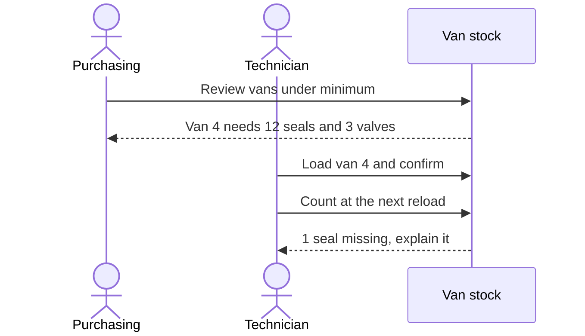

🏠 [Specs](../../../../README.md) › 🏷️ [Sectors](../../../README.md) ›
🔧 [SC19 Trades and home services](../../README.md) › 📝 [Use cases](../README.md) ›
📝 [Use cases: FL-SC19-05 On-call, warranties, van stock and site quotes](README.md) ›
📝 UC-SC19-19 Keep stock in each van

# 📝 UC-SC19-19 Keep stock in each van

**Status:** ✅ specified

## Summary

Purchasing keeps a standard load for each technician's van with a minimum and maximum per part, sees what each van has
used, and has the technician count the van at every reload.

## Personas

- [U14 Field worker](../../../../01-users/personas/u14-field-worker.md)
- [U04 Purchasing and stock](../../../../01-users/personas/u04-purchasing.md)

## Goal

Every van holds the parts of its standard load, the stock of each van is known, and no van leaves with a difference
nobody explained.

## Trigger

A van's stock falls under its minimum, a technician reloads, or a count is due.

## Frequency

Daily for the vans in use.

## Preconditions

- Each van is a stock location
  ([E-F7-07 Location](../../../../02-functional/f07-purchasing-and-stock/data/e-f07-07-location.md)).
- The standard load of each van lists parts with minimum and maximum
  ([E-F7-06 Item](../../../../02-functional/f07-purchasing-and-stock/data/e-f07-06-item.md)).
- Parts used are recorded on interventions ([UC-SC19-07](../02-on-site-intervention/uc-sc19-07-record-parts-used.md)).

## Postconditions

- **Succeeded:** each van's stock is saved ([E-SC19-13 Van stock](../../data/e-sc19-13-van-stock.md)) with its expected
  and counted quantities and its differences explained.
- **Failed:** a van is not reloaded over its maximum, a difference is not left unexplained at the next load, and a van
  below its minimum is listed.

## Main flow

1. Purchasing opens the van stock screen
   ([S-SC19-19](../../screens/05-on-call-warranties-van-stock-and-site-quotes/s-sc19-19-van-stock.md)) and sees each van
   with its standard load and what it has.
2. simple-ERP lists the parts below their minimum and proposes the reload
   [UC-F7-05](../../../../02-functional/f07-purchasing-and-stock/use-cases/03-replenish/uc-f07-05-replenish-stock.md).
3. The technician loads the van from the warehouse and confirms the load on the phone.
4. At the next reload the technician counts the van and simple-ERP shows the difference to the expected quantity
   ([BR-SC19-19](../../business-rules/br-sc19-19-each-van-is-counted-at-every-reload.md)).
5. The technician or purchasing explains the difference and the van is Reconciled.

## Alternative flows

- 4a. A part is missing: the difference is written off as lost or charged to the intervention that used it.
- 2a. A part is used in more than one van: the reload is grouped by warehouse run.
- 3a. A technician borrows from another van: a transfer between vans is recorded.

## Error flows

- 4e. The van is not counted at the reload: the reload is refused until it is counted.
- 3e. The reload would exceed the maximum: the quantity is cut.
- Any step: a service does not answer; the call is retried first
  ([BR-F3-32](../../../../02-functional/f03-assistant/business-rules/br-f03-32-retry-before-an-error.md)), then the
  message follows the error pattern ([D122](../../../../06-decisions/ux/d122-error-message-standard.md)) and what the
  user typed stays on the screen.

## Business rules

- [BR-SC19-19](../../business-rules/br-sc19-19-each-van-is-counted-at-every-reload.md)
- [BR-SC19-07](../../business-rules/br-sc19-07-parts-used-lower-the-vans-stock.md)

## Entities

- [E-SC19-13 Van stock](../../data/e-sc19-13-van-stock.md): created, counted, reconciled
- [E-F7-07 Location](../../../../02-functional/f07-purchasing-and-stock/data/e-f07-07-location.md): read, the van
  location
- [E-F7-11](../../../../02-functional/f07-purchasing-and-stock/data/e-f07-11-stock-count.md): created, the stock count
- [E-SC15-16 Van stock](../../../sc15-wholesale-and-distribution/data/e-sc15-16-van-stock.md): read, the van stock of a
  delivery round

## Permissions

Purchasing sets standard loads and reads all vans; technician counts and reloads their own van. A technician
cannot write off a difference above an amount of the owner's choice.

## Notifications

Purchasing, in the app: a van under its minimum or a difference unexplained. The technician, on the phone: the reload
list.

## Audit events

Each load, use, count, difference, explanation and write-off, who and when.

## AI involvement

No AI step of its own. The AI assistant may open the screen and prefill it from the user's words; the user checks and
confirms
[BR-F3-07](../../../../02-functional/f03-assistant/business-rules/br-f03-07-no-deletes-no-irreversible-acts.md).

## API, MCP and A2A exposure

T5 operations of the capability for the personas above: create, read, update and list. The MCP tool of the
capability may read and propose, never confirm alone. No A2A skill.

## Screens

- [S-SC19-19](../../screens/05-on-call-warranties-van-stock-and-site-quotes/s-sc19-19-van-stock.md)

## Flowchart

See
[FL-SC19-05 On-call, warranties, van stock and site quotes](../../flows/fl-sc19-05-on-call-warranties-van-stock-and-site-quotes.md#flowchart).

## Sequence diagram

## Acceptance criteria

1. **Given** a van under the minimum of a part **when** purchasing opens the screen **then** the reload is proposed.
2. **Given** a van not counted **when** the technician asks for a reload **then** it is refused until counted.
3. **Given** a difference of one seal **when** the technician explains it **then** the van is Reconciled.

## Non-functional notes

The screen answers within 2 seconds for 10,000 records; every change is audited.

## Regulatory references

None specific to this use case beyond the rules above.

## Related use cases

- [UC-SC19-18](uc-sc19-18-keep-builders-warranties-and-certificates.md)
- [UC-SC19-20](uc-sc19-20-quote-on-site-and-sign-on-the-phone.md)
- [UC-SC19-07 Record parts used](../02-on-site-intervention/uc-sc19-07-record-parts-used.md)
- [UC-SC15-22](../../../sc15-wholesale-and-distribution/use-cases/06-beverages-vans-weights-and-devices/uc-sc15-22-sell-from-the-van.md)

## Open questions

None.

---

⬅️ [UC-SC19-18 Keep builders' warranties and certificates](uc-sc19-18-keep-builders-warranties-and-certificates.md) ·
⬆️ [Up](README.md) ·
➡️ [UC-SC19-20 Quote on site and sign on the phone](uc-sc19-20-quote-on-site-and-sign-on-the-phone.md)
