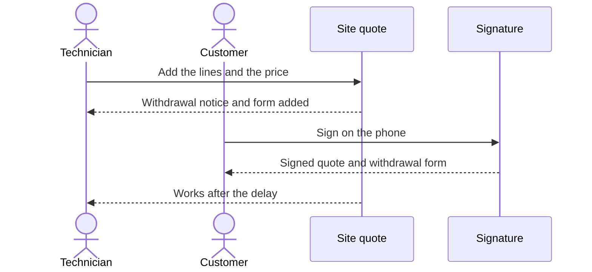

🏠 [Specs](../../../../README.md) › 🏷️ [Sectors](../../../README.md) ›
🔧 [SC19 Trades and home services](../../README.md) › 📝 [Use cases](../README.md) ›
📝 [Use cases: FL-SC19-05 On-call, warranties, van stock and site quotes](README.md) ›
📝 UC-SC19-20 Quote on site and sign on the phone

# 📝 UC-SC19-20 Quote on site and sign on the phone

**Status:** ✅ specified

## Summary

A technician makes a quote on site on the phone: lines from the catalogue, the price, and the customer's signature on
the phone, with the withdrawal notice and form that the law requires for a contract signed at the customer's home.

## Personas

- [U14 Field worker](../../../../01-users/personas/u14-field-worker.md)
- [U09 Customer](../../../../01-users/personas/u09-customer.md)

## Goal

The customer signs the quote on the spot knowing their right to withdraw, and no payment is taken before the law allows.

## Trigger

A technician finds work to quote at a customer's home, or after a call-out.

## Frequency

Several a week per technician.

## Preconditions

- The catalogue of services and parts has prices
  ([E-F6-08](../../../../02-functional/f06-customers-and-sales/data/e-f06-08-sales-price-list.md)).
- The customer is known or created on site
  ([E-F6-01](../../../../02-functional/f06-customers-and-sales/data/e-f06-01-customer-record.md)).
- The withdrawal notice text is set in the sector pack.

## Postconditions

- **Succeeded:** the quote ([E-F6-03 Quote](../../../../02-functional/f06-customers-and-sales/data/e-f06-03-quote.md))
  is signed on the phone, carries the withdrawal notice and form, and the customer has received a copy.
- **Failed:** a quote signed at home is not valid without the notice, no payment is taken in the withdrawal delay except
  for an urgent repair the customer asked for in writing, and the copy is always sent.

## Main flow

1. The technician opens the site quote screen
   ([S-SC19-20](../../screens/05-on-call-warranties-van-stock-and-site-quotes/s-sc19-20-site-quotes.md)) at the
   customer's home.
2. The technician adds lines from the catalogue and sets the quantities and the price.
3. SimpleERP adds the withdrawal notice and form and shows the withdrawal delay
   ([BR-SC19-20](../../business-rules/br-sc19-20-a-quote-signed-on-site-carries-the-withdrawal-notice.md)).
4. The customer reads the quote on their own phone and signs
   [UC-F6-04](../../../../02-functional/f06-customers-and-sales/use-cases/02-quote-to-order/uc-f06-04-accept-or-sign-a-quote.md).
5. The signed quote and the withdrawal form are sent to the customer by email and SMS.
6. The works are planned after the withdrawal delay unless the customer asked in writing for an urgent start.

## Alternative flows

- 6a. The customer asks for an urgent repair: the written request is recorded and the urgent part starts at once, and
  only that part.
- 4a. The customer prefers to think: the quote is sent and the signature is requested later by link.
- 3a. The quote is over the amount for which the pack requires more information: the missing lines are asked.

## Error flows

- 3e. The notice or form is missing: the quote cannot be sent for signature.
- 5e. The customer has no email or phone number: the paper copy is printed and handed over.
- Any step: a service does not answer; the call is retried first
  ([BR-F3-32](../../../../02-functional/f03-assistant/business-rules/br-f03-32-retry-before-an-error.md)), then the
  message follows the error pattern ([D122](../../../../06-decisions/ux/d122-error-message-standard.md)) and what the
  user typed stays on the screen.

## Business rules

- [BR-SC19-20](../../business-rules/br-sc19-20-a-quote-signed-on-site-carries-the-withdrawal-notice.md)
- [BR-SC19-18](../../business-rules/br-sc19-18-works-start-only-with-a-valid-insurance-certificate.md)

## Entities

- [E-F6-03 Quote](../../../../02-functional/f06-customers-and-sales/data/e-f06-03-quote.md): created, the quote with its
  notice
- [E-F2-14](../../../../02-functional/f02-no-code-configuration/data/e-f02-14-signature-request.md): created, the
  signature request
- [E-F11-08](../../../../02-functional/f11-online-shop/data/e-f11-08-withdrawal-request.md): read, the withdrawal
  request pattern

## Permissions

Technician makes and signs quotes on site; office reads them; customer signs and withdraws. A technician
cannot take a payment in the withdrawal delay.

## Notifications

The customer, by email and SMS: the signed quote and the withdrawal form.

## Audit events

Each quote created on site, notice shown, signature, copy sent and withdrawal, who and when.

## AI involvement

No AI step of its own. The AI assistant may open the screen and prefill it from the user's words; the user checks and
confirms
[BR-F3-07](../../../../02-functional/f03-assistant/business-rules/br-f03-07-no-deletes-no-irreversible-acts.md).

## API, MCP and A2A exposure

T5 operations of the capability for the personas above: create, read, update and list. The MCP tool of the
capability may read and propose, never confirm alone. No A2A skill.

## Screens

- [S-SC19-20](../../screens/05-on-call-warranties-van-stock-and-site-quotes/s-sc19-20-site-quotes.md)

## Flowchart

See
[FL-SC19-05 On-call, warranties, van stock and site quotes](../../flows/fl-sc19-05-on-call-warranties-van-stock-and-site-quotes.md#flowchart).

## Sequence diagram

## Acceptance criteria

1. **Given** a quote made at the customer's home **when** the technician sends it for signature **then** it carries the
   withdrawal notice and form.
2. **Given** a customer who signed **when** the technician asks for a deposit in the withdrawal delay **then** it is
   refused.
3. **Given** an urgent repair asked in writing **when** the customer signs the request **then** the urgent part starts
   at once.

## Non-functional notes

The screen answers within 2 seconds for 10,000 records; every change is audited.

## Regulatory references

A consumer who signs a contract away from the company's premises, such as at home, has a delay to withdraw,
and the quote must carry the withdrawal notice and form; no payment may be taken in the first days, except for an
immediate repair the consumer asked for in writing, limited to what is needed. The delays are data of the France pack.
Related: [CR-FR-036](../../../../10-country-packs/france/consumer/cr-fr-036-withdrawal-right.md),
[CR-FR-020](../../../../10-country-packs/france/invoicing/cr-fr-020-electronic-acceptance-and-signature.md),
[CR-FR-015](../../../../10-country-packs/france/invoicing/cr-fr-015-invoice-mandatory-mentions.md).

## Related use cases

- [UC-SC19-19 Keep stock in each van](uc-sc19-19-keep-stock-in-each-van.md)
- [UC-SC19-06](../02-on-site-intervention/uc-sc19-06-report-on-site-with-photos.md)
- [UC-F6-03](../../../../02-functional/f06-customers-and-sales/use-cases/01-lead-to-quote/uc-f06-03-create-and-send-a-quote.md)

## Open questions

None.

---

⬅️ [UC-SC19-19 Keep stock in each van](uc-sc19-19-keep-stock-in-each-van.md) · ⬆️ [Up](README.md)
