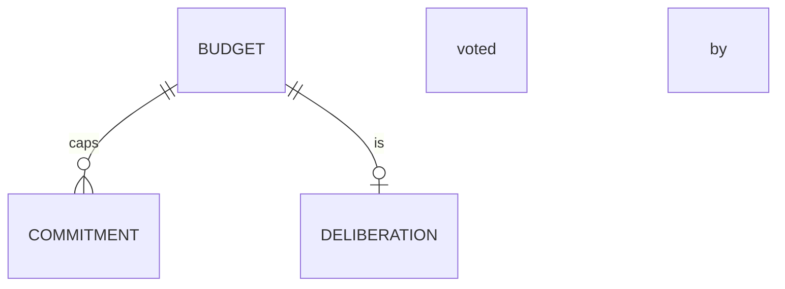
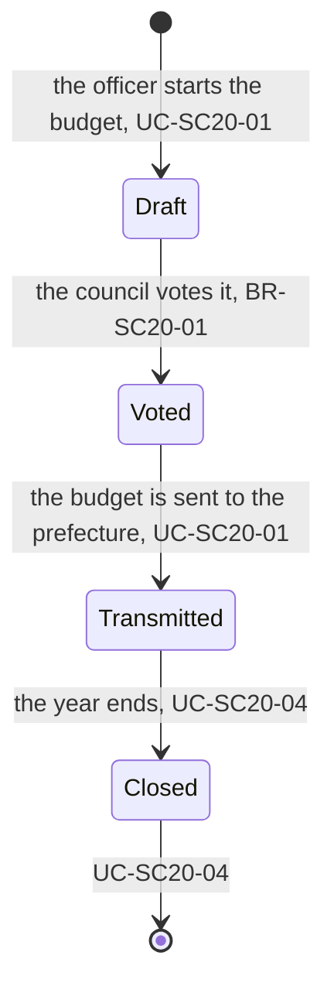

🏠 [Specs](../../../README.md) › 🏷️ [Sectors](../../README.md) › 🏛️ [SC20 Public bodies](../README.md) ›
🗃️ [Data](README.md) › 🗃️ E-SC20-01 Budget

# 🗃️ E-SC20-01 Budget

**Status:** ✅ specified

## Purpose

The budget of a local body for one year or one supplementary decision: sections, chapters, credits voted and the vote
([D564](../../../06-decisions/sectors/d564-benchmark-gaps-sc20-public-bodies.md)). It is not the accounting budget of a
company ([E-F8-08](../../../02-functional/f08-accounting/data/e-f08-08-accounting-budget.md)), which follows an analytic
plan: this one is voted by an assembly and caps commitments.

## Fields

| Name | Type | Required | Validation | Default | Example | Personal data | Custom fields |
|---|---|---|---|---|---|---|---|
| year | number | yes | a year | this year | 2027 | no | no |
| kind | text | yes | primary or supplementary | primary | Primary | no | no |
| chapters | list of section, chapter and credit | yes | each section balanced | - | Operation, Staff costs, 1,820,000 | no | no |
| revenue | list of source and amount | yes | covers the credits | - | Local taxes, 2,100,000 | no | no |
| vote date | date | no | on or after the council meeting | - | 2027-03-28 | no | no |
| transmitted on | date | no | not before the vote | - | 2027-03-30 | no | no |
| state | Draft, Voted, Transmitted, Closed | yes | the lifecycle below | Draft | Voted | no | no |
| owner | user | yes | a user of the company | the creator | Claire P. | yes | no |

## Relations

- [E-F8-08](../../../02-functional/f08-accounting/data/e-f08-08-accounting-budget.md)
- [E-F8-16 Budget plan](../../../02-functional/f08-accounting/data/e-f08-16-budget-plan.md)
- [E-SC20-02 Commitment](e-sc20-02-commitment.md)
- [E-SC20-12 Deliberation](e-sc20-12-deliberation.md)

## Lifecycle

## Indexes and search

By year, kind, state and chapter.

## Retention

Kept permanently as a public record, with the accounts
([CR-FR-002](../../../10-country-packs/france/accounting/cr-fr-002-accounting-records-kept-ten-years.md)).

## Audit

Every credit, vote, transmission and change of state, with who, when and the old and new value.

## Import and export

Export of the budget as PDF and as the national data format; import of last year's accounts as CSV.

## Used by

- [UC-SC20-01](../use-cases/01-public-accounting/uc-sc20-01-prepare-and-vote-the-budget.md)
- [UC-SC20-02](../use-cases/01-public-accounting/uc-sc20-02-commit-expenditure.md)
- [UC-SC20-16](../use-cases/04-public-hr-and-pay/uc-sc20-16-ask-the-assistant-about-the-budget.md)

## Open questions

None.

---

⬆️ [Up](README.md) · ➡️ [E-SC20-02 Commitment](e-sc20-02-commitment.md)
