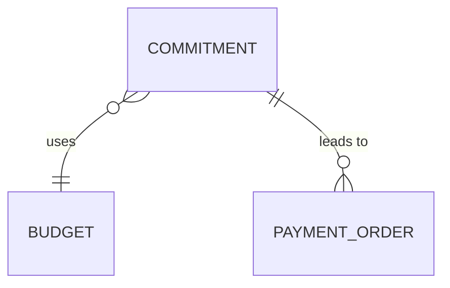
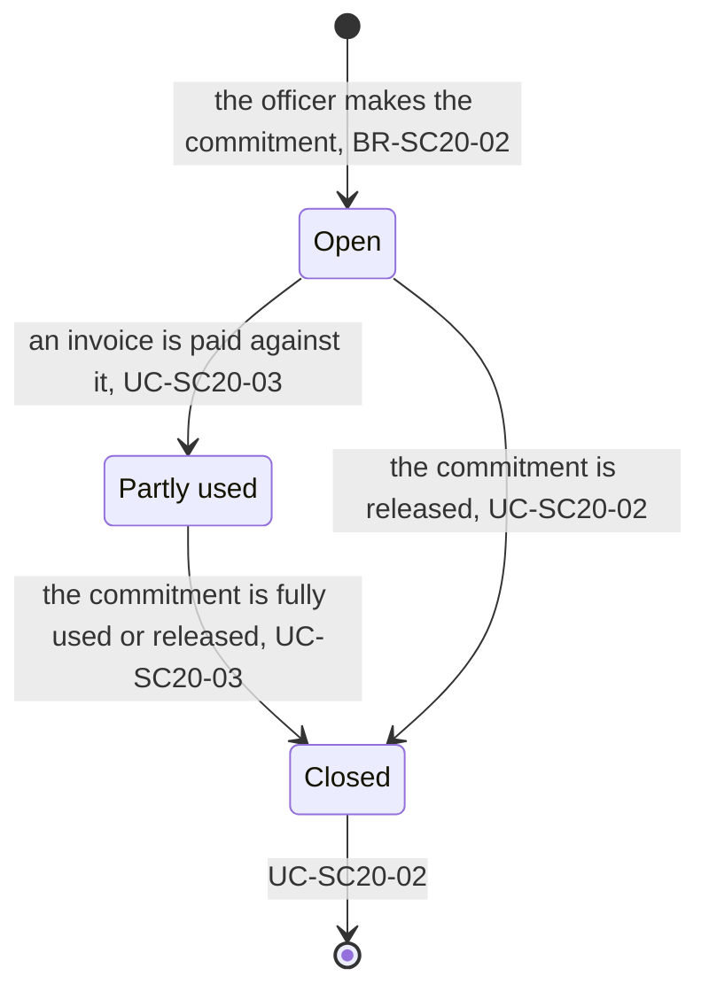

🏠 [Specs](../../../README.md) › 🏷️ [Sectors](../../README.md) › 🏛️ [SC20 Public bodies](../README.md) ›
🗃️ [Data](README.md) › 🗃️ E-SC20-02 Commitment

# 🗃️ E-SC20-02 Commitment

**Status:** ✅ specified

## Purpose

The reservation of credit on a budget chapter before an order
([D564](../../../06-decisions/sectors/d564-benchmark-gaps-sc20-public-bodies.md)). It is not a purchase order
([E-F7-03](../../../02-functional/f07-purchasing-and-stock/data/e-f07-03-purchase-order.md)): it reserves credit and
follows its use, and the order carries its number.

## Fields

| Name | Type | Required | Validation | Default | Example | Personal data | Custom fields |
|---|---|---|---|---|---|---|---|
| number | text | yes | unique per year | next number | 2027-0411 | no | no |
| budget | budget (E-SC20-01) | yes | a voted budget | - | 2027 | no | no |
| chapter | text | yes | a chapter of the budget | - | Schools | no | no |
| supplier | supplier (E-F7-01) | no | a supplier of the body | - | Mobilier Pro | no | no |
| amount | amount | yes | above 0 and within the credit left | - | 18,000.00 | no | no |
| used | amount | no | not above the amount | 0 | 0.00 | no | no |
| purpose | text | yes | - | - | School furniture | no | no |
| state | Open, Partly used, Closed | yes | the lifecycle below | Open | Partly used | no | no |
| owner | user | yes | a user of the company | the creator | Claire P. | yes | no |

## Relations

- [E-SC20-01 Budget](e-sc20-01-budget.md)
- [E-F7-01](../../../02-functional/f07-purchasing-and-stock/data/e-f07-01-supplier-record.md)
- [E-F7-03](../../../02-functional/f07-purchasing-and-stock/data/e-f07-03-purchase-order.md)
- [E-SC20-03 Payment order](e-sc20-03-payment-order.md)

## Lifecycle

## Indexes and search

By number, chapter, supplier, state and year.

## Retention

Kept with the accounts
([CR-FR-002](../../../10-country-packs/france/accounting/cr-fr-002-accounting-records-kept-ten-years.md)).

## Audit

Every commitment, use, release and refusal, with who, when and the old and new value.

## Import and export

Export of the commitments as CSV; import of the budget chapters as CSV.

## Used by

- [UC-SC20-02](../use-cases/01-public-accounting/uc-sc20-02-commit-expenditure.md)
- [UC-SC20-03](../use-cases/01-public-accounting/uc-sc20-03-issue-payment-orders-and-revenue-titles.md)

## Open questions

None.

---

⬅️ [E-SC20-01 Budget](e-sc20-01-budget.md) · ⬆️ [Up](README.md) ·
➡️ [E-SC20-03 Payment order](e-sc20-03-payment-order.md)
