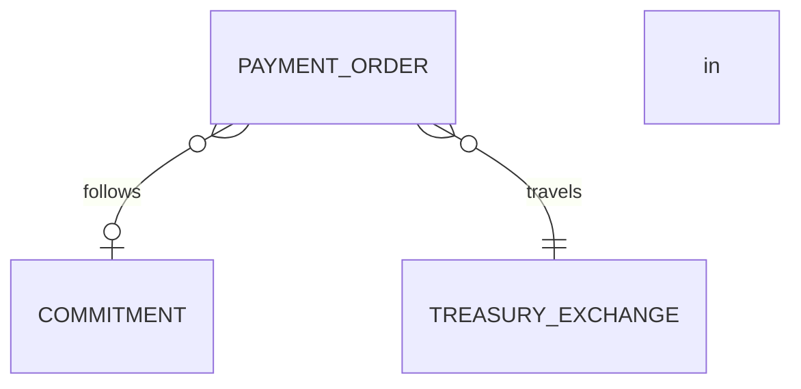
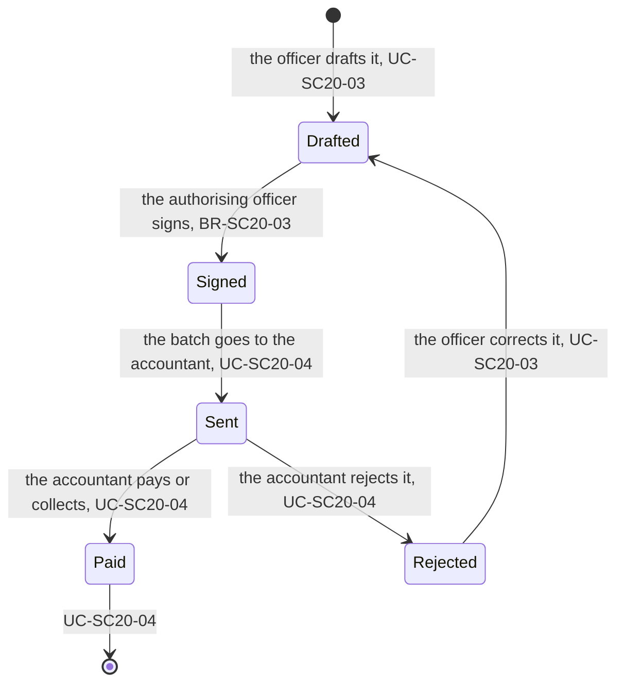

🏠 [Specs](../../../README.md) › 🏷️ [Sectors](../../README.md) › 🏛️ [SC20 Public bodies](../README.md) ›
🗃️ [Data](README.md) › 🗃️ E-SC20-03 Payment order

# 🗃️ E-SC20-03 Payment order

**Status:** ✅ specified

## Purpose

One payment order (mandate) or revenue title, with its commitment, supporting documents and signature
([D564](../../../06-decisions/sectors/d564-benchmark-gaps-sc20-public-bodies.md)). It is not the payment order of a
company ([E-F8-38 Payment order](../../../02-functional/f08-accounting/data/e-f08-38-payment-order.md)), which a bank
executes: this one is signed by an authorising officer and sent to the public accountant, who pays.

## Fields

| Name | Type | Required | Validation | Default | Example | Personal data | Custom fields |
|---|---|---|---|---|---|---|---|
| kind | text | yes | mandate or revenue title | - | Mandate | no | no |
| number | text | yes | unique per year and kind | next number | M-1204 | no | no |
| third party | supplier or debtor | yes | a record of the body | - | Mobilier Pro | no | no |
| amount | amount | yes | above 0 | - | 18,000.00 | no | no |
| commitment | commitment (E-SC20-02) | no | required for a mandate | - | 2027-0411 | no | no |
| documents | list | yes | the list of the pack | the pack's list | Invoice, order | no | no |
| signed by | user | no | holds the delegation | - | Mayor | no | no |
| state | Drafted, Signed, Sent, Paid, Rejected | yes | the lifecycle below | Drafted | Signed | no | no |
| owner | user | yes | a user of the company | the creator | Claire P. | yes | no |

## Relations

- [E-SC20-02 Commitment](e-sc20-02-commitment.md)
- [E-SC20-04 Treasury exchange](e-sc20-04-treasury-exchange.md)
- [E-F8-38 Payment order](../../../02-functional/f08-accounting/data/e-f08-38-payment-order.md)
- [E-F7-05](../../../02-functional/f07-purchasing-and-stock/data/e-f07-05-supplier-invoice.md)

## Lifecycle

## Indexes and search

By kind, number, third party, state and date.

## Retention

Kept with the accounts and the supporting documents, as the public accountant requires
([CR-FR-002](../../../10-country-packs/france/accounting/cr-fr-002-accounting-records-kept-ten-years.md)).

## Audit

Every draft, signature, delegation used, sending, payment and rejection, with who, when and the old and new value.

## Import and export

Export in the national exchange format; no import.

## Used by

- [UC-SC20-03](../use-cases/01-public-accounting/uc-sc20-03-issue-payment-orders-and-revenue-titles.md)
- [UC-SC20-04](../use-cases/01-public-accounting/uc-sc20-04-exchange-with-the-public-treasury.md)

## Open questions

None.

---

⬅️ [E-SC20-02 Commitment](e-sc20-02-commitment.md) · ⬆️ [Up](README.md) ·
➡️ [E-SC20-04 Treasury exchange](e-sc20-04-treasury-exchange.md)
