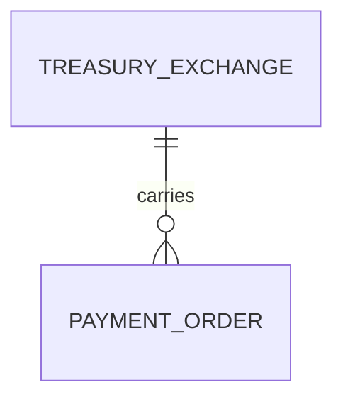
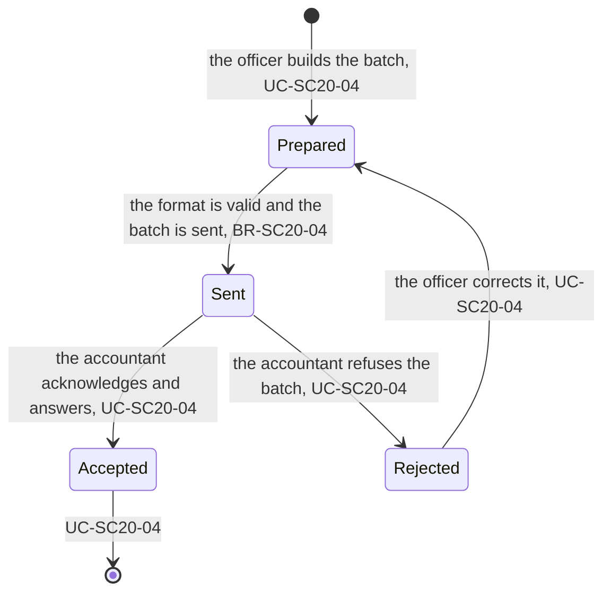

🏠 [Specs](../../../README.md) › 🏷️ [Sectors](../../README.md) › 🏛️ [SC20 Public bodies](../README.md) ›
🗃️ [Data](README.md) › 🗃️ E-SC20-04 Treasury exchange

# 🗃️ E-SC20-04 Treasury exchange

**Status:** ✅ specified

## Purpose

One batch of orders and titles sent to the public accountant and the answers received
([D564](../../../06-decisions/sectors/d564-benchmark-gaps-sc20-public-bodies.md)). It is not a bank file
([E-F8-28 Payment run](../../../02-functional/f08-accounting/data/e-f08-28-payment-run.md)): it goes to a public
accountant, who checks and pays.

## Fields

| Name | Type | Required | Validation | Default | Example | Personal data | Custom fields |
|---|---|---|---|---|---|---|---|
| batch | text | yes | unique per body | next number | B-0112 | no | no |
| orders | list of orders (E-SC20-03) | yes | signed orders | - | 14 orders | no | no |
| format check | text | yes | valid or errors | computed | valid | no | no |
| sent at | date and time | no | - | - | 2027-03-12 16:02 | no | no |
| acknowledged at | date and time | no | after sending | - | 2027-03-12 16:10 | no | no |
| answers | list of order and outcome | no | - | - | 13 paid, 1 rejected | no | no |
| state | Prepared, Sent, Accepted, Rejected | yes | the lifecycle below | Prepared | Sent | no | no |
| owner | user | yes | a user of the company | the creator | Claire P. | yes | no |

## Relations

- [E-SC20-03 Payment order](e-sc20-03-payment-order.md)
- [E-F8-28 Payment run](../../../02-functional/f08-accounting/data/e-f08-28-payment-run.md)

## Lifecycle

## Indexes and search

By batch, date, state and order.

## Retention

Kept with the accounts
([CR-FR-002](../../../10-country-packs/france/accounting/cr-fr-002-accounting-records-kept-ten-years.md)).

## Audit

Every batch, format check, sending, acknowledgement and answer, with who, when and the old and new value.

## Import and export

Export of the batch in the national exchange format; import of the answers in the same format.

## Used by

- [UC-SC20-04](../use-cases/01-public-accounting/uc-sc20-04-exchange-with-the-public-treasury.md)
- [UC-SC20-03](../use-cases/01-public-accounting/uc-sc20-03-issue-payment-orders-and-revenue-titles.md)

## Open questions

None.

---

⬅️ [E-SC20-03 Payment order](e-sc20-03-payment-order.md) · ⬆️ [Up](README.md) ·
➡️ [E-SC20-05 Tender file](e-sc20-05-tender-file.md)
