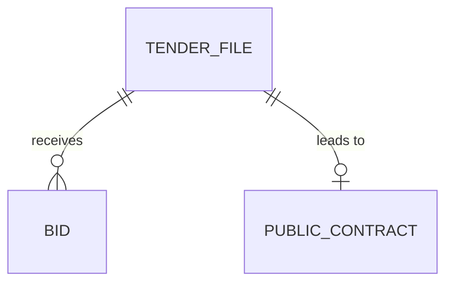
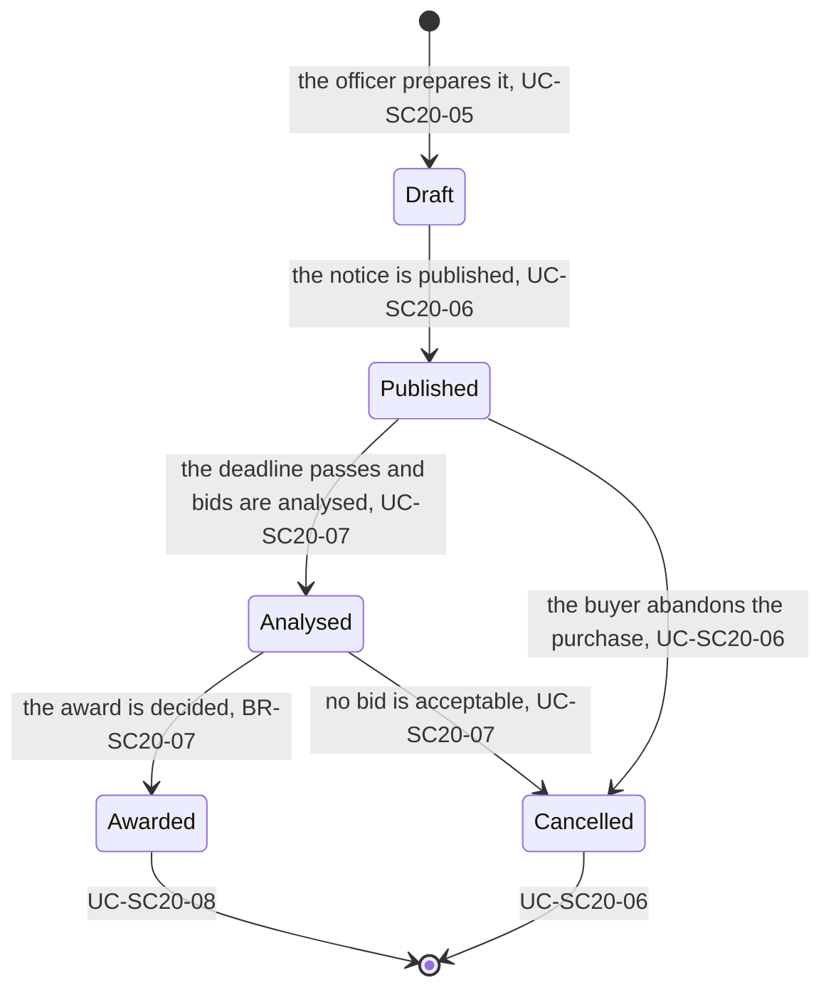

🏠 [Specs](../../../README.md) › 🏷️ [Sectors](../../README.md) › 🏛️ [SC20 Public bodies](../README.md) ›
🗃️ [Data](README.md) › 🗃️ E-SC20-05 Tender file

# 🗃️ E-SC20-05 Tender file

**Status:** ✅ specified

## Purpose

The file of one public purchase: object, estimate, procedure, criteria, dates and documents
([D564](../../../06-decisions/sectors/d564-benchmark-gaps-sc20-public-bodies.md)). It is not the call for tenders of a
company ([E-F7-13](../../../02-functional/f07-purchasing-and-stock/data/e-f07-13-call-for-tenders.md)), which compares
quotes freely: this one follows the procedure a public buyer's thresholds require, with set criteria and publication. It
is the buyer's side of the tender a builder follows
([E-SC01-12 Public tender](../../sc01-construction/data/e-sc01-12-public-tender.md)).

## Fields

| Name | Type | Required | Validation | Default | Example | Personal data | Custom fields |
|---|---|---|---|---|---|---|---|
| number | text | yes | unique per year | next number | AO-2027-014 | no | no |
| object | text | yes | - | - | School catering | no | no |
| kind | text | yes | works, supplies or services | - | Services | no | no |
| estimate | amount excl. VAT | yes | above 0 | - | 190,000.00 | no | no |
| procedure | text | yes | from the thresholds | computed | Formal | no | no |
| criteria | list of criterion and weight | yes | weights add to 100 | - | Price 50 | no | no |
| deadline | date and time | yes | after publication | - | 2027-05-12 12:00 | no | no |
| state | Draft, Published, Analysed, Awarded, Cancelled | yes | the lifecycle below | Draft | Published | no | no |
| owner | user | yes | a user of the company | the creator | Claire P. | yes | no |

## Relations

- [E-SC20-06 Bid](e-sc20-06-bid.md)
- [E-SC20-07 Public contract](e-sc20-07-public-contract.md)
- [E-F7-13](../../../02-functional/f07-purchasing-and-stock/data/e-f07-13-call-for-tenders.md)
- [E-SC01-12 Public tender](../../sc01-construction/data/e-sc01-12-public-tender.md)

## Lifecycle

## Indexes and search

By number, object, kind, procedure and state.

## Retention

Kept for the years the France pack sets for public contracts.

## Audit

Every estimate, procedure, criterion, document, publication and decision, with who, when and the old and new value.

## Import and export

Export of the file as PDF; import of the specifications as documents.

## Used by

- [UC-SC20-05](../use-cases/02-public-procurement/uc-sc20-05-prepare-a-tender-file.md)
- [UC-SC20-06](../use-cases/02-public-procurement/uc-sc20-06-publish-the-tender.md)
- [UC-SC20-07](../use-cases/02-public-procurement/uc-sc20-07-analyse-bids-and-award.md)

## Open questions

None.

---

⬅️ [E-SC20-04 Treasury exchange](e-sc20-04-treasury-exchange.md) · ⬆️ [Up](README.md) ·
➡️ [E-SC20-06 Bid](e-sc20-06-bid.md)
