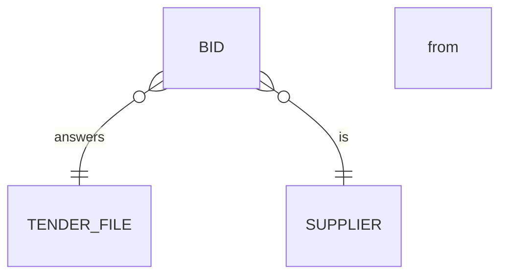
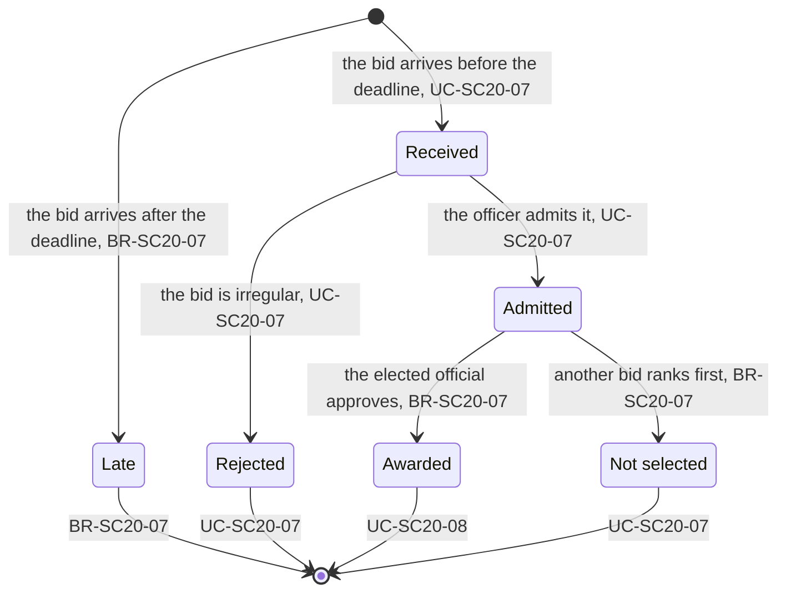

🏠 [Specs](../../../README.md) › 🏷️ [Sectors](../../README.md) › 🏛️ [SC20 Public bodies](../README.md) ›
🗃️ [Data](README.md) › 🗃️ E-SC20-06 Bid

# 🗃️ E-SC20-06 Bid

**Status:** ✅ specified

## Purpose

One bid received for a tender, with its received time, admission, scores and rank
([D564](../../../06-decisions/sectors/d564-benchmark-gaps-sc20-public-bodies.md)). It is not a supplier quote
([E-F7-13](../../../02-functional/f07-purchasing-and-stock/data/e-f07-13-call-for-tenders.md)): it is sealed until the
deadline and ranked only on the published criteria.

## Fields

| Name | Type | Required | Validation | Default | Example | Personal data | Custom fields |
|---|---|---|---|---|---|---|---|
| tender file | tender file (E-SC20-05) | yes | a published file | - | AO-2027-014 | no | no |
| bidder | supplier (E-F7-01) | yes | a record of the body | - | Cantine Plus | no | no |
| received | date and time | yes | set by the system | now | 2027-05-11 16:20 | no | no |
| price | amount excl. VAT | yes | above 0 | - | 182,000.00 | no | no |
| scores | list of criterion and score | no | published criteria only | - | Price 45 | no | no |
| total | number | no | weighted sum | computed | 92 | no | no |
| admission | text | no | admitted or rejected with a reason | - | Admitted | no | no |
| state | Received, Late, Admitted, Rejected, Awarded, Not selected | yes | the lifecycle below | Received | Late | no | no |
| owner | user | yes | a user of the company | the creator | Claire P. | yes | no |

## Relations

- [E-SC20-05 Tender file](e-sc20-05-tender-file.md)
- [E-F7-01](../../../02-functional/f07-purchasing-and-stock/data/e-f07-01-supplier-record.md)
- [E-F7-13](../../../02-functional/f07-purchasing-and-stock/data/e-f07-13-call-for-tenders.md)

## Lifecycle

## Indexes and search

By tender file, bidder, state and total.

## Retention

Kept for the years the France pack sets for public contracts; unsuccessful bids with the file.

## Audit

Every receipt with its time, admission, score, rank and award, with who, when and the old and new value.

## Import and export

Export of the scoring sheet as PDF; no import.

## Used by

- [UC-SC20-07](../use-cases/02-public-procurement/uc-sc20-07-analyse-bids-and-award.md)
- [UC-SC20-05](../use-cases/02-public-procurement/uc-sc20-05-prepare-a-tender-file.md)

## Open questions

None.

---

⬅️ [E-SC20-05 Tender file](e-sc20-05-tender-file.md) · ⬆️ [Up](README.md) ·
➡️ [E-SC20-07 Public contract](e-sc20-07-public-contract.md)
