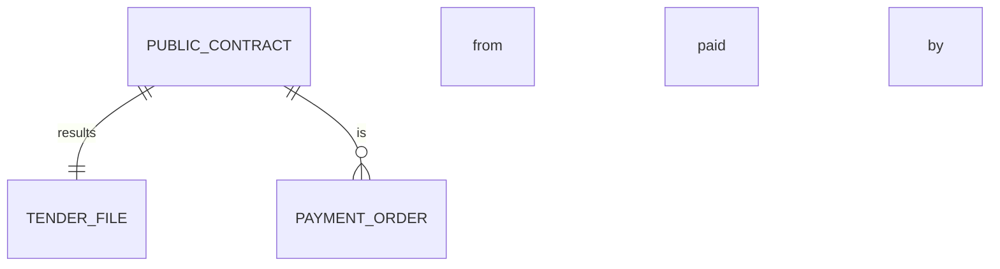
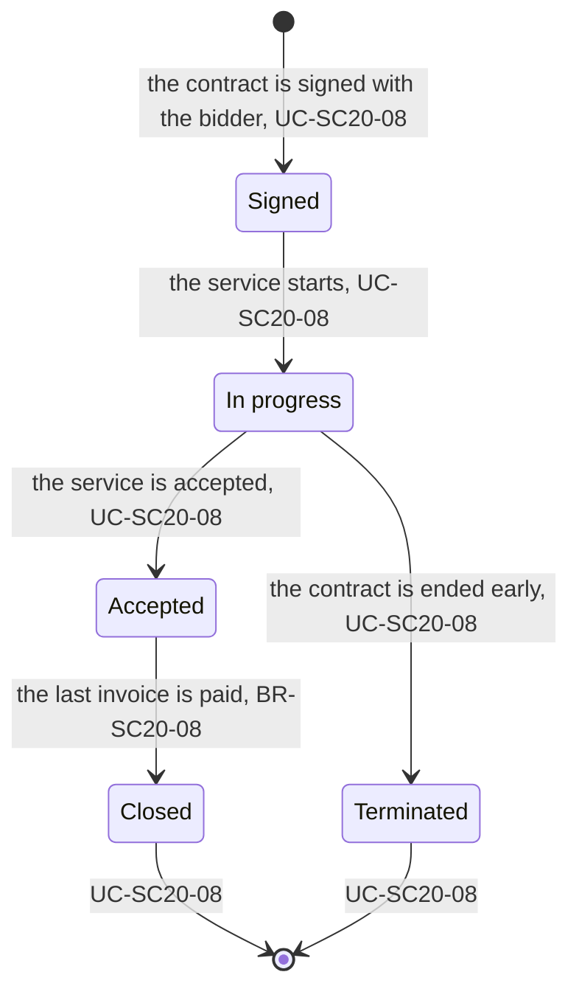

🏠 [Specs](../../../README.md) › 🏷️ [Sectors](../../README.md) › 🏛️ [SC20 Public bodies](../README.md) ›
🗃️ [Data](README.md) › 🗃️ E-SC20-07 Public contract

# 🗃️ E-SC20-07 Public contract

**Status:** ✅ specified

## Purpose

A contract signed with the successful bidder, with its amount, dates, amendments and invoices
([D564](../../../06-decisions/sectors/d564-benchmark-gaps-sc20-public-bodies.md)). It is not the frame contract of sales
([E-F6-25](../../../02-functional/f06-customers-and-sales/data/e-f06-25-frame-contract.md)): it is the buyer's contract
and carries the legal payment term.

## Fields

| Name | Type | Required | Validation | Default | Example | Personal data | Custom fields |
|---|---|---|---|---|---|---|---|
| number | text | yes | unique per year | next number | MP-2027-009 | no | no |
| tender file | tender file (E-SC20-05) | yes | an awarded file | - | AO-2027-014 | no | no |
| supplier | supplier (E-F7-01) | yes | the successful bidder | - | Cantine Plus | no | no |
| amount | amount excl. VAT | yes | above 0 | - | 182,000.00 | no | no |
| start date | date | yes | - | - | 2027-09-01 | no | no |
| end date | date | yes | after the start | - | 2028-08-31 | no | no |
| payment term | number of days | yes | from the pack | from the pack | 30 | no | no |
| amendments | list with approval | no | within the legal limit | - | none | no | no |
| state | Signed, In progress, Accepted, Closed, Terminated | yes | the lifecycle below | Signed | In progress | no | no |
| owner | user | yes | a user of the company | the creator | Claire P. | yes | no |

## Relations

- [E-SC20-05 Tender file](e-sc20-05-tender-file.md)
- [E-SC20-03 Payment order](e-sc20-03-payment-order.md)
- [E-F7-01](../../../02-functional/f07-purchasing-and-stock/data/e-f07-01-supplier-record.md)
- [E-F6-25](../../../02-functional/f06-customers-and-sales/data/e-f06-25-frame-contract.md)

## Lifecycle

## Indexes and search

By number, supplier, end date, state and invoice deadline.

## Retention

Kept for the years the France pack sets for public contracts.

## Audit

Every contract, amendment, invoice, certification, payment and interest, with who, when and the old and new value.

## Import and export

Export of the contract as PDF; no import.

## Used by

- [UC-SC20-08](../use-cases/02-public-procurement/uc-sc20-08-follow-the-public-contract.md)
- [UC-SC20-07](../use-cases/02-public-procurement/uc-sc20-07-analyse-bids-and-award.md)

## Open questions

None.

---

⬅️ [E-SC20-06 Bid](e-sc20-06-bid.md) · ⬆️ [Up](README.md) ·
➡️ [E-SC20-08 Citizen request](e-sc20-08-citizen-request.md)
