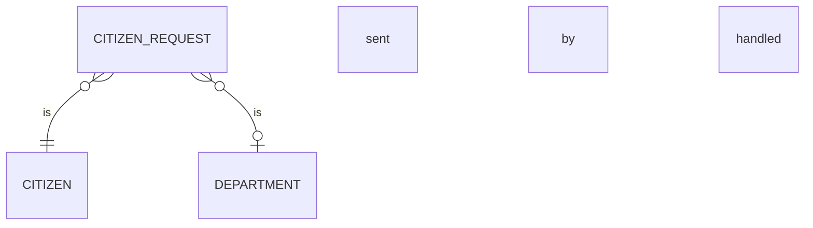
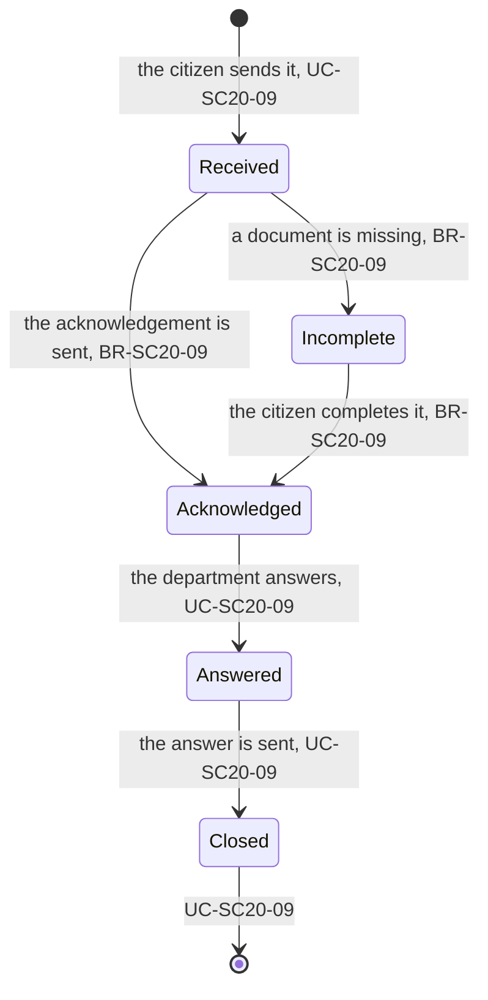

🏠 [Specs](../../../README.md) › 🏷️ [Sectors](../../README.md) › 🏛️ [SC20 Public bodies](../README.md) ›
🗃️ [Data](README.md) › 🗃️ E-SC20-08 Citizen request

# 🗃️ E-SC20-08 Citizen request

**Status:** ✅ specified

## Purpose

One request from a citizen to the body, with its type, documents, deadline, department and answer
([D564](../../../06-decisions/sectors/d564-benchmark-gaps-sc20-public-bodies.md)). It is not a customer-support ticket
([E-F16-01](../../../02-functional/f16-customer-support-agents/data/e-f16-01-customer-request.md)): it carries a legal
deadline and the meaning of silence.

## Fields

| Name | Type | Required | Validation | Default | Example | Personal data | Custom fields |
|---|---|---|---|---|---|---|---|
| number | text | yes | unique | next number | R-8412 | no | no |
| type | text | yes | a request type of the body | - | Road defect | no | no |
| citizen | person | yes | a person of the portal or entered at the counter | - | M. Roux | no | no |
| documents | list | no | those the type asks | - | photo | no | no |
| received | date and time | yes | set by the system | now | 2027-03-03 09:12 | no | no |
| deadline | date | yes | from the type | computed | 2027-03-18 | no | no |
| department | text | no | a department of the body | - | Roads | no | no |
| answer | text | no | - | - | Repair planned in week 12 | yes | no |
| state | Received, Acknowledged, Incomplete, Answered, Closed | yes | the lifecycle below | Received | Acknowledged | no | no |
| owner | user | yes | a user of the company | the creator | Claire P. | yes | no |

## Relations

- [E-F2-14](../../../02-functional/f02-no-code-configuration/data/e-f02-14-signature-request.md)
- [E-F11-09](../../../02-functional/f11-online-shop/data/e-f11-09-customer-account.md)

## Lifecycle

## Indexes and search

By number, type, citizen, department, deadline and state.

## Retention

Kept as long as the request type's rule says, then deleted or archived
([CR-FR-052](../../../10-country-packs/france/data-protection/cr-fr-052-storage-limitation.md)).

## Audit

Every request, acknowledgement, completion, routing, answer and closure, with who, when and the old and new value.

## Import and export

Export of the register of requests as CSV; import of counter requests from a form.

## Used by

- [UC-SC20-09](../use-cases/03-citizen-services/uc-sc20-09-receive-a-citizens-request.md)
- [UC-SC20-10](../use-cases/03-citizen-services/uc-sc20-10-book-halls-and-equipment.md)

## Open questions

None.

---

⬅️ [E-SC20-07 Public contract](e-sc20-07-public-contract.md) · ⬆️ [Up](README.md) ·
➡️ [E-SC20-09 Hall booking](e-sc20-09-hall-booking.md)
