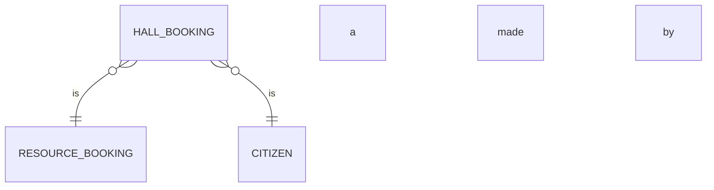
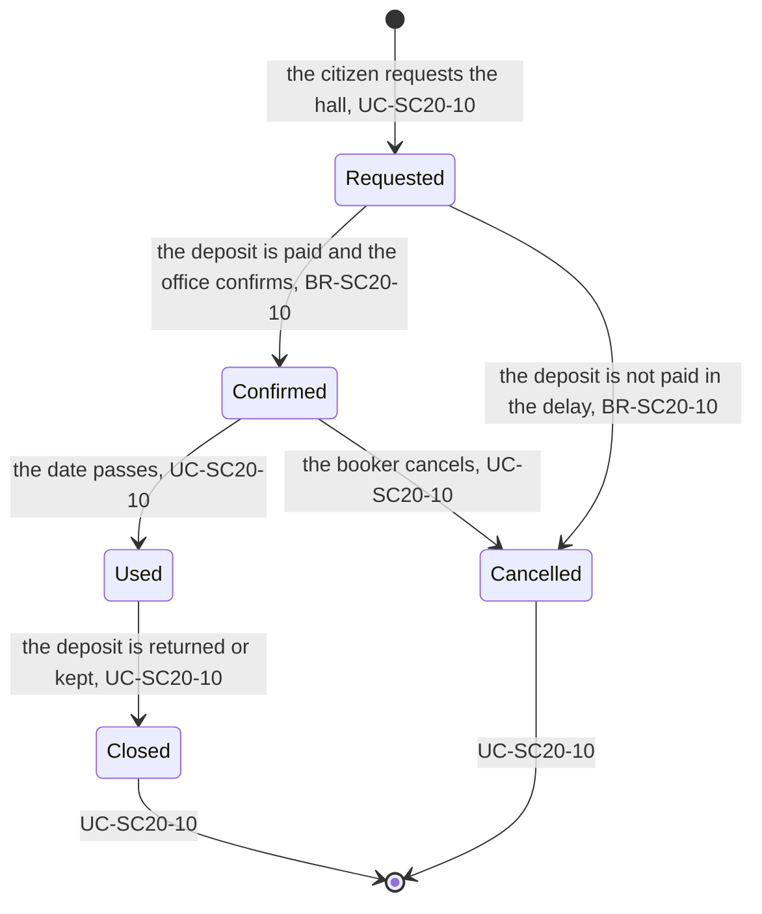

🏠 [Specs](../../../README.md) › 🏷️ [Sectors](../../README.md) › 🏛️ [SC20 Public bodies](../README.md) ›
🗃️ [Data](README.md) › 🗃️ E-SC20-09 Hall booking

# 🗃️ E-SC20-09 Hall booking

**Status:** ✅ specified

## Purpose

One booking of a municipal hall or equipment by a citizen or an association, with its rate and deposit
([D564](../../../06-decisions/sectors/d564-benchmark-gaps-sc20-public-bodies.md)). It is a resource booking
([E-F2-18](../../../02-functional/f02-no-code-configuration/data/e-f02-18-resource-booking.md)) with the rates voted by
the council, the class of user and the deposit that a plain booking has not.

## Fields

| Name | Type | Required | Validation | Default | Example | Personal data | Custom fields |
|---|---|---|---|---|---|---|---|
| resource | hall or equipment | yes | a bookable resource | - | Village hall | no | no |
| date | date | yes | free | - | 2027-06-14 | no | no |
| booker | person | yes | a person or an association | - | Association Les Lilas | no | no |
| class | text | yes | resident, association or other | computed | Association | no | no |
| people | number | yes | not above the capacity | - | 80 | no | no |
| rate | amount | yes | from the council's rates | computed | 120.00 | no | no |
| deposit | amount | yes | from the council's rates | computed | 300.00 | no | no |
| purpose | text | no | - | - | Wedding | no | no |
| state | Requested, Confirmed, Used, Closed, Cancelled | yes | the lifecycle below | Requested | Confirmed | no | no |
| owner | user | yes | a user of the company | the creator | Claire P. | yes | no |

## Relations

- [E-F2-18](../../../02-functional/f02-no-code-configuration/data/e-f02-18-resource-booking.md)
- [E-SC20-03 Payment order](e-sc20-03-payment-order.md)
- [E-F11-06](../../../02-functional/f11-online-shop/data/e-f11-06-payment-provider.md)

## Lifecycle

## Indexes and search

By resource, date, booker, state and class.

## Retention

Kept with the accounts for the revenue
([CR-FR-002](../../../10-country-packs/france/accounting/cr-fr-002-accounting-records-kept-ten-years.md)).

## Audit

Every booking, rate, deposit, confirmation, use and return, with who, when and the old and new value.

## Import and export

Export of the planning of a hall as PDF; no import.

## Used by

- [UC-SC20-10](../use-cases/03-citizen-services/uc-sc20-10-book-halls-and-equipment.md)
- [UC-SC20-11](../use-cases/03-citizen-services/uc-sc20-11-take-online-payments.md)

## Open questions

None.

---

⬅️ [E-SC20-08 Citizen request](e-sc20-08-citizen-request.md) · ⬆️ [Up](README.md) ·
➡️ [E-SC20-10 Council decision](e-sc20-10-council-decision.md)
