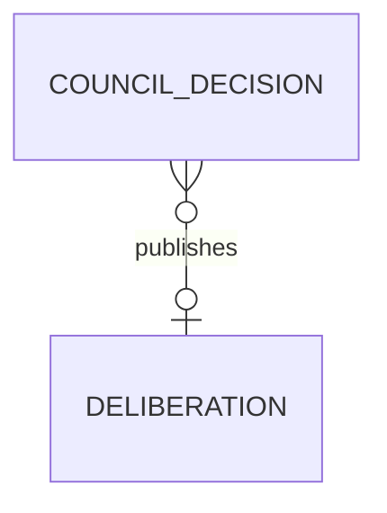
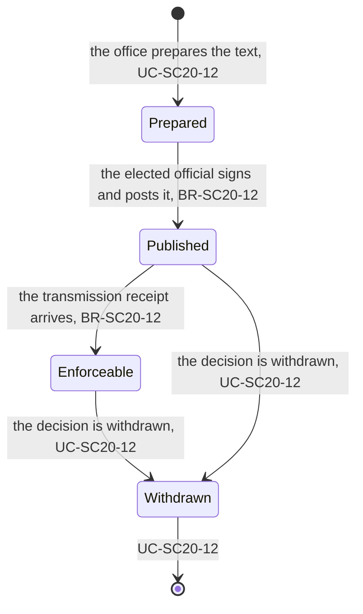

🏠 [Specs](../../../README.md) › 🏷️ [Sectors](../../README.md) › 🏛️ [SC20 Public bodies](../README.md) ›
🗃️ [Data](README.md) › 🗃️ E-SC20-10 Council decision

# 🗃️ E-SC20-10 Council decision

**Status:** ✅ specified

## Purpose

The published form of a decision of the body: its text, signature and the dates of posting, publication, transmission
and enforceability ([D564](../../../06-decisions/sectors/d564-benchmark-gaps-sc20-public-bodies.md)). It is not the
deliberation of the council ([E-SC20-12 Deliberation](e-sc20-12-deliberation.md)), which records the meeting's vote:
this one is the act that citizens read and that becomes enforceable.

## Fields

| Name | Type | Required | Validation | Default | Example | Personal data | Custom fields |
|---|---|---|---|---|---|---|---|
| number | text | yes | unique per year | next number | D-2027-31 | no | no |
| kind | text | yes | deliberation, mayor's order or decision | - | Deliberation | no | no |
| text | document | yes | - | - | decision-31.pdf | no | no |
| signed on | date | no | - | - | 2027-03-10 | no | no |
| posted on | date | no | not before the signature | - | 2027-03-11 | no | no |
| transmitted on | date | no | not before the signature | - | 2027-03-11 | no | no |
| enforceable on | date | no | the later of the posting and the transmission | computed | 2027-03-11 | no | no |
| state | Prepared, Published, Enforceable, Withdrawn | yes | the lifecycle below | Prepared | Published | no | no |
| owner | user | yes | a user of the company | the creator | Claire P. | yes | no |

## Relations

- [E-SC20-12 Deliberation](e-sc20-12-deliberation.md)
- [E-F18-01](../../../02-functional/f18-hosted-websites-and-domains/data/e-f18-01-hosted-website.md)

## Lifecycle

## Indexes and search

By number, kind, state and enforceable date.

## Retention

Kept permanently as a public record.

## Audit

Every text, signature, posting, transmission and withdrawal, with who, when and the old and new value.

## Import and export

Export of the register as PDF and CSV; no import.

## Used by

- [UC-SC20-12](../use-cases/03-citizen-services/uc-sc20-12-publish-council-decisions.md)
- [UC-SC20-17](../use-cases/05-council-registry-permits-and-assets/uc-sc20-17-run-council-meetings-and-deliberations.md)

## Open questions

None.

---

⬅️ [E-SC20-09 Hall booking](e-sc20-09-hall-booking.md) · ⬆️ [Up](README.md) · ➡️ [E-SC20-11 Grade](e-sc20-11-grade.md)
