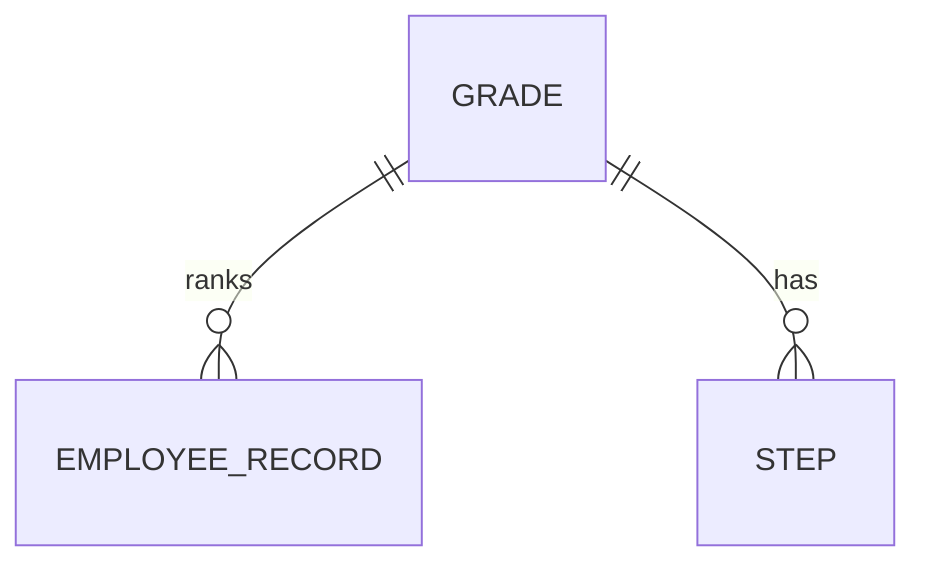
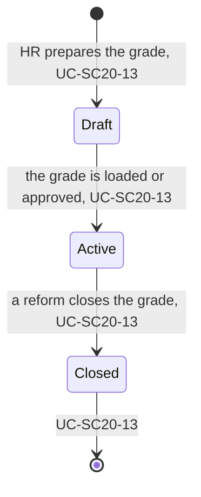

🏠 [Specs](../../../README.md) › 🏷️ [Sectors](../../README.md) › 🏛️ [SC20 Public bodies](../README.md) ›
🗃️ [Data](README.md) › 🗃️ E-SC20-11 Grade

# 🗃️ E-SC20-11 Grade

**Status:** ✅ specified

## Purpose

One grade of a staff category with its steps, index numbers and times
([D564](../../../06-decisions/sectors/d564-benchmark-gaps-sc20-public-bodies.md)). It is not a job position
([E-F9-06 Job position](../../../02-functional/f09-hr-and-projects/data/e-f09-06-job-position.md)): the position is the
post, the grade is the statutory rank that sets the pay.

## Fields

| Name | Type | Required | Validation | Default | Example | Personal data | Custom fields |
|---|---|---|---|---|---|---|---|
| grade | text | yes | a grade of the pack | - | Technician | no | no |
| category | text | yes | a staff category of the pack | - | B | no | no |
| steps | list of step, index number and time | yes | at least one | - | 4, 410, 2 years | no | no |
| valid from | date | yes | - | - | 2027-01-01 | no | no |
| valid until | date | no | after the start | - | - | no | no |
| state | Draft, Active, Closed | yes | the lifecycle below | Draft | Active | no | no |
| owner | user | yes | a user of the company | the creator | Claire P. | yes | no |

## Relations

- [E-F9-01](../../../02-functional/f09-hr-and-projects/data/e-f09-01-employee-record.md)
- [E-F9-06 Job position](../../../02-functional/f09-hr-and-projects/data/e-f09-06-job-position.md)
- [E-F9-02 Contract](../../../02-functional/f09-hr-and-projects/data/e-f09-02-contract.md)

## Lifecycle

## Indexes and search

By grade, category, step and state.

## Retention

Kept permanently, as pay and pension rights depend on the past grades.

## Audit

Every grade, step, index number, placement and step change, with who, when and the old and new value.

## Import and export

Export of the grid as PDF; import of the pack's grid.

## Used by

- [UC-SC20-13](../use-cases/04-public-hr-and-pay/uc-sc20-13-manage-grades-and-steps.md)
- [UC-SC20-14](../use-cases/04-public-hr-and-pay/uc-sc20-14-compute-statutory-pay.md)

## Open questions

None.

---

⬅️ [E-SC20-10 Council decision](e-sc20-10-council-decision.md) · ⬆️ [Up](README.md) ·
➡️ [E-SC20-12 Deliberation](e-sc20-12-deliberation.md)
