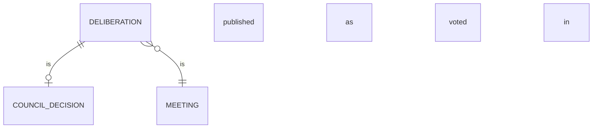
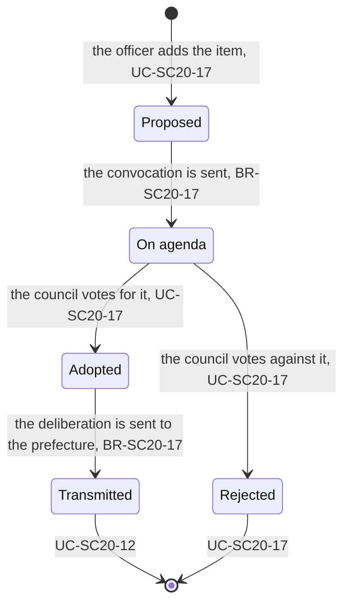

🏠 [Specs](../../../README.md) › 🏷️ [Sectors](../../README.md) › 🏛️ [SC20 Public bodies](../README.md) ›
🗃️ [Data](README.md) › 🗃️ E-SC20-12 Deliberation

# 🗃️ E-SC20-12 Deliberation

**Status:** ✅ specified

## Purpose

One deliberation of the council: its item, the vote, the result and its transmission
([D564](../../../06-decisions/sectors/d564-benchmark-gaps-sc20-public-bodies.md)). It is not a meeting of F4
([E-F4-01 Meeting](../../../02-functional/f04-meetings/data/e-f04-01-meeting.md)), which records what was said: this one
is the act voted and the dates that make it enforceable.

## Fields

| Name | Type | Required | Validation | Default | Example | Personal data | Custom fields |
|---|---|---|---|---|---|---|---|
| meeting | date, time and place | yes | - | - | 2027-03-28 18:30 | no | no |
| item | text | yes | - | - | Budget 2027 | no | no |
| note | document | yes | sent with the convocation | - | note-1.pdf | no | no |
| votes | for, against, abstentions | no | numbers add to those voting | - | 16, 2, 0 | no | no |
| result | text | no | adopted or rejected | computed | Adopted | no | no |
| transmitted on | date | no | after the vote | - | 2027-03-30 | no | no |
| state | Proposed, On agenda, Adopted, Rejected, Transmitted | yes | the lifecycle below | Proposed | On agenda | no | no |
| owner | user | yes | a user of the company | the creator | Claire P. | yes | no |

## Relations

- [E-SC20-10 Council decision](e-sc20-10-council-decision.md)
- [E-F4-01 Meeting](../../../02-functional/f04-meetings/data/e-f04-01-meeting.md)
- [E-SC20-01 Budget](e-sc20-01-budget.md)

## Lifecycle

## Indexes and search

By meeting, item, result and state.

## Retention

Kept permanently as a public record.

## Audit

Every convocation, attendance, vote, result and transmission, with who, when and the old and new value.

## Import and export

Export of the minutes as PDF; no import.

## Used by

- [UC-SC20-17](../use-cases/05-council-registry-permits-and-assets/uc-sc20-17-run-council-meetings-and-deliberations.md)
- [UC-SC20-01](../use-cases/01-public-accounting/uc-sc20-01-prepare-and-vote-the-budget.md)
- [UC-SC20-12](../use-cases/03-citizen-services/uc-sc20-12-publish-council-decisions.md)

## Open questions

None.

---

⬅️ [E-SC20-11 Grade](e-sc20-11-grade.md) · ⬆️ [Up](README.md) · ➡️ [E-SC20-13 Civil record](e-sc20-13-civil-record.md)
