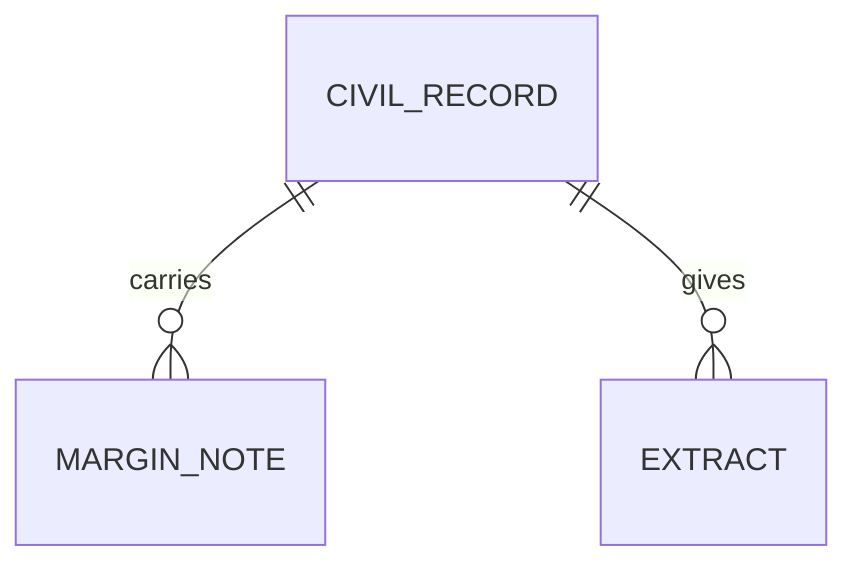
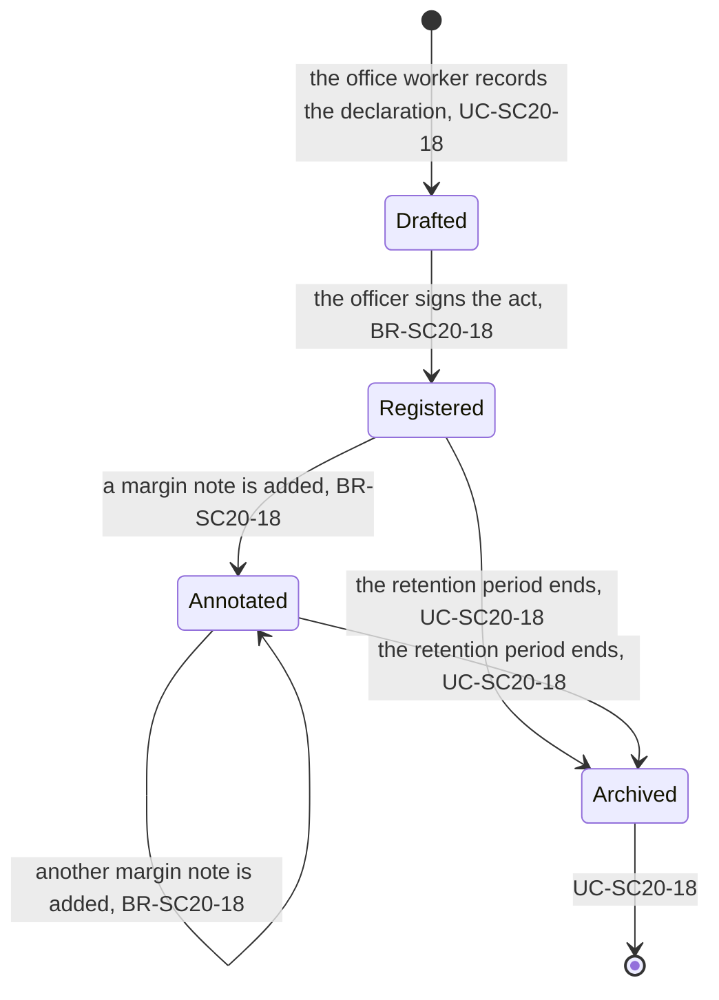

🏠 [Specs](../../../README.md) › 🏷️ [Sectors](../../README.md) › 🏛️ [SC20 Public bodies](../README.md) ›
🗃️ [Data](README.md) › 🗃️ E-SC20-13 Civil record

# 🗃️ E-SC20-13 Civil record

**Status:** ✅ specified

## Purpose

One civil-status act of birth, marriage or death, with its margin notes
([D564](../../../06-decisions/sectors/d564-benchmark-gaps-sc20-public-bodies.md)). It is not a citizen request
([E-SC20-08 Citizen request](e-sc20-08-citizen-request.md)): the request asks for an extract, the record is the act
itself and can never be erased or edited.

## Fields

| Name | Type | Required | Validation | Default | Example | Personal data | Custom fields |
|---|---|---|---|---|---|---|---|
| number | text | yes | unique per year and kind | next number | 2027-B-18 | no | no |
| kind | text | yes | birth, marriage or death | - | Birth | no | no |
| persons | list | yes | as the declaration states | - | Roux, Camille | yes | no |
| date of the event | date | yes | not in the future | - | 2027-02-12 | yes | no |
| declared by | person | yes | a person entitled to declare | - | Roux, Anne | yes | no |
| margin notes | list of note, basis and date | no | added only | - | none | no | no |
| signed by | user | no | the civil-status officer | - | Mayor | no | no |
| state | Drafted, Registered, Annotated, Archived | yes | the lifecycle below | Drafted | Registered | no | no |
| owner | user | yes | a user of the company | the creator | Claire P. | yes | no |

## Relations

- [E-SC20-08 Citizen request](e-sc20-08-citizen-request.md)
- [E-F2-14](../../../02-functional/f02-no-code-configuration/data/e-f02-14-signature-request.md)

## Lifecycle

## Indexes and search

By number, kind, date and state; the persons are searched only by those entitled.

## Retention

Kept for the years the law sets, then handed to the departmental archives; never deleted on request
([CR-FR-052](../../../10-country-packs/france/data-protection/cr-fr-052-storage-limitation.md)).

## Audit

Every act, signature, margin note, extract and access, with who, when and the old and new value.

## Import and export

Export of an extract as PDF; no import.

## Used by

- [UC-SC20-18](../use-cases/05-council-registry-permits-and-assets/uc-sc20-18-keep-the-civil-registry.md)
- [UC-SC20-19](../use-cases/05-council-registry-permits-and-assets/uc-sc20-19-instruct-planning-permits.md)

## Open questions

None.

---

⬅️ [E-SC20-12 Deliberation](e-sc20-12-deliberation.md) · ⬆️ [Up](README.md) ·
➡️ [E-SC20-14 Permit request](e-sc20-14-permit-request.md)
