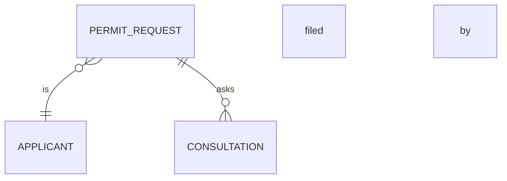
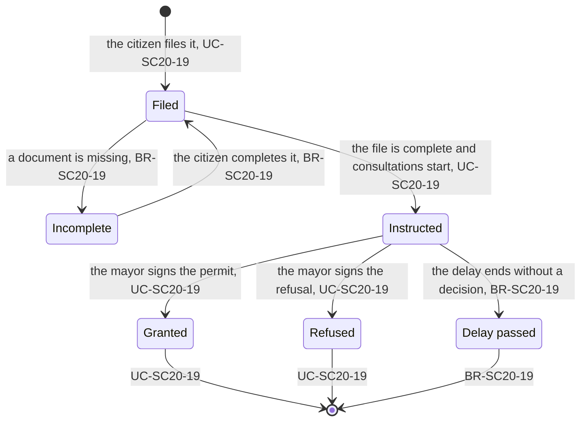

🏠 [Specs](../../../README.md) › 🏷️ [Sectors](../../README.md) › 🏛️ [SC20 Public bodies](../README.md) ›
🗃️ [Data](README.md) › 🗃️ E-SC20-14 Permit request

# 🗃️ E-SC20-14 Permit request

**Status:** ✅ specified

## Purpose

One planning-permit request, with its kind, delay clock, consultations and decision
([D564](../../../06-decisions/sectors/d564-benchmark-gaps-sc20-public-bodies.md)). It is not a plain citizen request
([E-SC20-08 Citizen request](e-sc20-08-citizen-request.md)): it carries the clock that restarts, the consultations and
the effect of silence.

## Fields

| Name | Type | Required | Validation | Default | Example | Personal data | Custom fields |
|---|---|---|---|---|---|---|---|
| number | text | yes | unique per year | next number | PC-2027-031 | no | no |
| kind | text | yes | a kind of the pack | - | Building permit | no | no |
| applicant | person | yes | a person of the portal | - | Garcia | yes | no |
| filed on | date | yes | set by the system | today | 2027-03-03 | no | no |
| complete on | date | no | not before the filing | - | 2027-03-18 | no | no |
| delay ends | date | yes | from the kind and the completion | computed | 2027-05-18 | no | no |
| consultations | list of body and answer | no | - | - | Heritage architect | no | no |
| decision | text | no | granted or refused | - | - | no | no |
| state | Filed, Incomplete, Instructed, Granted, Refused, Delay passed | yes | the lifecycle below | Filed | Incomplete | no | no |
| owner | user | yes | a user of the company | the creator | Claire P. | yes | no |

## Relations

- [E-SC20-08 Citizen request](e-sc20-08-citizen-request.md)
- [E-SC20-10 Council decision](e-sc20-10-council-decision.md)
- [E-SC20-13 Civil record](e-sc20-13-civil-record.md)

## Lifecycle

## Indexes and search

By number, kind, applicant, delay end and state.

## Retention

Kept permanently with the decision, as it is the legal basis of the works.

## Audit

Every filing, completion, consultation, decision, notification and delay, with who, when and the old and new value.

## Import and export

Export of the file as PDF; import of the applicant's plans as documents.

## Used by

- [UC-SC20-19](../use-cases/05-council-registry-permits-and-assets/uc-sc20-19-instruct-planning-permits.md)
- [UC-SC20-18](../use-cases/05-council-registry-permits-and-assets/uc-sc20-18-keep-the-civil-registry.md)

## Open questions

None.

---

⬅️ [E-SC20-13 Civil record](e-sc20-13-civil-record.md) · ⬆️ [Up](README.md) ·
➡️ [E-SC20-15 Public asset](e-sc20-15-public-asset.md)
