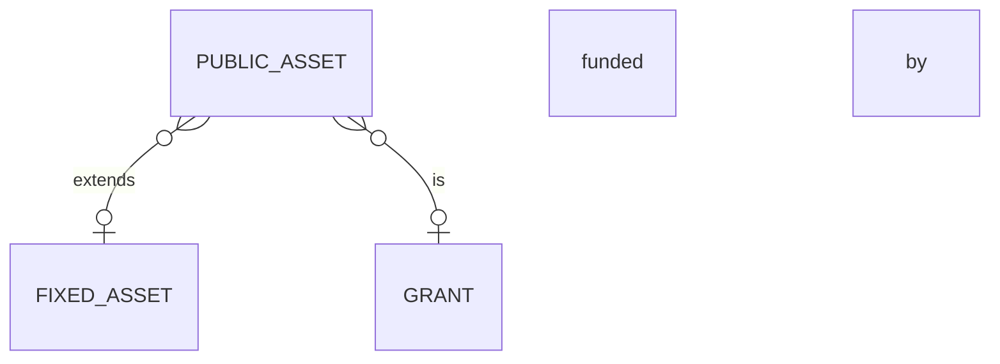
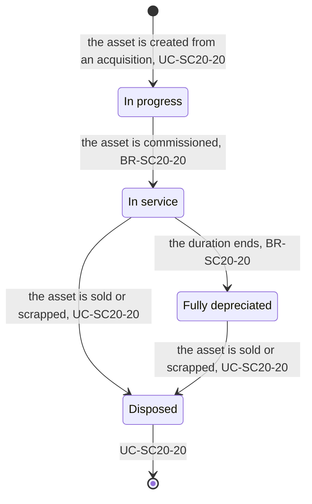

🏠 [Specs](../../../README.md) › 🏷️ [Sectors](../../README.md) › 🏛️ [SC20 Public bodies](../README.md) ›
🗃️ [Data](README.md) › 🗃️ E-SC20-15 Public asset

# 🗃️ E-SC20-15 Public asset

**Status:** ✅ specified

## Purpose

One asset of the body in the public register, with its category, value, commissioning and depreciation
([D564](../../../06-decisions/sectors/d564-benchmark-gaps-sc20-public-bodies.md)). It extends the fixed asset of
accounting ([E-F8-07 Fixed asset](../../../02-functional/f08-accounting/data/e-f08-07-fixed-asset.md)) with the
inventory number shared with the public accountant, the M57 durations and the grants that follow the asset.

## Fields

| Name | Type | Required | Validation | Default | Example | Personal data | Custom fields |
|---|---|---|---|---|---|---|---|
| inventory number | text | yes | unique | next number | A-0412 | no | no |
| asset | text | yes | - | - | Primary school | no | no |
| category | text | yes | a category of the pack | - | Building | no | no |
| value | amount | yes | above 0 | from the order | 2,400,000.00 | no | no |
| commissioned on | date | no | not before the acquisition | - | 2019-09-01 | no | no |
| duration | years | yes | from the category | from the pack | 40 | no | no |
| grant | grant (E-F8-18) | no | a grant for this asset | - | - | no | no |
| accountant's inventory | text | no | the number held by the accountant | - | A-0412 | no | no |
| state | In progress, In service, Fully depreciated, Disposed | yes | the lifecycle below | In progress | In service | no | no |
| owner | user | yes | a user of the company | the creator | Claire P. | yes | no |

## Relations

- [E-F8-07 Fixed asset](../../../02-functional/f08-accounting/data/e-f08-07-fixed-asset.md)
- [E-F8-18 Grant](../../../02-functional/f08-accounting/data/e-f08-18-grant.md)
- [E-SC20-03 Payment order](e-sc20-03-payment-order.md)

## Lifecycle

## Indexes and search

By inventory number, category, state and commissioning date.

## Retention

Kept permanently with the accounts, as the register is part of the body's accounts.

## Audit

Every asset, commissioning, depreciation, disposal and comparison, with who, when and the old and new value.

## Import and export

Export of the register as PDF and in the national data format; import of the accountant's inventory as CSV.

## Used by

- [UC-SC20-20](../use-cases/05-council-registry-permits-and-assets/uc-sc20-20-keep-the-public-assets-register.md)
- [UC-SC20-03](../use-cases/01-public-accounting/uc-sc20-03-issue-payment-orders-and-revenue-titles.md)

## Open questions

None.

---

⬅️ [E-SC20-14 Permit request](e-sc20-14-permit-request.md) · ⬆️ [Up](README.md)
