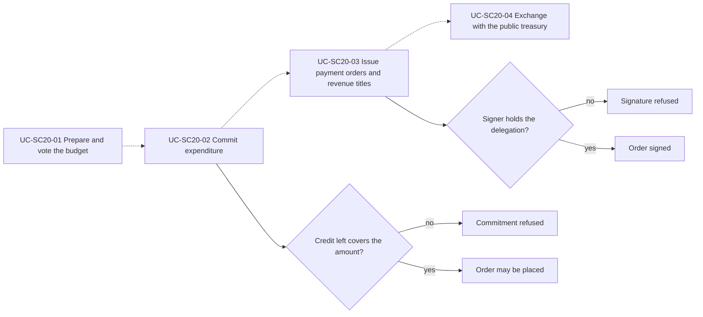
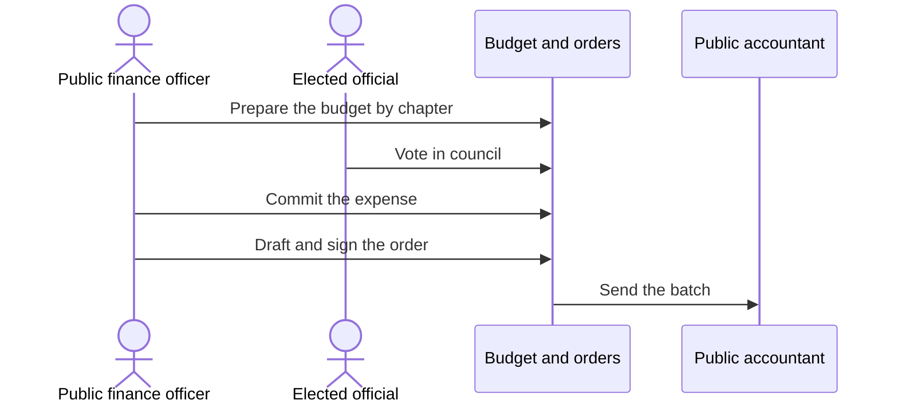

🏠 [Specs](../../../README.md) › 🏷️ [Sectors](../../README.md) › 🏛️ [SC20 Public bodies](../README.md) ›
🔀 [Flows](README.md) › 🔀 FL-SC20-01 Public accounting

# 🔀 FL-SC20-01 Public accounting

**Status:** ✅ specified

## Summary

A local body votes its budget by chapter, commits expenditure before any order, signs payment orders and revenue titles
by the authorising officer, and exchanges them with the public accountant in the national format
([D564](../../../06-decisions/sectors/d564-benchmark-gaps-sc20-public-bodies.md)).

## Personas

- [U54 Public finance officer](../../../01-users/personas/u54-public-finance-officer.md), who prepares the budget,
  commits, drafts the orders and sends the batches
- [U55 Elected official](../../../01-users/personas/u55-elected-official.md), who reviews and votes the budget

## Flowchart

## Sequence diagram

## Steps

| Step | Persona | Screen | Use case | What happens |
|---|---|---|---|---|
| 1 | [U54](../../../01-users/personas/u54-public-finance-officer.md) | [S-SC20-01](../screens/01-public-accounting/s-sc20-01-budget-vote.md) | [UC-SC20-01](../use-cases/01-public-accounting/uc-sc20-01-prepare-and-vote-the-budget.md) | The officer prepares the budget by chapter and the council votes it |
| 2 | [U54](../../../01-users/personas/u54-public-finance-officer.md) | [S-SC20-02](../screens/01-public-accounting/s-sc20-02-commitments.md) | [UC-SC20-02](../use-cases/01-public-accounting/uc-sc20-02-commit-expenditure.md) | The officer commits the expense on its chapter before the order |
| 3 | [U54](../../../01-users/personas/u54-public-finance-officer.md) | [S-SC20-03](../screens/01-public-accounting/s-sc20-03-orders-and-titles.md) | [UC-SC20-03](../use-cases/01-public-accounting/uc-sc20-03-issue-payment-orders-and-revenue-titles.md) | The officer drafts the payment orders and revenue titles and the authorising officer signs them |
| 4 | [U54](../../../01-users/personas/u54-public-finance-officer.md) | [S-SC20-04](../screens/01-public-accounting/s-sc20-04-treasury-exchange.md) | [UC-SC20-04](../use-cases/01-public-accounting/uc-sc20-04-exchange-with-the-public-treasury.md) | The officer sends the signed batch to the public accountant and applies its answers |

### Entities and screens

| Entity | States in this flow | Shown at step and screen | Aggregated view |
|---|---|---|---|
| [E-SC20-01 Budget](../data/e-sc20-01-budget.md) | Draft, Voted, Transmitted, Closed | 1 [S-SC20-01](../screens/01-public-accounting/s-sc20-01-budget-vote.md) | Budgets |
| [E-SC20-02 Commitment](../data/e-sc20-02-commitment.md) | Open, Partly used, Closed | 2 [S-SC20-02](../screens/01-public-accounting/s-sc20-02-commitments.md) | Commitments |
| [E-SC20-03 Payment order](../data/e-sc20-03-payment-order.md) | Drafted, Signed, Sent, Paid, Rejected | 3 [S-SC20-03](../screens/01-public-accounting/s-sc20-03-orders-and-titles.md) | Orders and titles |
| [E-SC20-04 Treasury exchange](../data/e-sc20-04-treasury-exchange.md) | Prepared, Sent, Accepted, Rejected | 4 [S-SC20-04](../screens/01-public-accounting/s-sc20-04-treasury-exchange.md) | Treasury exchanges |

## Errors

- **E1 The credit is exceeded.** A commitment is above the credit left on its chapter: it is refused and the officer is
  shown the credit left and the options of a transfer or a supplementary budget
  ([BR-SC20-02](../business-rules/br-sc20-02-no-order-without-a-prior-commitment.md), step 2).

## Images

Every step and error, for each persona taking part, in light and dark mode (D120). Steps are numbered as in the Steps
table; E rows are the error cases.

| Step | Persona | Device | Light | Dark |
|---|---|---|---|---|
| 1 | U54 | desktop | [light](../images/01-public-accounting/u54-public-finance-officer/1-budget-vote-desktop-light.png) | [dark](../images/01-public-accounting/u54-public-finance-officer/1-budget-vote-desktop-dark.png) |
| 1 | U55 | desktop | [light](../images/01-public-accounting/u55-elected-official/1-budget-vote-desktop-light.png) | [dark](../images/01-public-accounting/u55-elected-official/1-budget-vote-desktop-dark.png) |
| 2 | U54 | desktop | [light](../images/01-public-accounting/u54-public-finance-officer/2-commitments-desktop-light.png) | [dark](../images/01-public-accounting/u54-public-finance-officer/2-commitments-desktop-dark.png) |
| 3 | U54 | desktop | [light](../images/01-public-accounting/u54-public-finance-officer/3-orders-and-titles-desktop-light.png) | [dark](../images/01-public-accounting/u54-public-finance-officer/3-orders-and-titles-desktop-dark.png) |
| 4 | U54 | desktop | [light](../images/01-public-accounting/u54-public-finance-officer/4-treasury-exchange-desktop-light.png) | [dark](../images/01-public-accounting/u54-public-finance-officer/4-treasury-exchange-desktop-dark.png) |
| E1 | U54 | desktop | [light](../images/01-public-accounting/u54-public-finance-officer/e1-the-credit-is-exceeded-desktop-light.png) | [dark](../images/01-public-accounting/u54-public-finance-officer/e1-the-credit-is-exceeded-desktop-dark.png) |

## Open questions

None.

---

⬆️ [Up](README.md) · ➡️ [FL-SC20-02 Public procurement](fl-sc20-02-public-procurement.md)
