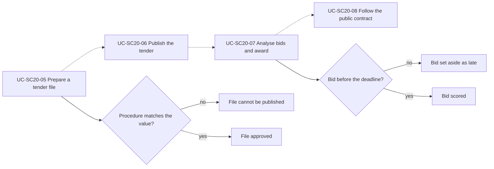
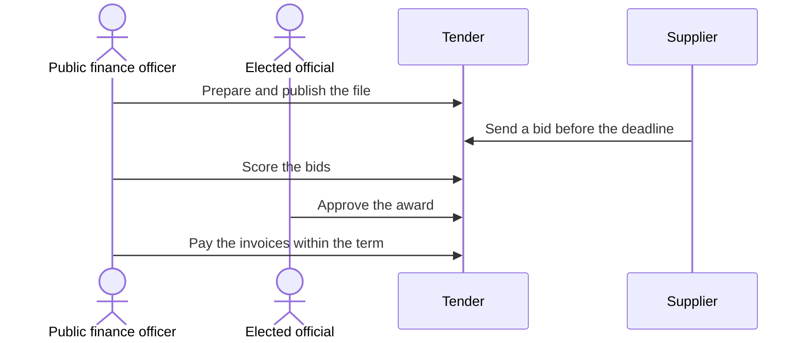

🏠 [Specs](../../../README.md) › 🏷️ [Sectors](../../README.md) › 🏛️ [SC20 Public bodies](../README.md) ›
🔀 [Flows](README.md) › 🔀 FL-SC20-02 Public procurement

# 🔀 FL-SC20-02 Public procurement

**Status:** 🔄 waiting for the owner

## Summary

A public buyer prepares a tender file with the procedure its value requires, publishes it in the legal media, analyses
the bids against the published criteria, awards the contract and pays its invoices within the legal term
([D564](../../../06-decisions/sectors/d564-benchmark-gaps-sc20-public-bodies.md)).

## Personas

- [U54 Public finance officer](../../../01-users/personas/u54-public-finance-officer.md), who prepares, publishes,
  analyses and follows
- [U55 Elected official](../../../01-users/personas/u55-elected-official.md), who approves the award

## Flowchart

## Sequence diagram

## Steps

| Step | Persona | Screen | Use case | What happens |
|---|---|---|---|---|
| 1 | [U54](../../../01-users/personas/u54-public-finance-officer.md) | [S-SC20-05](../screens/02-public-procurement/s-sc20-05-tender-file.md) | [UC-SC20-05](../use-cases/02-public-procurement/uc-sc20-05-prepare-a-tender-file.md) | The officer prepares the file with the procedure the value requires |
| 2 | [U54](../../../01-users/personas/u54-public-finance-officer.md) | [S-SC20-06](../screens/02-public-procurement/s-sc20-06-tender-publication.md) | [UC-SC20-06](../use-cases/02-public-procurement/uc-sc20-06-publish-the-tender.md) | The officer publishes the notice in the legal media and answers the bidders |
| 3 | [U54](../../../01-users/personas/u54-public-finance-officer.md) | [S-SC20-07](../screens/02-public-procurement/s-sc20-07-bid-analysis.md) | [UC-SC20-07](../use-cases/02-public-procurement/uc-sc20-07-analyse-bids-and-award.md) | The officer scores the bids and the elected official approves the award |
| 4 | [U54](../../../01-users/personas/u54-public-finance-officer.md) | [S-SC20-08](../screens/02-public-procurement/s-sc20-08-public-contract.md) | [UC-SC20-08](../use-cases/02-public-procurement/uc-sc20-08-follow-the-public-contract.md) | The officer follows the contract and pays each invoice within the legal term |

### Entities and screens

| Entity | States in this flow | Shown at step and screen | Aggregated view |
|---|---|---|---|
| [E-SC20-05 Tender file](../data/e-sc20-05-tender-file.md) | Draft, Published, Analysed, Awarded, Cancelled | 1 [S-SC20-05](../screens/02-public-procurement/s-sc20-05-tender-file.md) | Tender files |
| [E-SC20-06 Bid](../data/e-sc20-06-bid.md) | Received, Late, Admitted, Rejected, Awarded, Not selected | 3 [S-SC20-07](../screens/02-public-procurement/s-sc20-07-bid-analysis.md) | Bids |
| [E-SC20-07 Public contract](../data/e-sc20-07-public-contract.md) | Signed, In progress, Accepted, Closed, Terminated | 4 [S-SC20-08](../screens/02-public-procurement/s-sc20-08-public-contract.md) | Public contracts |

## Errors

- **E1 A bid is late.** A bid arrives after the deadline: it is marked Late, never opened and the bidder is told
  ([BR-SC20-07](../business-rules/br-sc20-07-award-follows-the-published-criteria.md), step 3).

## Images

Every step and error, for each persona taking part, in light and dark mode (D120). Steps are numbered as in the Steps
table; E rows are the error cases.

| Step | Persona | Device | Light | Dark |
|---|---|---|---|---|
| 1 | U54 | desktop | [light](../images/02-public-procurement/u54-public-finance-officer/1-tender-file-desktop-light.png) | [dark](../images/02-public-procurement/u54-public-finance-officer/1-tender-file-desktop-dark.png) |
| 2 | U54 | desktop | [light](../images/02-public-procurement/u54-public-finance-officer/2-tender-publication-desktop-light.png) | [dark](../images/02-public-procurement/u54-public-finance-officer/2-tender-publication-desktop-dark.png) |
| 3 | U54 | desktop | [light](../images/02-public-procurement/u54-public-finance-officer/3-bid-analysis-desktop-light.png) | [dark](../images/02-public-procurement/u54-public-finance-officer/3-bid-analysis-desktop-dark.png) |
| 3 | U55 | desktop | [light](../images/02-public-procurement/u55-elected-official/3-bid-analysis-desktop-light.png) | [dark](../images/02-public-procurement/u55-elected-official/3-bid-analysis-desktop-dark.png) |
| 4 | U54 | desktop | [light](../images/02-public-procurement/u54-public-finance-officer/4-public-contract-desktop-light.png) | [dark](../images/02-public-procurement/u54-public-finance-officer/4-public-contract-desktop-dark.png) |
| E1 | U54 | desktop | [light](../images/02-public-procurement/u54-public-finance-officer/e1-a-bid-is-late-desktop-light.png) | [dark](../images/02-public-procurement/u54-public-finance-officer/e1-a-bid-is-late-desktop-dark.png) |

## Open questions

None.

---

⬅️ [FL-SC20-01 Public accounting](fl-sc20-01-public-accounting.md) · ⬆️ [Up](README.md) ·
➡️ [FL-SC20-03 Citizen services](fl-sc20-03-citizen-services.md)
