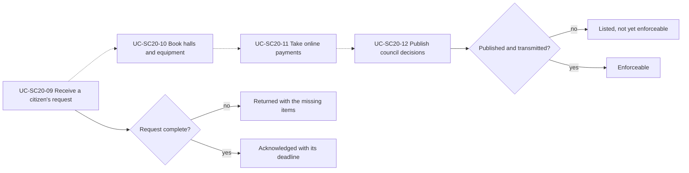
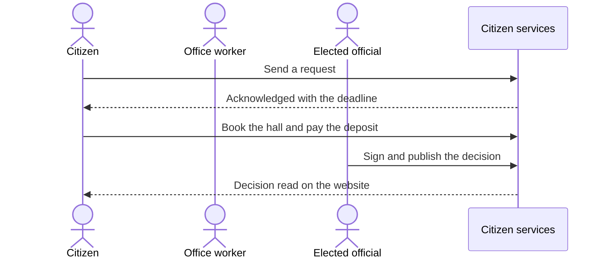

🏠 [Specs](../../../README.md) › 🏷️ [Sectors](../../README.md) › 🏛️ [SC20 Public bodies](../README.md) ›
🔀 [Flows](README.md) › 🔀 FL-SC20-03 Citizen services

# 🔀 FL-SC20-03 Citizen services

**Status:** ✅ specified

## Summary

A citizen sends a request with its acknowledgement and deadline, books a hall at the council's rates, pays online
through the public treasury's channel, and reads the council's decisions, which become enforceable once published and
transmitted ([D564](../../../06-decisions/sectors/d564-benchmark-gaps-sc20-public-bodies.md)).

## Personas

- [U56 Citizen](../../../01-users/personas/u56-citizen.md), who sends requests, books halls and pays
- [U16 Office worker](../../../01-users/personas/u16-office-worker.md), who receives and routes the requests
- [U55 Elected official](../../../01-users/personas/u55-elected-official.md), who signs and publishes the decisions

## Flowchart

## Sequence diagram

## Steps

| Step | Persona | Screen | Use case | What happens |
|---|---|---|---|---|
| 1 | [U56](../../../01-users/personas/u56-citizen.md) | [S-SC20-09](../screens/03-citizen-services/s-sc20-09-citizen-request.md) | [UC-SC20-09](../use-cases/03-citizen-services/uc-sc20-09-receive-a-citizens-request.md) | The citizen sends a request and receives the acknowledgement with the deadline |
| 2 | [U56](../../../01-users/personas/u56-citizen.md) | [S-SC20-10](../screens/03-citizen-services/s-sc20-10-hall-booking.md) | [UC-SC20-10](../use-cases/03-citizen-services/uc-sc20-10-book-halls-and-equipment.md) | The citizen books a hall at the rate of the class of user |
| 3 | [U56](../../../01-users/personas/u56-citizen.md) | [S-SC20-11](../screens/03-citizen-services/s-sc20-11-public-payments.md) | [UC-SC20-11](../use-cases/03-citizen-services/uc-sc20-11-take-online-payments.md) | The citizen pays the bill online through the treasury's channel |
| 4 | [U55](../../../01-users/personas/u55-elected-official.md) | [S-SC20-12](../screens/03-citizen-services/s-sc20-12-council-decisions.md) | [UC-SC20-12](../use-cases/03-citizen-services/uc-sc20-12-publish-council-decisions.md) | The elected official signs and publishes the decision, which becomes enforceable |

### Entities and screens

| Entity | States in this flow | Shown at step and screen | Aggregated view |
|---|---|---|---|
| [E-SC20-08 Citizen request](../data/e-sc20-08-citizen-request.md) | Received, Acknowledged, Incomplete, Answered, Closed | 1 [S-SC20-09](../screens/03-citizen-services/s-sc20-09-citizen-request.md) | Citizen requests |
| [E-SC20-09 Hall booking](../data/e-sc20-09-hall-booking.md) | Requested, Confirmed, Used, Closed, Cancelled | 2 [S-SC20-10](../screens/03-citizen-services/s-sc20-10-hall-booking.md) | Hall bookings |
| [E-SC20-10 Council decision](../data/e-sc20-10-council-decision.md) | Prepared, Published, Enforceable, Withdrawn | 4 [S-SC20-12](../screens/03-citizen-services/s-sc20-12-council-decisions.md) | Council decisions |

## Errors

- **E1 The request is incomplete.** A document is missing: the request is marked Incomplete, the citizen is told what to
  add and by when, and the deadline starts when it is complete
  ([BR-SC20-09](../business-rules/br-sc20-09-requests-are-acknowledged-with-a-deadline.md), step 1).

## Images

Every step and error, for each persona taking part, in light and dark mode (D120). Steps are numbered as in the Steps
table; E rows are the error cases.

| Step | Persona | Device | Light | Dark |
|---|---|---|---|---|
| 1 | U56 | phone | [light](../images/03-citizen-services/u56-citizen/1-citizen-request-phone-light.png) | [dark](../images/03-citizen-services/u56-citizen/1-citizen-request-phone-dark.png) |
| 1 | U16 | desktop | [light](../images/03-citizen-services/u16-office-worker/1-citizen-request-desktop-light.png) | [dark](../images/03-citizen-services/u16-office-worker/1-citizen-request-desktop-dark.png) |
| 2 | U56 | phone | [light](../images/03-citizen-services/u56-citizen/2-hall-booking-phone-light.png) | [dark](../images/03-citizen-services/u56-citizen/2-hall-booking-phone-dark.png) |
| 3 | U56 | phone | [light](../images/03-citizen-services/u56-citizen/3-public-payments-phone-light.png) | [dark](../images/03-citizen-services/u56-citizen/3-public-payments-phone-dark.png) |
| 4 | U55 | desktop | [light](../images/03-citizen-services/u55-elected-official/4-council-decisions-desktop-light.png) | [dark](../images/03-citizen-services/u55-elected-official/4-council-decisions-desktop-dark.png) |
| E1 | U56 | phone | [light](../images/03-citizen-services/u56-citizen/e1-the-request-is-incomplete-phone-light.png) | [dark](../images/03-citizen-services/u56-citizen/e1-the-request-is-incomplete-phone-dark.png) |

## Open questions

None.

---

⬅️ [FL-SC20-02 Public procurement](fl-sc20-02-public-procurement.md) · ⬆️ [Up](README.md) ·
➡️ [FL-SC20-04 Public-sector HR and pay](fl-sc20-04-public-hr-and-pay.md)
