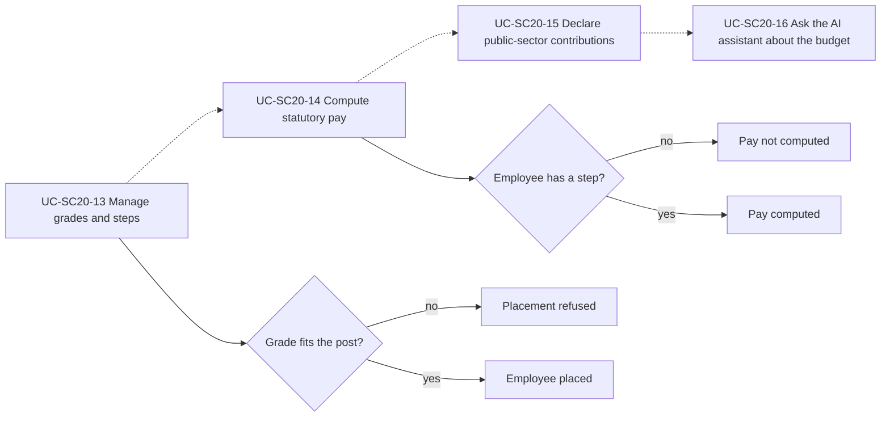
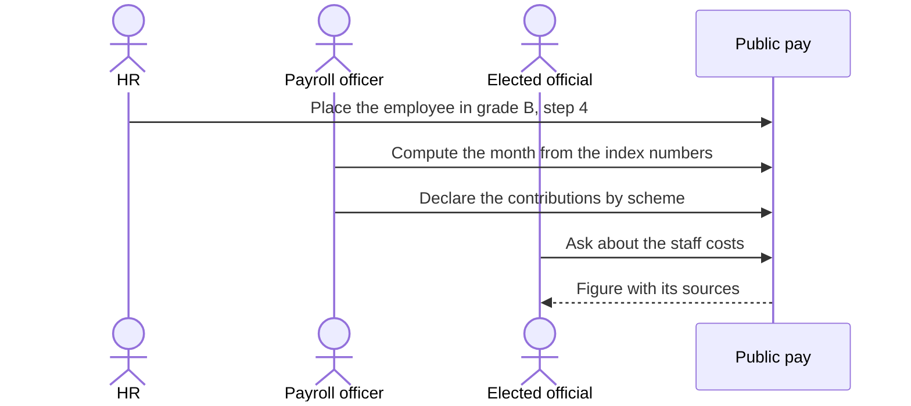

🏠 [Specs](../../../README.md) › 🏷️ [Sectors](../../README.md) › 🏛️ [SC20 Public bodies](../README.md) ›
🔀 [Flows](README.md) › 🔀 FL-SC20-04 Public-sector HR and pay

# 🔀 FL-SC20-04 Public-sector HR and pay

**Status:** 🔄 waiting for the owner

## Summary

HR keeps the grades and steps of civil servants, the payroll officer computes their statutory pay from the index number
and the point value, declares the contributions of each pension scheme, and an elected official asks the AI assistant
about the budget ([D564](../../../06-decisions/sectors/d564-benchmark-gaps-sc20-public-bodies.md)).

## Personas

- [U06 Human resources](../../../01-users/personas/u06-hr.md), who keeps the grades and the step changes
- [U45 Payroll officer](../../../01-users/personas/u45-payroll-officer.md), who computes the pay and declares the
  contributions
- [U55 Elected official](../../../01-users/personas/u55-elected-official.md), who asks about the budget

## Flowchart

## Sequence diagram

## Steps

| Step | Persona | Screen | Use case | What happens |
|---|---|---|---|---|
| 1 | [U06](../../../01-users/personas/u06-hr.md) | [S-SC20-13](../screens/04-public-hr-and-pay/s-sc20-13-grades-and-steps.md) | [UC-SC20-13](../use-cases/04-public-hr-and-pay/uc-sc20-13-manage-grades-and-steps.md) | HR places each employee in a grade and a step and approves the step changes |
| 2 | [U45](../../../01-users/personas/u45-payroll-officer.md) | [S-SC20-14](../screens/04-public-hr-and-pay/s-sc20-14-statutory-pay.md) | [UC-SC20-14](../use-cases/04-public-hr-and-pay/uc-sc20-14-compute-statutory-pay.md) | The payroll officer computes the basic pay from the index number and the point value |
| 3 | [U45](../../../01-users/personas/u45-payroll-officer.md) | [S-SC20-15](../screens/04-public-hr-and-pay/s-sc20-15-public-contributions.md) | [UC-SC20-15](../use-cases/04-public-hr-and-pay/uc-sc20-15-declare-public-sector-contributions.md) | The payroll officer declares the contributions of each pension scheme |
| 4 | [U55](../../../01-users/personas/u55-elected-official.md) | [S-SC20-16](../screens/04-public-hr-and-pay/s-sc20-16-budget-assistant.md) | [UC-SC20-16](../use-cases/04-public-hr-and-pay/uc-sc20-16-ask-the-assistant-about-the-budget.md) | The elected official asks the AI assistant about the budget and sees the sources |

### Entities and screens

| Entity | States in this flow | Shown at step and screen | Aggregated view |
|---|---|---|---|
| [E-SC20-11 Grade](../data/e-sc20-11-grade.md) | Draft, Active, Closed | 1 [S-SC20-13](../screens/04-public-hr-and-pay/s-sc20-13-grades-and-steps.md) | Grades |

## Errors

- **E1 The grade does not match the post.** An employee is placed in a grade outside the staff category of their post:
  the placement is refused and HR is shown the categories allowed
  ([BR-SC20-13](../business-rules/br-sc20-13-step-changes-follow-the-seniority-rules.md), step 1).

## Images

Every step and error, for each persona taking part, in light and dark mode (D120). Steps are numbered as in the Steps
table; E rows are the error cases.

| Step | Persona | Device | Light | Dark |
|---|---|---|---|---|
| 1 | U06 | desktop | [light](../images/04-public-hr-and-pay/u06-hr/1-grades-and-steps-desktop-light.png) | [dark](../images/04-public-hr-and-pay/u06-hr/1-grades-and-steps-desktop-dark.png) |
| 2 | U45 | desktop | [light](../images/04-public-hr-and-pay/u45-payroll-officer/2-statutory-pay-desktop-light.png) | [dark](../images/04-public-hr-and-pay/u45-payroll-officer/2-statutory-pay-desktop-dark.png) |
| 3 | U45 | desktop | [light](../images/04-public-hr-and-pay/u45-payroll-officer/3-public-contributions-desktop-light.png) | [dark](../images/04-public-hr-and-pay/u45-payroll-officer/3-public-contributions-desktop-dark.png) |
| 4 | U55 | desktop | [light](../images/04-public-hr-and-pay/u55-elected-official/4-budget-assistant-desktop-light.png) | [dark](../images/04-public-hr-and-pay/u55-elected-official/4-budget-assistant-desktop-dark.png) |
| E1 | U06 | desktop | [light](../images/04-public-hr-and-pay/u06-hr/e1-the-grade-does-not-match-the-post-desktop-light.png) | [dark](../images/04-public-hr-and-pay/u06-hr/e1-the-grade-does-not-match-the-post-desktop-dark.png) |

## Open questions

None.

---

⬅️ [FL-SC20-03 Citizen services](fl-sc20-03-citizen-services.md) · ⬆️ [Up](README.md) ·
➡️ [FL-SC20-05 Council, civil registry, permits and assets](fl-sc20-05-council-registry-permits-and-assets.md)
