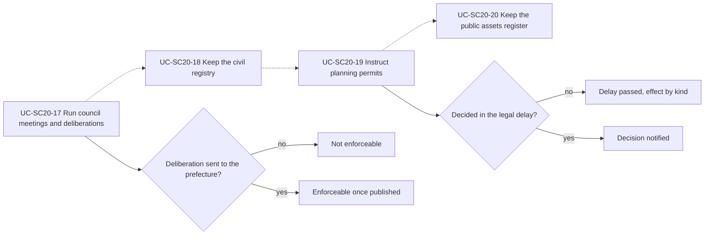
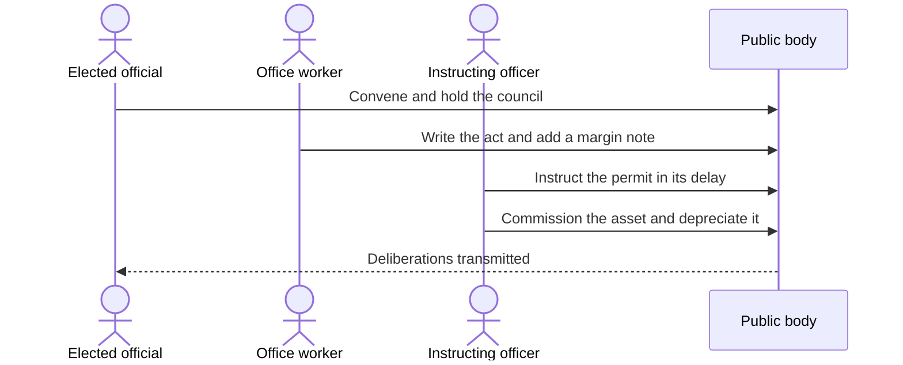

🏠 [Specs](../../../README.md) › 🏷️ [Sectors](../../README.md) › 🏛️ [SC20 Public bodies](../README.md) ›
🔀 [Flows](README.md) › 🔀 FL-SC20-05 Council, civil registry, permits and assets

# 🔀 FL-SC20-05 Council, civil registry, permits and assets

**Status:** 🔄 waiting for the owner

## Summary

The elected official convenes the council and transmits its deliberations, the civil registry keeps its acts unchanged
except by margin notes, planning permits are instructed inside their legal delay, and the register of public assets is
depreciated under M57 ([D564](../../../06-decisions/sectors/d564-benchmark-gaps-sc20-public-bodies.md)).

## Personas

- [U55 Elected official](../../../01-users/personas/u55-elected-official.md), who convenes the council and signs the
  decisions
- [U54 Public finance officer](../../../01-users/personas/u54-public-finance-officer.md), who keeps the assets and
  instructs the permits
- [U16 Office worker](../../../01-users/personas/u16-office-worker.md), who keeps the civil registry
- [U56 Citizen](../../../01-users/personas/u56-citizen.md), who asks for extracts and files permit requests

## Flowchart

## Sequence diagram

## Steps

| Step | Persona | Screen | Use case | What happens |
|---|---|---|---|---|
| 1 | [U55](../../../01-users/personas/u55-elected-official.md) | [S-SC20-17](../screens/05-council-registry-permits-and-assets/s-sc20-17-council-meetings.md) | [UC-SC20-17](../use-cases/05-council-registry-permits-and-assets/uc-sc20-17-run-council-meetings-and-deliberations.md) | The elected official convenes the council, records the votes and transmits the deliberations |
| 2 | [U16](../../../01-users/personas/u16-office-worker.md) | [S-SC20-18](../screens/05-council-registry-permits-and-assets/s-sc20-18-civil-registry.md) | [UC-SC20-18](../use-cases/05-council-registry-permits-and-assets/uc-sc20-18-keep-the-civil-registry.md) | The office worker writes the civil acts and corrects them only by margin notes |
| 3 | [U54](../../../01-users/personas/u54-public-finance-officer.md) | [S-SC20-19](../screens/05-council-registry-permits-and-assets/s-sc20-19-planning-permits.md) | [UC-SC20-19](../use-cases/05-council-registry-permits-and-assets/uc-sc20-19-instruct-planning-permits.md) | The instructing officer follows each permit request to its decision inside the legal delay |
| 4 | [U54](../../../01-users/personas/u54-public-finance-officer.md) | [S-SC20-20](../screens/05-council-registry-permits-and-assets/s-sc20-20-public-assets.md) | [UC-SC20-20](../use-cases/05-council-registry-permits-and-assets/uc-sc20-20-keep-the-public-assets-register.md) | The officer keeps the register of public assets and depreciates them under M57 |

### Entities and screens

| Entity | States in this flow | Shown at step and screen | Aggregated view |
|---|---|---|---|
| [E-SC20-12 Deliberation](../data/e-sc20-12-deliberation.md) | Proposed, On agenda, Adopted, Rejected, Transmitted | 1 [S-SC20-17](../screens/05-council-registry-permits-and-assets/s-sc20-17-council-meetings.md) | Deliberations |
| [E-SC20-13 Civil record](../data/e-sc20-13-civil-record.md) | Drafted, Registered, Annotated, Archived | 2 [S-SC20-18](../screens/05-council-registry-permits-and-assets/s-sc20-18-civil-registry.md) | Civil records |
| [E-SC20-14 Permit request](../data/e-sc20-14-permit-request.md) | Filed, Incomplete, Instructed, Granted, Refused, Delay passed | 3 [S-SC20-19](../screens/05-council-registry-permits-and-assets/s-sc20-19-planning-permits.md) | Permit requests |
| [E-SC20-15 Public asset](../data/e-sc20-15-public-asset.md) | In progress, In service, Fully depreciated, Disposed | 4 [S-SC20-20](../screens/05-council-registry-permits-and-assets/s-sc20-20-public-assets.md) | Public assets |

## Errors

- **E1 The legal delay has passed.** A permit request is not decided in its delay: it is marked Delay passed, the effect
  the law gives silence for its kind is recorded and the elected official is told
  ([BR-SC20-19](../business-rules/br-sc20-19-silence-after-the-legal-delay-counts-as-the-law-says.md), step 3).

## Images

Every step and error, for each persona taking part, in light and dark mode (D120). Steps are numbered as in the Steps
table; E rows are the error cases.

| Step | Persona | Device | Light | Dark |
|---|---|---|---|---|
| 1 | U55 | desktop | [light](../images/05-council-registry-permits-and-assets/u55-elected-official/1-council-meetings-desktop-light.png) | [dark](../images/05-council-registry-permits-and-assets/u55-elected-official/1-council-meetings-desktop-dark.png) |
| 1 | U54 | desktop | [light](../images/05-council-registry-permits-and-assets/u54-public-finance-officer/1-council-meetings-desktop-light.png) | [dark](../images/05-council-registry-permits-and-assets/u54-public-finance-officer/1-council-meetings-desktop-dark.png) |
| 2 | U16 | desktop | [light](../images/05-council-registry-permits-and-assets/u16-office-worker/2-civil-registry-desktop-light.png) | [dark](../images/05-council-registry-permits-and-assets/u16-office-worker/2-civil-registry-desktop-dark.png) |
| 2 | U56 | phone | [light](../images/05-council-registry-permits-and-assets/u56-citizen/2-civil-registry-phone-light.png) | [dark](../images/05-council-registry-permits-and-assets/u56-citizen/2-civil-registry-phone-dark.png) |
| 2 | U16 | phone | [light](../images/05-council-registry-permits-and-assets/u16-office-worker/2-civil-registry-phone-light.png) | [dark](../images/05-council-registry-permits-and-assets/u16-office-worker/2-civil-registry-phone-dark.png) |
| 3 | U54 | desktop | [light](../images/05-council-registry-permits-and-assets/u54-public-finance-officer/3-planning-permits-desktop-light.png) | [dark](../images/05-council-registry-permits-and-assets/u54-public-finance-officer/3-planning-permits-desktop-dark.png) |
| 3 | U56 | phone | [light](../images/05-council-registry-permits-and-assets/u56-citizen/3-planning-permits-phone-light.png) | [dark](../images/05-council-registry-permits-and-assets/u56-citizen/3-planning-permits-phone-dark.png) |
| 4 | U54 | desktop | [light](../images/05-council-registry-permits-and-assets/u54-public-finance-officer/4-public-assets-desktop-light.png) | [dark](../images/05-council-registry-permits-and-assets/u54-public-finance-officer/4-public-assets-desktop-dark.png) |
| E1 | U55 | desktop | [light](../images/05-council-registry-permits-and-assets/u55-elected-official/e1-the-legal-delay-has-passed-desktop-light.png) | [dark](../images/05-council-registry-permits-and-assets/u55-elected-official/e1-the-legal-delay-has-passed-desktop-dark.png) |

## Open questions

None.

---

⬅️ [FL-SC20-04 Public-sector HR and pay](fl-sc20-04-public-hr-and-pay.md) · ⬆️ [Up](README.md)
