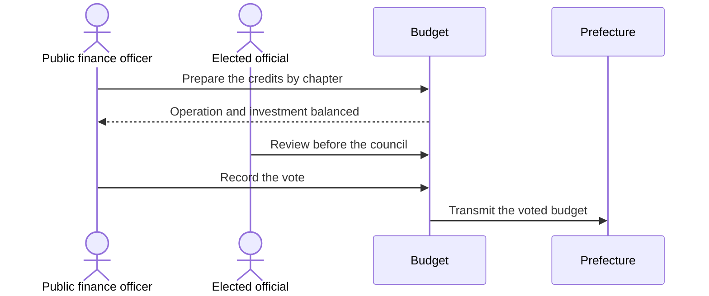

🏠 [Specs](../../../../README.md) › 🏷️ [Sectors](../../../README.md) › 🏛️ [SC20 Public bodies](../../README.md) ›
📝 [Use cases](../README.md) › 📝 [Use cases: FL-SC20-01 Public accounting](README.md) ›
📝 UC-SC20-01 Prepare and vote the budget

# 📝 UC-SC20-01 Prepare and vote the budget

**Status:** ✅ specified

## Summary

The public finance officer prepares the yearly budget of a commune by chapter, for operation and for investment, with
the revenue expected, and the council votes it. The vote opens the credits that expenditure may use.

## Personas

- [U54 Public finance officer](../../../../01-users/personas/u54-public-finance-officer.md)
- [U55 Elected official](../../../../01-users/personas/u55-elected-official.md)

## Goal

The budget is prepared on time, voted by chapter and transmitted, and the credits voted become the ceiling for every
commitment.

## Trigger

The budget season starts, the council votes the budget, or a supplementary budget is needed.

## Frequency

One budget a year, plus a few supplementary budgets.

## Preconditions

- The accounting framework M57 is set for the body
  ([E-F8-01 Account](../../../../02-functional/f08-accounting/data/e-f08-01-account.md)).
- The previous year's accounts and the multi-year investment plan are available.
- A council meeting is scheduled
  ([UC-SC20-17](../05-council-registry-permits-and-assets/uc-sc20-17-run-council-meetings-and-deliberations.md)).

## Postconditions

- **Succeeded:** the budget is saved ([E-SC20-01 Budget](../../data/e-sc20-01-budget.md)) with its chapters, its credits
  voted and its vote date, and transmitted to the prefecture.
- **Failed:** a budget is not voted unbalanced, a credit above the voted amount is never opened, and a vote after the
  legal date is flagged.

## Main flow

1. The public finance officer opens the budget screen
   ([S-SC20-01 Budget vote](../../screens/01-public-accounting/s-sc20-01-budget-vote.md)) and starts the year's budget
   from the last year's accounts.
2. The officer enters the expected revenue and the credits by chapter, for operation and for investment.
3. SimpleERP checks that operation and investment are each balanced
   ([BR-SC20-01](../../business-rules/br-sc20-01-expenditure-stays-within-voted-credits.md)).
4. The elected official reviews the budget on the desktop and the debate is held in council.
5. After the vote the officer records the vote date, the result and the credits voted.
6. SimpleERP transmits the budget to the prefecture and opens the credits.

## Alternative flows

- 3a. The budget is not balanced: the vote cannot be recorded and the gap is shown.
- 6a. The vote is after the legal date: the delay is flagged and the prefect's procedure is noted.
- 2a. A supplementary budget is made: the credits are added to the voted ones and voted again.

## Error flows

- 3e. A chapter has no credit: the budget cannot be sent to the council.
- 6e. The transmission to the prefecture fails: it is kept and retried, and the officer is told.
- Any step: a service does not answer; the call is retried first
  ([BR-F3-32](../../../../02-functional/f03-assistant/business-rules/br-f03-32-retry-before-an-error.md)), then the
  message follows the error pattern ([D122](../../../../06-decisions/ux/d122-error-message-standard.md)) and what the
  user typed stays on the screen.

## Business rules

- [BR-SC20-01](../../business-rules/br-sc20-01-expenditure-stays-within-voted-credits.md)
- [BR-SC20-02](../../business-rules/br-sc20-02-no-order-without-a-prior-commitment.md)

## Entities

- [E-SC20-01 Budget](../../data/e-sc20-01-budget.md): created, voted, transmitted
- [E-F8-08](../../../../02-functional/f08-accounting/data/e-f08-08-accounting-budget.md): read, the accounting budget
  the credits follow
- [E-F8-16 Budget plan](../../../../02-functional/f08-accounting/data/e-f08-16-budget-plan.md): read, the multi-year
  plan
- [E-SC20-12 Deliberation](../../data/e-sc20-12-deliberation.md): read, the deliberation that votes it

## Permissions

Public finance officer prepares and records the vote; elected official reviews, votes in council and signs.
Other staff read the voted budget only.

## Notifications

The elected official, by email: the budget to read before the council. The officer, in the app: the legal vote date
approaching.

## Audit events

Each credit entered or changed, each vote, each transmission, who and when.

## AI involvement

No AI step of its own. The AI assistant may open the screen and prefill it from the user's words; the user checks and
confirms
[BR-F3-07](../../../../02-functional/f03-assistant/business-rules/br-f03-07-no-deletes-no-irreversible-acts.md).

## API, MCP and A2A exposure

T5 operations of the capability for the personas above: create, read, update and list. The MCP tool of the
capability may read and propose, never confirm alone. No A2A skill.

## Screens

- [S-SC20-01 Budget vote](../../screens/01-public-accounting/s-sc20-01-budget-vote.md)

## Flowchart

See [FL-SC20-01 Public accounting](../../flows/fl-sc20-01-public-accounting.md#flowchart).

## Sequence diagram

## Acceptance criteria

1. **Given** a budget with operation and investment balanced **when** the officer records the vote **then** the credits
   are opened.
2. **Given** an unbalanced budget **when** the officer records the vote **then** it is refused and the gap is shown.
3. **Given** a transmission that fails **when** the officer saves **then** it is kept and retried.

## Non-functional notes

The screen answers within 2 seconds for 10,000 records; every change is audited.

## Regulatory references

A local body votes its budget by 15 April (30 April in the year its assembly is renewed), after a report on its
orientations in communes of 3 500 inhabitants or more, each section (operation, investment) voted in balance with
sincere estimates (CGCT L1612-2, L1612-4, L2312-1); a budget not adopted in time is referred by the prefect to the
regional audit chamber. The budget is transmitted to the prefecture, which checks its legality. Dates and sizes are data
of the France pack. The accounting framework M57 is mandatory for the bodies the law lists and
optional for the other local bodies (CR-FR-250). Related:
[CR-FR-064](../../../../10-country-packs/france/accounting/cr-fr-064-accounting-frameworks.md).

- France-pack rule (the dates, the balance and the scope of M57 read):
  [CR-FR-250 Public accounting M57](../../../../10-country-packs/france/accounting/cr-fr-250-public-accounting-m57.md)

## Related use cases

- [UC-SC20-02 Commit expenditure](uc-sc20-02-commit-expenditure.md)
- [UC-F8-19](../../../../02-functional/f08-accounting/use-cases/06-benchmark-additions/uc-f08-19-plan-and-forecast.md)
- [UC-F8-09](../../../../02-functional/f08-accounting/use-cases/04-tax-assets-and-analytics/uc-f08-09-track-analytics-and-budgets.md)

## Open questions

None.

---

⬆️ [Up](README.md) · ➡️ [UC-SC20-02 Commit expenditure](uc-sc20-02-commit-expenditure.md)
