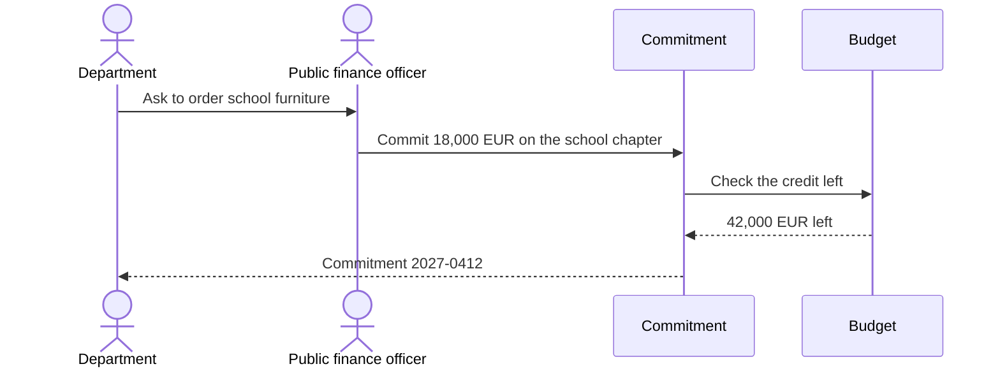

🏠 [Specs](../../../../README.md) › 🏷️ [Sectors](../../../README.md) › 🏛️ [SC20 Public bodies](../../README.md) ›
📝 [Use cases](../README.md) › 📝 [Use cases: FL-SC20-01 Public accounting](README.md) › 📝 UC-SC20-02 Commit expenditure

# 📝 UC-SC20-02 Commit expenditure

**Status:** ✅ specified

## Summary

Before any order is placed, the public finance officer records a commitment on the budget chapter: the amount reserved,
the supplier and the purpose. The commitment is the condition of the order and of the payment later.

## Personas

- [U54 Public finance officer](../../../../01-users/personas/u54-public-finance-officer.md)

## Goal

No order is placed without a commitment that the voted credit can bear, so that spending is controlled before it
happens.

## Trigger

A department wants to order, a contract is signed, or a recurring expense starts.

## Frequency

Dozens a week for a commune; hundreds for a group.

## Preconditions

- The budget is voted ([E-SC20-01 Budget](../../data/e-sc20-01-budget.md)).
- The expense has a chapter and a purpose.
- The supplier is a record
  ([E-F7-01](../../../../02-functional/f07-purchasing-and-stock/data/e-f07-01-supplier-record.md)).

## Postconditions

- **Succeeded:** the commitment is saved ([E-SC20-02 Commitment](../../data/e-sc20-02-commitment.md)) with its chapter,
  amount, supplier and number, and the credit left on the chapter is lowered.
- **Failed:** no order is placed against a refused commitment, a commitment never exceeds the credit left, and the
  commitment number is on every order.

## Main flow

1. A department asks for an order; the public finance officer opens the commitments screen
   ([S-SC20-02 Commitments](../../screens/01-public-accounting/s-sc20-02-commitments.md)).
2. The officer picks the chapter and enters the amount, the supplier and the purpose.
3. SimpleERP checks the credit left on the chapter
   ([BR-SC20-02](../../business-rules/br-sc20-02-no-order-without-a-prior-commitment.md)).
4. If the credit is enough, the commitment is made and its number is given to the department.
5. The department places the order with the commitment number
   [UC-F7-02](../../../../02-functional/f07-purchasing-and-stock/use-cases/01-procure/uc-f07-02-order-from-a-supplier.md).
6. As invoices are paid, the commitment is used and closed.

## Alternative flows

- 3a. The credit is not enough: the officer proposes a transfer between chapters, which needs a vote or a delegation, or
  a supplementary budget.
- 6a. The order costs less than planned: the unused amount is released.
- 2a. A multi-year contract: the commitment is split by year.

## Error flows

- 3e. The credit left is not enough and no transfer is possible: the commitment is refused.
- 5e. An order is placed without a commitment number: it cannot be sent to the supplier.
- Any step: a service does not answer; the call is retried first
  ([BR-F3-32](../../../../02-functional/f03-assistant/business-rules/br-f03-32-retry-before-an-error.md)), then the
  message follows the error pattern ([D122](../../../../06-decisions/ux/d122-error-message-standard.md)) and what the
  user typed stays on the screen.

## Business rules

- [BR-SC20-02](../../business-rules/br-sc20-02-no-order-without-a-prior-commitment.md)
- [BR-SC20-01](../../business-rules/br-sc20-01-expenditure-stays-within-voted-credits.md)

## Entities

- [E-SC20-02 Commitment](../../data/e-sc20-02-commitment.md): created, used, closed
- [E-SC20-01 Budget](../../data/e-sc20-01-budget.md): read and changed, the credit left
- [E-F7-02](../../../../02-functional/f07-purchasing-and-stock/data/e-f07-02-purchase-request.md): read, the purchase
  request
- [E-F7-03](../../../../02-functional/f07-purchasing-and-stock/data/e-f07-03-purchase-order.md): read, the order that
  carries the number

## Permissions

Public finance officer makes and closes commitments; departments request and read theirs; the elected official reads the
totals. A commitment above a threshold needs the authorising officer's signature.

## Notifications

The department, in the app: the commitment number or the refusal. The officer, in the app: a chapter above 90 percent of
its credit.

## Audit events

Each commitment made, used, released and refused, who and when.

## AI involvement

No AI step of its own. The AI assistant may open the screen and prefill it from the user's words; the user checks and
confirms
[BR-F3-07](../../../../02-functional/f03-assistant/business-rules/br-f03-07-no-deletes-no-irreversible-acts.md).

## API, MCP and A2A exposure

T5 operations of the capability for the personas above: create, read, update and list. The MCP tool of the
capability may read and propose, never confirm alone. No A2A skill.

## Screens

- [S-SC20-02 Commitments](../../screens/01-public-accounting/s-sc20-02-commitments.md)

## Flowchart

See [FL-SC20-01 Public accounting](../../flows/fl-sc20-01-public-accounting.md#flowchart).

## Sequence diagram

## Acceptance criteria

1. **Given** a chapter with 42,000 EUR left **when** the officer commits 18,000 EUR **then** the commitment is made and
   the credit left is 24,000 EUR.
2. **Given** a chapter with 10,000 EUR left **when** the officer commits 18,000 EUR **then** it is refused.
3. **Given** an order without a commitment number **when** the department sends it **then** it is refused.

## Non-functional notes

The screen answers within 2 seconds for 10,000 records; every change is audited.

## Regulatory references

A local body commits expenditure before ordering: the authorising officer reserves the credit, and the commitment is the
first step before the order, the service done, the payment order and the payment by the public accountant. Commitments
above the credit voted are irregular. The chapters and thresholds are data of the France pack. Since the
budget year 2026 the mayor or the president keeps the commitment accounts, under a joint ministerial order (CGCT
L1612-38, created by Ordonnance n° 2025-526, which repealed L2342-2), and the accountant pays only within the credits
opened (L1612-39, [CR-FR-250](../../../../10-country-packs/france/accounting/cr-fr-250-public-accounting-m57.md)).

- France-pack rule on the budget:
  [CR-FR-250 Public accounting M57](../../../../10-country-packs/france/accounting/cr-fr-250-public-accounting-m57.md)

## Related use cases

- [UC-SC20-01 Prepare and vote the budget](uc-sc20-01-prepare-and-vote-the-budget.md)
- [UC-SC20-03](uc-sc20-03-issue-payment-orders-and-revenue-titles.md)
- [UC-SC20-01 Prepare and vote the budget](uc-sc20-01-prepare-and-vote-the-budget.md)
- [UC-SC20-03](uc-sc20-03-issue-payment-orders-and-revenue-titles.md)

## Open questions

None.

---

⬅️ [UC-SC20-01 Prepare and vote the budget](uc-sc20-01-prepare-and-vote-the-budget.md) · ⬆️ [Up](README.md) ·
➡️ [UC-SC20-03 Issue payment orders and revenue titles](uc-sc20-03-issue-payment-orders-and-revenue-titles.md)
