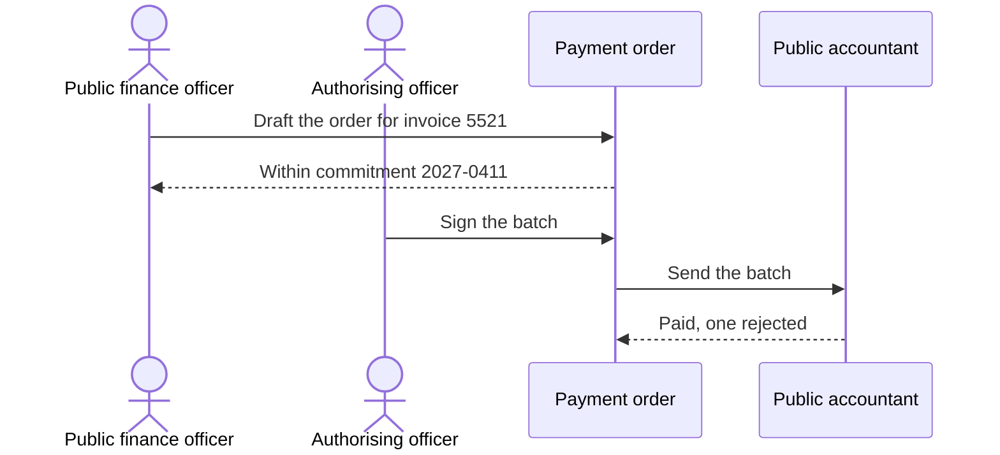

🏠 [Specs](../../../../README.md) › 🏷️ [Sectors](../../../README.md) › 🏛️ [SC20 Public bodies](../../README.md) ›
📝 [Use cases](../README.md) › 📝 [Use cases: FL-SC20-01 Public accounting](README.md) ›
📝 UC-SC20-03 Issue payment orders and revenue titles

# 📝 UC-SC20-03 Issue payment orders and revenue titles

**Status:** ✅ specified, ⚖️ lawyer review before launch (D574)

## Summary

The authorising officer, with the officer's delegates, signs the payment orders (mandates) for expenditure and the
revenue titles for income, with the supporting documents, and sends them to the public accountant who pays and collects.

## Personas

- [U54 Public finance officer](../../../../01-users/personas/u54-public-finance-officer.md)

## Goal

Each expense is ordered for payment only after the service is done, from a commitment, and each revenue is claimed by a
title, with the officer's signature and without the officer touching the money.

## Trigger

A supplier invoice is checked and the service is done, or a revenue falls due.

## Frequency

Daily; a batch at least weekly.

## Preconditions

- A commitment covers the expense ([E-SC20-02 Commitment](../../data/e-sc20-02-commitment.md)).
- The service is certified done by the department.
- The signature delegations are set.

## Postconditions

- **Succeeded:** each payment order or revenue title is saved
  ([E-SC20-03 Payment order](../../data/e-sc20-03-payment-order.md)) signed, with its supporting documents and its
  commitment, ready to be sent to the public accountant.
- **Failed:** an order is not signed by someone without the delegation, an order is not made for more than the
  commitment, and the officer never pays: the accountant does.

## Main flow

1. The public finance officer opens the orders and titles screen
   ([S-SC20-03 Orders and titles](../../screens/01-public-accounting/s-sc20-03-orders-and-titles.md)) and sees the
   invoices checked by the departments.
2. For each invoice the officer drafts a payment order from the commitment and attaches the documents.
3. For each revenue due, such as a hall rental, the officer drafts a revenue title with the debtor and the legal basis.
4. The authorising officer or a delegate signs electronically
   ([BR-SC20-03](../../business-rules/br-sc20-03-orders-are-signed-by-the-authorising-officer.md)).
5. The signed batch goes to the public accountant ([UC-SC20-04](uc-sc20-04-exchange-with-the-public-treasury.md)).
6. The accountant's payment or rejection comes back and the commitment is updated.

## Alternative flows

- 2a. An invoice exceeds the commitment: the order is limited to the commitment and the difference needs a new
  commitment.
- 4a. The mayor is absent: a delegate with the delegation signs and the delegation is shown.
- 6a. The accountant rejects an order: the reason is shown and the officer corrects and sends again.

## Error flows

- 4e. The signer has no delegation for the amount: the signature is refused.
- 2e. A supporting document is missing: the order cannot be signed.
- Any step: a service does not answer; the call is retried first
  ([BR-F3-32](../../../../02-functional/f03-assistant/business-rules/br-f03-32-retry-before-an-error.md)), then the
  message follows the error pattern ([D122](../../../../06-decisions/ux/d122-error-message-standard.md)) and what the
  user typed stays on the screen.

## Business rules

- [BR-SC20-03](../../business-rules/br-sc20-03-orders-are-signed-by-the-authorising-officer.md)
- [BR-SC20-02](../../business-rules/br-sc20-02-no-order-without-a-prior-commitment.md)

## Entities

- [E-SC20-03 Payment order](../../data/e-sc20-03-payment-order.md): created, signed, sent
- [E-SC20-02 Commitment](../../data/e-sc20-02-commitment.md): changed, the commitment is used
- [E-F7-05](../../../../02-functional/f07-purchasing-and-stock/data/e-f07-05-supplier-invoice.md): read, the supplier
  invoice
- [E-F8-38 Payment order](../../../../02-functional/f08-accounting/data/e-f08-38-payment-order.md): read, the private
  payment order this one differs from
- [E-F6-05 Invoice](../../../../02-functional/f06-customers-and-sales/data/e-f06-05-invoice.md): created, the claim of a
  revenue

## Permissions

Public finance officer drafts; the authorising officer and the delegates sign within their delegations; the elected
official reads. Drafting and signing are two different people for each order above a threshold.

## Notifications

The officer, in the app: a rejected order. The signer, in the app: the batch to sign.

## Audit events

Each order and title drafted, signed, sent, paid and rejected, each delegation used, who and when.

## AI involvement

No AI step of its own. The AI assistant may open the screen and prefill it from the user's words; the user checks and
confirms
[BR-F3-07](../../../../02-functional/f03-assistant/business-rules/br-f03-07-no-deletes-no-irreversible-acts.md).

## API, MCP and A2A exposure

T5 operations of the capability for the personas above: create, read, update and list. The MCP tool of the
capability may read and propose, never confirm alone. No A2A skill.

## Screens

- [S-SC20-03 Orders and titles](../../screens/01-public-accounting/s-sc20-03-orders-and-titles.md)

## Flowchart

See [FL-SC20-01 Public accounting](../../flows/fl-sc20-01-public-accounting.md#flowchart).

## Sequence diagram

## Acceptance criteria

1. **Given** an invoice within its commitment **when** the officer drafts the order **then** it is ready to sign.
2. **Given** a signer without delegation **when** he signs an order of 30,000 EUR **then** the signature is refused.
3. **Given** a rejected order **when** the accountant answers **then** the reason is shown and the officer corrects it.

## Non-functional notes

The screen answers within 2 seconds for 10,000 records; every change is audited.

## Regulatory references

The authorising officer orders the payment of expenses and the collection of revenue: it issues payment orders
(mandates) and revenue titles, and does not handle the money, which only the public accountant does after its own
checks. The two functions are kept apart by law. The accountant may suspend a payment that is irregular. The delegations
and thresholds are data of the France pack. (⚖️ lawyer review before launch, D574) The France-pack rule is still to write: to read
the separation of authorising officers and accountants and their controls (décret n° 2012-1246, GBCP). Related:
[CR-FR-091](../../../../10-country-packs/france/invoicing/cr-fr-091-public-contracts-payment-and-chorus-pro.md).

- France-pack rule on the budget:
  [CR-FR-250 Public accounting M57](../../../../10-country-packs/france/accounting/cr-fr-250-public-accounting-m57.md)

## Related use cases

- [UC-SC20-02 Commit expenditure](uc-sc20-02-commit-expenditure.md)
- [UC-SC20-04 Exchange with the public treasury](uc-sc20-04-exchange-with-the-public-treasury.md)
- [UC-SC20-02 Commit expenditure](uc-sc20-02-commit-expenditure.md)
- [UC-SC20-04 Exchange with the public treasury](uc-sc20-04-exchange-with-the-public-treasury.md)

## Open questions

None.

---

⬅️ [UC-SC20-02 Commit expenditure](uc-sc20-02-commit-expenditure.md) · ⬆️ [Up](README.md) ·
➡️ [UC-SC20-04 Exchange with the public treasury](uc-sc20-04-exchange-with-the-public-treasury.md)
