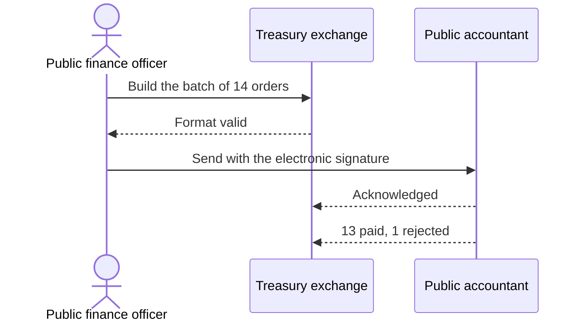

🏠 [Specs](../../../../README.md) › 🏷️ [Sectors](../../../README.md) › 🏛️ [SC20 Public bodies](../../README.md) ›
📝 [Use cases](../README.md) › 📝 [Use cases: FL-SC20-01 Public accounting](README.md) ›
📝 UC-SC20-04 Exchange with the public treasury

# 📝 UC-SC20-04 Exchange with the public treasury

**Status:** ✅ specified, ⚖️ lawyer review before launch (D574)

## Summary

The signed orders and titles travel to the public accountant in a batch, in the national exchange format with an
electronic signature, and the accountant's answers (accepted, paid, rejected) come back and update the records.

## Personas

- [U54 Public finance officer](../../../../01-users/personas/u54-public-finance-officer.md)

## Goal

Every batch reaches the public accountant in the right format and every answer is applied, so that payments and
collections are followed to the end.

## Trigger

A batch of signed orders is ready, or an answer arrives.

## Frequency

At least weekly; more at the month and year end.

## Preconditions

- The orders and titles are signed ([E-SC20-03 Payment order](../../data/e-sc20-03-payment-order.md)).
- The exchange is set with the public accountant's service (identification and certificate).
- The format of the exchange is loaded from the country pack.

## Postconditions

- **Succeeded:** the exchange is saved ([E-SC20-04 Treasury exchange](../../data/e-sc20-04-treasury-exchange.md)) with
  its batch, its sending, its acknowledgement and the answers, and each order shows its outcome.
- **Failed:** a batch is not sent in a wrong format, an unsigned order is never in a batch, and a rejection is applied
  to its order.

## Main flow

1. The public finance officer opens the exchange screen
   ([S-SC20-04 Treasury exchange](../../screens/01-public-accounting/s-sc20-04-treasury-exchange.md)) and sees the
   signed orders waiting.
2. SimpleERP builds the batch in the national exchange format and checks it against the format
   ([BR-SC20-04](../../business-rules/br-sc20-04-files-follow-the-public-treasury-format.md)).
3. The officer sends the batch with the body's electronic signature.
4. The accountant's service acknowledges the batch and processes each order.
5. The answers come back: each order is Paid or Rejected and the officer is told of the rejections.

## Alternative flows

- 2a. A format error is found: the batch is not sent and each error is listed.
- 5a. The accountant asks for a document: the order is marked Rejected with the reason, corrected and sent again.
- 4a. The accountant does not acknowledge in the delay: the officer is warned and may send again.

## Error flows

- 3e. The signature certificate has expired: the batch cannot be sent.
- 5e. An answer refers to an unknown order: it is kept in a list to check by hand.
- Any step: a service does not answer; the call is retried first
  ([BR-F3-32](../../../../02-functional/f03-assistant/business-rules/br-f03-32-retry-before-an-error.md)), then the
  message follows the error pattern ([D122](../../../../06-decisions/ux/d122-error-message-standard.md)) and what the
  user typed stays on the screen.

## Business rules

- [BR-SC20-04](../../business-rules/br-sc20-04-files-follow-the-public-treasury-format.md)
- [BR-SC20-03](../../business-rules/br-sc20-03-orders-are-signed-by-the-authorising-officer.md)

## Entities

- [E-SC20-04 Treasury exchange](../../data/e-sc20-04-treasury-exchange.md): created, sent, answered
- [E-SC20-03 Payment order](../../data/e-sc20-03-payment-order.md): changed, the outcome of each order
- [E-F8-02 Journal](../../../../02-functional/f08-accounting/data/e-f08-02-journal.md): created, the postings after
  payment

## Permissions

Public finance officer prepares and sends; authorising officer signs the batch; the accountant is outside the system.
The signature certificate is kept by the authorising officer.

## Notifications

The officer, in the app: a rejection, a late acknowledgement or a format error.

## Audit events

Each batch built, checked, sent, acknowledged and answered, who and when.

## AI involvement

No AI step of its own. The AI assistant may open the screen and prefill it from the user's words; the user checks and
confirms
[BR-F3-07](../../../../02-functional/f03-assistant/business-rules/br-f03-07-no-deletes-no-irreversible-acts.md).

## API, MCP and A2A exposure

T5 operations of the capability for the personas above: create, read, update and list. The MCP tool of the
capability may read and propose, never confirm alone. No A2A skill.

## Screens

- [S-SC20-04 Treasury exchange](../../screens/01-public-accounting/s-sc20-04-treasury-exchange.md)

## Flowchart

See [FL-SC20-01 Public accounting](../../flows/fl-sc20-01-public-accounting.md#flowchart).

## Sequence diagram

## Acceptance criteria

1. **Given** a batch in the right format **when** the officer sends it **then** it is acknowledged and each order is
   followed.
2. **Given** a batch with a format error **when** the officer builds it **then** it is not sent and the errors are
   listed.
3. **Given** a rejected order **when** the answer comes back **then** the order is Rejected with the reason.

## Non-functional notes

The screen answers within 2 seconds for 10,000 records; every change is audited.

## Regulatory references

Local bodies exchange their orders, titles and accounts with the public accountant in a national electronic format with
a signature. The accountant pays after its checks and may reject an order that is irregular; rejected orders are
corrected and sent again. The format and the signature are data of the France pack. (⚖️ lawyer review before launch, D574) The
France-pack rule is still to write: to read the DGFiP's PES V2 exchange protocol and the list of supporting documents
(CGCT D1617-19 and its annex). Related:
[CR-FR-016](../../../../10-country-packs/france/invoicing/cr-fr-016-electronic-invoicing.md).

- France-pack rule on the budget:
  [CR-FR-250 Public accounting M57](../../../../10-country-packs/france/accounting/cr-fr-250-public-accounting-m57.md)

## Related use cases

- [UC-SC20-03](uc-sc20-03-issue-payment-orders-and-revenue-titles.md)
- [UC-SC20-03](uc-sc20-03-issue-payment-orders-and-revenue-titles.md)
- [UC-F8-06](../../../../02-functional/f08-accounting/use-cases/03-bank-and-collect/uc-f08-06-connect-banks-and-reconcile.md)

## Open questions

None.

---

⬅️ [UC-SC20-03 Issue payment orders and revenue titles](uc-sc20-03-issue-payment-orders-and-revenue-titles.md) ·
⬆️ [Up](README.md) ·
➡️ [UC-SC20-05 Prepare a tender file](../02-public-procurement/uc-sc20-05-prepare-a-tender-file.md)
