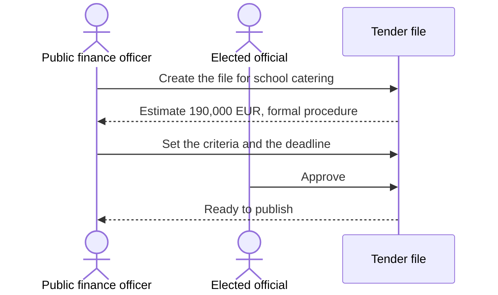

🏠 [Specs](../../../../README.md) › 🏷️ [Sectors](../../../README.md) › 🏛️ [SC20 Public bodies](../../README.md) ›
📝 [Use cases](../README.md) › 📝 [Use cases: FL-SC20-02 Public procurement](README.md) ›
📝 UC-SC20-05 Prepare a tender file

# 📝 UC-SC20-05 Prepare a tender file

**Status:** ✅ specified

## Summary

The public finance officer prepares a tender file for a purchase: the object, the estimated value, the kind (works,
supplies, services), the procedure the thresholds require, the award criteria with their weights, and the dates.

## Personas

- [U54 Public finance officer](../../../../01-users/personas/u54-public-finance-officer.md)

## Goal

Each purchase follows the procedure its estimated value requires, with criteria set and published before bids are
opened.

## Trigger

A department needs works, supplies or services, or a contract reaches its end.

## Frequency

A few a month for a commune; more for a group.

## Preconditions

- The need is entered with its estimate
  ([E-F7-02](../../../../02-functional/f07-purchasing-and-stock/data/e-f07-02-purchase-request.md)).
- The procurement thresholds are loaded from the country pack.
- The budget has the credit ([E-SC20-01 Budget](../../data/e-sc20-01-budget.md)).

## Postconditions

- **Succeeded:** the file is saved ([E-SC20-05 Tender file](../../data/e-sc20-05-tender-file.md)) with its object,
  estimate, procedure, criteria, dates and documents.
- **Failed:** a file is not published with a procedure that does not match its value, the estimate is not split to stay
  under a threshold, and the criteria are fixed before publication.

## Main flow

1. The officer opens the tender file screen
   ([S-SC20-05 Tender file](../../screens/02-public-procurement/s-sc20-05-tender-file.md)) from a purchase need.
2. The officer enters the object, the kind and the estimated value, counting related purchases together.
3. SimpleERP shows the procedure the thresholds require
   ([BR-SC20-05](../../business-rules/br-sc20-05-the-procedure-follows-the-thresholds.md)).
4. The officer sets the award criteria and their weights, the deadline and the documents asked.
5. The officer attaches the specifications and the draft contract.
6. The elected official approves the file when the body requires it.

## Alternative flows

- 3a. The estimate is near a threshold: the file shows the margin and the officer may justify the choice.
- 2a. Several purchases for the same need: they are added up to find the procedure.
- 6a. The file is below the lowest threshold: a simple consultation is kept as proof.

## Error flows

- 3e. The procedure chosen does not match the value: the file cannot be published.
- 4e. The criteria weights do not add up to 100: the file stays in draft.
- Any step: a service does not answer; the call is retried first
  ([BR-F3-32](../../../../02-functional/f03-assistant/business-rules/br-f03-32-retry-before-an-error.md)), then the
  message follows the error pattern ([D122](../../../../06-decisions/ux/d122-error-message-standard.md)) and what the
  user typed stays on the screen.

## Business rules

- [BR-SC20-05](../../business-rules/br-sc20-05-the-procedure-follows-the-thresholds.md)
- [BR-SC20-06](../../business-rules/br-sc20-06-publication-follows-the-legal-media.md)

## Entities

- [E-SC20-05 Tender file](../../data/e-sc20-05-tender-file.md): created, changed
- [E-F7-13](../../../../02-functional/f07-purchasing-and-stock/data/e-f07-13-call-for-tenders.md): read, the private
  call for tenders this one differs from
- [E-SC01-12 Public tender](../../../sc01-construction/data/e-sc01-12-public-tender.md): read, the same tender followed
  from the bidder's side
- [E-F7-02](../../../../02-functional/f07-purchasing-and-stock/data/e-f07-02-purchase-request.md): read, the need

## Permissions

Public finance officer prepares the file; the elected official approves where the body requires it; departments read
their own. The estimate is hidden from bidders.

## Notifications

The elected official, in the app: a file to approve. The officer, in the app: a threshold close to its estimate.

## Audit events

Each estimate, procedure, criterion, weight and approval, who and when.

## AI involvement

No AI step of its own. The AI assistant may open the screen and prefill it from the user's words; the user checks and
confirms
[BR-F3-07](../../../../02-functional/f03-assistant/business-rules/br-f03-07-no-deletes-no-irreversible-acts.md).

## API, MCP and A2A exposure

T5 operations of the capability for the personas above: create, read, update and list. The MCP tool of the
capability may read and propose, never confirm alone. No A2A skill.

## Screens

- [S-SC20-05 Tender file](../../screens/02-public-procurement/s-sc20-05-tender-file.md)

## Flowchart

See [FL-SC20-02 Public procurement](../../flows/fl-sc20-02-public-procurement.md#flowchart).

## Sequence diagram

## Acceptance criteria

1. **Given** an estimate above the formal threshold **when** the officer prepares the file **then** the formal procedure
   is shown.
2. **Given** criteria weights adding to 90 **when** the officer saves **then** the file stays in draft.
3. **Given** two related purchases **when** the officer adds them **then** their total decides the procedure.

## Non-functional notes

The screen answers within 2 seconds for 10,000 records; every change is audited.

## Regulatory references

A public buyer chooses its procedure from the estimated value of the whole need, without VAT: below 60 000 EUR for
supplies and services and 100 000 EUR for works no notice is required, while keeping good use of funds; in between it
follows an adapted procedure with a notice; from the European thresholds (5 404 000 EUR for works; 140 000, 216 000 or
432 000 EUR for supplies and services, by kind of buyer) a formal one. From 2027-01-01 the ceiling without publicity for
works rises to 140 000 EUR. The buyer must not split a need to stay under a threshold, and fixes the award criteria in
advance. The thresholds change over time and are data of the France pack. Related:
[CR-FR-091](../../../../10-country-packs/france/invoicing/cr-fr-091-public-contracts-payment-and-chorus-pro.md).

- France-pack rule:
  [CR-FR-251 Public procurement thresholds](../../../../10-country-packs/france/trade/cr-fr-251-public-procurement-thresholds.md)

## Related use cases

- [UC-SC20-06 Publish the tender](uc-sc20-06-publish-the-tender.md)
- [UC-F7-14](../../../../02-functional/f07-purchasing-and-stock/use-cases/06-benchmark-additions/uc-f07-14-run-a-call-for-tenders-and-rate-suppliers.md)
- [UC-SC01-13](../../../sc01-construction/use-cases/01-win-the-work/uc-sc01-13-answer-public-tenders-and-invoice-through-chorus-pro.md)

## Open questions

None.

---

⬅️ [UC-SC20-04](../01-public-accounting/uc-sc20-04-exchange-with-the-public-treasury.md) · ⬆️ [Up](README.md) ·
➡️ [UC-SC20-06 Publish the tender](uc-sc20-06-publish-the-tender.md)
