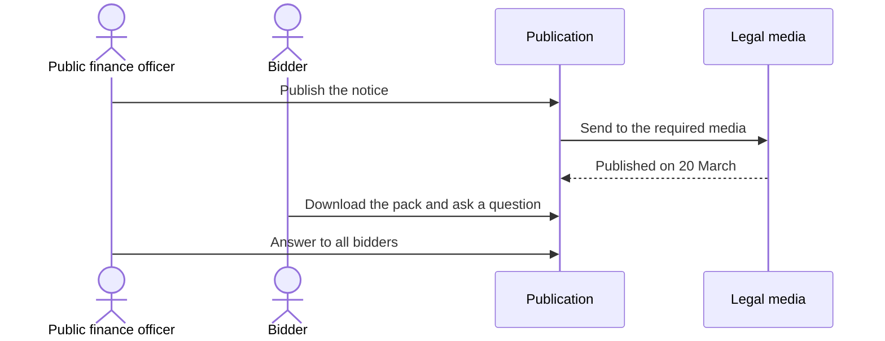

🏠 [Specs](../../../../README.md) › 🏷️ [Sectors](../../../README.md) › 🏛️ [SC20 Public bodies](../../README.md) ›
📝 [Use cases](../README.md) › 📝 [Use cases: FL-SC20-02 Public procurement](README.md) ›
📝 UC-SC20-06 Publish the tender

# 📝 UC-SC20-06 Publish the tender

**Status:** 🔄 waiting for the owner

## Summary

The officer publishes the tender notice in the media the procedure requires and on the buyer's profile, opens the
document pack to bidders, and answers their questions to all of them.

## Personas

- [U54 Public finance officer](../../../../01-users/personas/u54-public-finance-officer.md)

## Goal

The notice appears in the legal media for the procedure, bidders can download the file and ask questions, and the
deadline respects the legal minimum.

## Trigger

A tender file is approved and ready.

## Frequency

A few a month.

## Preconditions

- The tender file is approved ([E-SC20-05 Tender file](../../data/e-sc20-05-tender-file.md)).
- The legal media of the procedure are set in the country pack.
- The buyer profile is available on the body's website.

## Postconditions

- **Succeeded:** the notice is published, the file state is Published, the document pack is open and the deadline is
  kept.
- **Failed:** a notice is not published in fewer media than the procedure needs, the deadline is not shorter than the
  minimum, and each answer goes to every bidder.

## Main flow

1. The officer opens the publication screen
   ([S-SC20-06](../../screens/02-public-procurement/s-sc20-06-tender-publication.md)) on an approved file.
2. SimpleERP lists the media the procedure requires
   ([BR-SC20-06](../../business-rules/br-sc20-06-publication-follows-the-legal-media.md)) and the minimum deadline.
3. The officer checks the notice and publishes it to each medium.
4. SimpleERP opens the document pack on the buyer's profile.
5. Bidders download the file and ask questions; the officer answers each to all bidders.

## Alternative flows

- 3a. A correction is needed: a corrective notice is published and the deadline is extended if the law requires it.
- 5a. A question concerns a document: the document is updated and every bidder is told.
- 2a. The procedure is the free one: a single medium is enough and the proof is kept.

## Error flows

- 3e. A required medium refuses the notice: the file stays unpublished and the officer is told.
- 2e. The deadline is shorter than the minimum: it cannot be saved.
- Any step: a service does not answer; the call is retried first
  ([BR-F3-32](../../../../02-functional/f03-assistant/business-rules/br-f03-32-retry-before-an-error.md)), then the
  message follows the error pattern ([D122](../../../../06-decisions/ux/d122-error-message-standard.md)) and what the
  user typed stays on the screen.

## Business rules

- [BR-SC20-06](../../business-rules/br-sc20-06-publication-follows-the-legal-media.md)
- [BR-SC20-05](../../business-rules/br-sc20-05-the-procedure-follows-the-thresholds.md)

## Entities

- [E-SC20-05 Tender file](../../data/e-sc20-05-tender-file.md): changed, the file becomes Published
- [E-F18-01](../../../../02-functional/f18-hosted-websites-and-domains/data/e-f18-01-hosted-website.md): read, the
  body's website

## Permissions

Public finance officer publishes and answers; bidders read the pack and ask questions; the elected official reads.
Bidders' identities are not shown to other bidders.

## Notifications

The bidders who registered, by email: a correction or an answer.

## Audit events

Each publication, correction, document download and answer, who and when.

## AI involvement

No AI step of its own. The AI assistant may open the screen and prefill it from the user's words; the user checks and
confirms
[BR-F3-07](../../../../02-functional/f03-assistant/business-rules/br-f03-07-no-deletes-no-irreversible-acts.md).

## API, MCP and A2A exposure

T5 operations of the capability for the personas above: create, read, update and list. The MCP tool of the
capability may read and propose, never confirm alone. No A2A skill.

## Screens

- [S-SC20-06](../../screens/02-public-procurement/s-sc20-06-tender-publication.md)

## Flowchart

See [FL-SC20-02 Public procurement](../../flows/fl-sc20-02-public-procurement.md#flowchart).

## Sequence diagram

## Acceptance criteria

1. **Given** a formal procedure **when** the officer publishes **then** the notice goes to every required medium.
2. **Given** a deadline shorter than the minimum **when** the officer saves **then** it is refused.
3. **Given** a question from a bidder **when** the officer answers **then** every bidder receives the answer.

## Non-functional notes

The screen answers within 2 seconds for 10,000 records; every change is audited.

## Regulatory references

A public buyer publishes the notice in the media the procedure requires, such as the official bulletin and
the national buyers' platform, and puts the documents on its buyer profile; the deadline for bids has a minimum by
procedure, and the answers to questions go to all bidders. The media and minimum delays are data of the France pack.

- France-pack rule, (Proposed) until its law is read:
  [CR-FR-251 Public procurement thresholds](../../../../10-country-packs/france/trade/cr-fr-251-public-procurement-thresholds.md)

## Related use cases

- [UC-SC20-05 Prepare a tender file](uc-sc20-05-prepare-a-tender-file.md)
- [UC-SC20-07 Analyse bids and award](uc-sc20-07-analyse-bids-and-award.md)
- [UC-SC20-05 Prepare a tender file](uc-sc20-05-prepare-a-tender-file.md)
- [UC-SC20-07 Analyse bids and award](uc-sc20-07-analyse-bids-and-award.md)

## Open questions

None.

---

⬅️ [UC-SC20-05 Prepare a tender file](uc-sc20-05-prepare-a-tender-file.md) · ⬆️ [Up](README.md) ·
➡️ [UC-SC20-07 Analyse bids and award](uc-sc20-07-analyse-bids-and-award.md)
