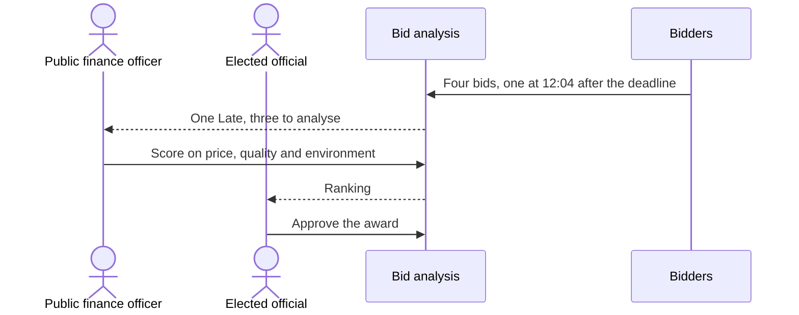

🏠 [Specs](../../../../README.md) › 🏷️ [Sectors](../../../README.md) › 🏛️ [SC20 Public bodies](../../README.md) ›
📝 [Use cases](../README.md) › 📝 [Use cases: FL-SC20-02 Public procurement](README.md) ›
📝 UC-SC20-07 Analyse bids and award

# 📝 UC-SC20-07 Analyse bids and award

**Status:** ✅ specified, ⚖️ lawyer review before launch (D574)

## Summary

After the deadline the officer opens the bids, rejects late and irregular ones, scores the others against the published
criteria, and the elected official approves the award.

## Personas

- [U54 Public finance officer](../../../../01-users/personas/u54-public-finance-officer.md)
- [U55 Elected official](../../../../01-users/personas/u55-elected-official.md)

## Goal

Each bid is treated by the same criteria that were published, a late bid is never opened, and the award is justified.

## Trigger

The bid deadline passes.

## Frequency

A few a month.

## Preconditions

- The file is Published and its deadline passed ([E-SC20-05 Tender file](../../data/e-sc20-05-tender-file.md)).
- Bids are received electronically with their date and time.
- The criteria and weights were published.

## Postconditions

- **Succeeded:** each bid is saved ([E-SC20-06 Bid](../../data/e-sc20-06-bid.md)) with its admission, its scores and its
  rank, the award is recorded and the contract is prepared.
- **Failed:** a bid received after the deadline is never scored, a criterion not published is never used, and a decision
  is not made without the elected official's approval where the body requires it.

## Main flow

1. The officer opens the bid analysis screen
   ([S-SC20-07 Bid analysis](../../screens/02-public-procurement/s-sc20-07-bid-analysis.md)) after the deadline.
2. SimpleERP marks any bid received after the deadline as Late and sets it aside
   ([BR-SC20-07](../../business-rules/br-sc20-07-award-follows-the-published-criteria.md)).
3. The officer checks the admission of each other bid: documents, capacity, regularity.
4. The officer scores each admitted bid on each published criterion and SimpleERP ranks them.
5. The elected official reviews the ranking and approves the award.
6. Unsuccessful bidders are told, with the reasons, and the award is published.

## Alternative flows

- 3a. A bid is irregular but may be put right: the bidder is asked and the bid stays Received.
- 4a. A bid is abnormally low: the bidder is asked to justify the price before it is ranked.
- 5a. The elected official declines the award: the file is cancelled or re-run with the reason.

## Error flows

- 2e. A bid arrives after the deadline: it is Late and never opened.
- 4e. A criterion has no score: the ranking is not computed.
- Any step: a service does not answer; the call is retried first
  ([BR-F3-32](../../../../02-functional/f03-assistant/business-rules/br-f03-32-retry-before-an-error.md)), then the
  message follows the error pattern ([D122](../../../../06-decisions/ux/d122-error-message-standard.md)) and what the
  user typed stays on the screen.

## Business rules

- [BR-SC20-07](../../business-rules/br-sc20-07-award-follows-the-published-criteria.md)
- [BR-SC20-06](../../business-rules/br-sc20-06-publication-follows-the-legal-media.md)

## Entities

- [E-SC20-06 Bid](../../data/e-sc20-06-bid.md): received, scored, awarded
- [E-SC20-05 Tender file](../../data/e-sc20-05-tender-file.md): changed, the file becomes Analysed then Awarded
- [E-F7-01](../../../../02-functional/f07-purchasing-and-stock/data/e-f07-01-supplier-record.md): read, the bidder

## Permissions

Public finance officer opens and scores bids; the elected official approves the award; bidders see only their own bid
and the result. The scoring sheet is read-only after the award.

## Notifications

The elected official, in the app: an award to approve. The bidders, by email: the result with the reasons.

## Audit events

Each bid received with its time, opened, admitted, scored and ranked, each award and notification, who and when.

## AI involvement

No AI step of its own. The AI assistant may open the screen and prefill it from the user's words; the user checks and
confirms
[BR-F3-07](../../../../02-functional/f03-assistant/business-rules/br-f03-07-no-deletes-no-irreversible-acts.md).

## API, MCP and A2A exposure

T5 operations of the capability for the personas above: create, read, update and list. The MCP tool of the
capability may read and propose, never confirm alone. No A2A skill.

## Screens

- [S-SC20-07 Bid analysis](../../screens/02-public-procurement/s-sc20-07-bid-analysis.md)

## Flowchart

See [FL-SC20-02 Public procurement](../../flows/fl-sc20-02-public-procurement.md#flowchart).

## Sequence diagram

## Acceptance criteria

1. **Given** a bid received after the deadline **when** the officer opens the analysis **then** the bid is Late and set
   aside.
2. **Given** three admitted bids **when** the officer scores them **then** they are ranked by the published criteria.
3. **Given** an unpublished criterion **when** the officer adds it **then** it is refused.

## Non-functional notes

The screen answers within 2 seconds for 10,000 records; every change is audited.

## Regulatory references

Bids received after the deadline are not opened; the buyer ranks bids only on the criteria it published, with their
weights, and tells unsuccessful bidders the reasons and the waiting period before signing, for procedures that require
it. An abnormally low bid is justified by its bidder before it is ranked. Delays are data of the France pack. (⚖️
lawyer review before launch, D574) The France-pack rule on the award is still to write: to read Code de la commande publique L2152-7 and
R2152-6 to R2152-12 (criteria), L2152-5, L2152-6 and R2152-3 to R2152-5 (abnormally low bids), R2181-1 to R2182-1
(information of unsuccessful bidders and the waiting period).

- France-pack rule on the thresholds:
  [CR-FR-251 Public procurement thresholds](../../../../10-country-packs/france/trade/cr-fr-251-public-procurement-thresholds.md)

## Related use cases

- [UC-SC20-06 Publish the tender](uc-sc20-06-publish-the-tender.md)
- [UC-SC20-08 Follow the public contract](uc-sc20-08-follow-the-public-contract.md)
- [UC-SC20-06 Publish the tender](uc-sc20-06-publish-the-tender.md)
- [UC-SC20-08 Follow the public contract](uc-sc20-08-follow-the-public-contract.md)

## Open questions

None.

---

⬅️ [UC-SC20-06 Publish the tender](uc-sc20-06-publish-the-tender.md) · ⬆️ [Up](README.md) ·
➡️ [UC-SC20-08 Follow the public contract](uc-sc20-08-follow-the-public-contract.md)
