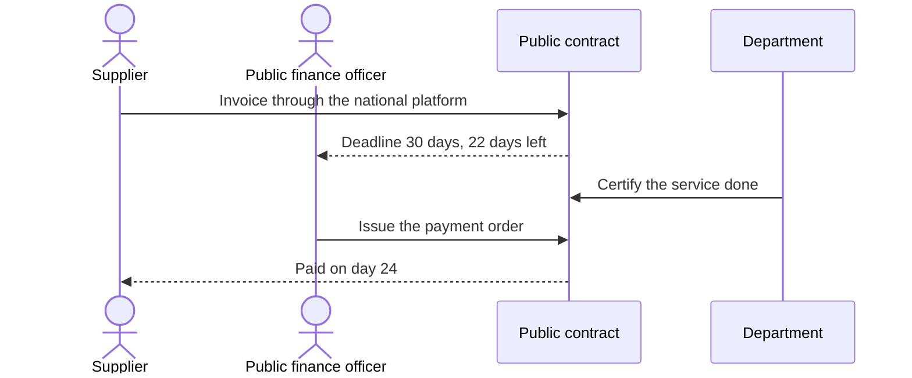

🏠 [Specs](../../../../README.md) › 🏷️ [Sectors](../../../README.md) › 🏛️ [SC20 Public bodies](../../README.md) ›
📝 [Use cases](../README.md) › 📝 [Use cases: FL-SC20-02 Public procurement](README.md) ›
📝 UC-SC20-08 Follow the public contract

# 📝 UC-SC20-08 Follow the public contract

**Status:** 🔄 waiting for the owner

## Summary

The officer follows the contract signed with the successful bidder: dates, amendments, deliveries, invoices received,
and the payment term that the law sets, with late-payment interest computed when it is exceeded.

## Personas

- [U54 Public finance officer](../../../../01-users/personas/u54-public-finance-officer.md)

## Goal

Each invoice is paid within the legal term and the contract's changes are kept with their approval.

## Trigger

A contract is signed, an invoice arrives, or an amendment is needed.

## Frequency

Daily for the invoices of the body's contracts.

## Preconditions

- The award is recorded ([E-SC20-06 Bid](../../data/e-sc20-06-bid.md)).
- The commitment covers the contract ([E-SC20-02 Commitment](../../data/e-sc20-02-commitment.md)).
- Invoices arrive through the national platform for public buyers.

## Postconditions

- **Succeeded:** the contract is saved ([E-SC20-07 Public contract](../../data/e-sc20-07-public-contract.md)) with its
  dates, amount, amendments and invoices, and each invoice shows its payment deadline and the interest if it is late.
- **Failed:** an invoice is not left unpaid beyond the term without the delay being shown, an amendment above the limit
  is not made without the approval, and the interest due is computed.

## Main flow

1. The officer opens the public contract screen
   ([S-SC20-08 Public contract](../../screens/02-public-procurement/s-sc20-08-public-contract.md)) and sees the
   contracts in progress.
2. An invoice arrives through the national platform
   [UC-F6-19](../../../../02-functional/f06-customers-and-sales/use-cases/07-special-invoicing/uc-f06-19-invoice-a-public-buyer-through-chorus-pro.md)
   and is linked to the contract.
3. simple-ERP computes the payment deadline from the receipt date
   ([BR-SC20-08](../../business-rules/br-sc20-08-payments-meet-the-legal-payment-term.md)).
4. The department certifies the service done and the officer issues the payment order
   ([UC-SC20-03](../01-public-accounting/uc-sc20-03-issue-payment-orders-and-revenue-titles.md)).
5. If an amendment is needed, the officer records it with its approval and the new amount.
6. At the end the contract is accepted and closed.

## Alternative flows

- 3a. The invoice is rejected as incorrect: the supplier is told within the delay and the clock restarts when the
  correct invoice arrives.
- 5a. An amendment above the allowed share of the amount: it needs the council's approval.
- 4a. The payment is late: the late-payment interest and the fixed indemnity are computed and shown.

## Error flows

- 3e. The invoice cannot be linked to a contract: it is kept in a list to match.
- 5e. An amendment has no approval: it cannot be saved.
- Any step: a service does not answer; the call is retried first
  ([BR-F3-32](../../../../02-functional/f03-assistant/business-rules/br-f03-32-retry-before-an-error.md)), then the
  message follows the error pattern ([D122](../../../../06-decisions/ux/d122-error-message-standard.md)) and what the
  user typed stays on the screen.

## Business rules

- [BR-SC20-08](../../business-rules/br-sc20-08-payments-meet-the-legal-payment-term.md)
- [BR-SC20-04](../../business-rules/br-sc20-04-files-follow-the-public-treasury-format.md)

## Entities

- [E-SC20-07 Public contract](../../data/e-sc20-07-public-contract.md): followed, amended, closed
- [E-F7-03](../../../../02-functional/f07-purchasing-and-stock/data/e-f07-03-purchase-order.md): read, the orders under
  the contract
- [E-SC20-03 Payment order](../../data/e-sc20-03-payment-order.md): read, the payment orders
- [E-F6-13](../../../../02-functional/f06-customers-and-sales/data/e-f06-13-public-buyer-setting.md): read, the buyer
  references the invoices use

## Permissions

Public finance officer follows contracts and invoices; departments certify the service; the elected official approves
amendments. Suppliers see only their own invoices' state.

## Notifications

The officer, in the app: an invoice five days from its deadline. The supplier, by email: a rejected invoice.

## Audit events

Each contract, amendment, invoice, certification, payment and interest, who and when.

## AI involvement

No AI step of its own. The AI assistant may open the screen and prefill it from the user's words; the user checks and
confirms
[BR-F3-07](../../../../02-functional/f03-assistant/business-rules/br-f03-07-no-deletes-no-irreversible-acts.md).

## API, MCP and A2A exposure

T5 operations of the capability for the personas above: create, read, update and list. The MCP tool of the
capability may read and propose, never confirm alone. No A2A skill.

## Screens

- [S-SC20-08 Public contract](../../screens/02-public-procurement/s-sc20-08-public-contract.md)

## Flowchart

See [FL-SC20-02 Public procurement](../../flows/fl-sc20-02-public-procurement.md#flowchart).

## Sequence diagram

## Acceptance criteria

1. **Given** an invoice received on 1 March **when** the officer opens it **then** its deadline is 30 days after the
   receipt.
2. **Given** an invoice paid on day 36 **when** the officer opens the contract **then** the interest and the indemnity
   are shown.
3. **Given** an amendment without approval **when** the officer saves it **then** it is refused.

## Non-functional notes

The screen answers within 2 seconds for 10,000 records; every change is audited.

## Regulatory references

Public bodies pay their suppliers within a legal term from the receipt of the invoice; beyond it,
late-payment interest and a fixed indemnity are due automatically. Invoices to public buyers go through the national
platform. An amendment changes the contract within limits set by law. The term, the rates and the limits are data of the
France pack. Related:
[CR-FR-091](../../../../10-country-packs/france/invoicing/cr-fr-091-public-contracts-payment-and-chorus-pro.md),
[CR-FR-019](../../../../10-country-packs/france/invoicing/cr-fr-019-late-payment-penalties.md).

- France-pack rule, (Proposed) until its law is read:
  [CR-FR-251 Public procurement thresholds](../../../../10-country-packs/france/trade/cr-fr-251-public-procurement-thresholds.md)

## Related use cases

- [UC-SC20-07 Analyse bids and award](uc-sc20-07-analyse-bids-and-award.md)
- [UC-SC20-07 Analyse bids and award](uc-sc20-07-analyse-bids-and-award.md)
- [UC-F6-19](../../../../02-functional/f06-customers-and-sales/use-cases/07-special-invoicing/uc-f06-19-invoice-a-public-buyer-through-chorus-pro.md)

## Open questions

None.

---

⬅️ [UC-SC20-07 Analyse bids and award](uc-sc20-07-analyse-bids-and-award.md) · ⬆️ [Up](README.md) ·
➡️ [UC-SC20-09 Receive a citizen's request](../03-citizen-services/uc-sc20-09-receive-a-citizens-request.md)
